<div align="center">

<picture>
  <source media="(prefers-color-scheme: dark)" srcset="assets/readme/hero-dark.svg">
  
</picture>

<br>

[](https://github.com/sourav-dhar/system-one-from-scratch/actions/workflows/ci.yml) [](pyproject.toml) [](LICENSE) [](docs/research/survey.md) [](research/papers/MANIFEST.md)

**[Field guide](#the-field-guide)** · **[Findings](#findings-so-far)** · **[What we are building](#what-we-are-building)** · **[Quickstart](#quickstart)** · **[Roadmap](#roadmap)**

</div>

---

## What is a System One model?

A **System One model** is a fast decision engine. It does not write text. You give it a **state** (a message, a document, an agent's context) and one or more **typed questions**:

- *choice*: one of K options;
- *yes / no*;
- *score*: a 1–10 rubric.

It returns a **probability for every option**, ideally in a single forward pass and within tens of milliseconds. TypeSafe's Jev popularized the idea in September 2026. Since then, dozens of open implementations have taken very different bets on what to encode jointly, what to cache, and how to calibrate.

```jsonc
// POST /v1/systemone: one state, many questions, no generation
{
  "state": "Order #4821 arrived 47 days ago. The customer is asking for a refund.",
  "questions": {
    "policy": { "type": "choice", "options": ["full refund (≤30 days)", "store credit (31–60 days)", "decline (>60 days)"] },
    "escalate": { "type": "noul", "instructions": "Does this need a human?" }
  }
}
```

Two workloads hide under one name, and they pull designs in opposite directions:

| | Typed decisions | Cached action selection |
|---|---|---|
| Examples | intent routing, policy checks, rubric scoring, triage | agent loops, verifiers, tool choice, games |
| Options | few, often short labels; new every request | many, **reused across requests** |
| What matters | reading the state *in light of the question*; calibration | latency per step; caching option representations |
| Today's best fit | joint decoders (Kev, Jeff-1.1, Strands, Decision 2.0) | cached designs (CLM, Jeva); quality still unproven |

This repository rebuilds the open CLM-8B recipe from scratch. It maps the whole field from primary sources. It is now building a model aimed at doing **both** workloads well on **one mid-range GPU**.

## Findings so far

<picture>
  <source media="(prefers-color-scheme: dark)" srcset="assets/readme/findings-dark.svg">
  
</picture>

- **The rebuild is validated.** Re-scoring the authors' published heads with our evaluation code gives **51.73 / 69.16 / 68.63%** on 191,161 hard-negative questions, within 0.4 points of the published 52.1 / 69.2 / 68.5 (measured on a different sample of about 100k).
- **CLM's speed hides a typed-decision gap.** On System1-Arena, CLM-8B scores 41.4% against **59.3%** for answer-token readout of its *own* frozen backbone. Its issue tracker points to likely causes that look fixable, though none has been isolated on that benchmark (which also kept only CLM's last 2,048 tokens):
  - appending the question to the state collapses distinct states (cosine 0.958 vs 0.452);
  - short option labels make the head ignore the state;
  - a linear probe on the same embeddings beats the fine-tuned head (0.900 vs 0.795).

  See [survey §7](docs/research/survey.md#7-evaluation-landscape-and-failure-modes).
- **One temperature removes most of the shipped heads' calibration error.** The published heads ship with their scale saturated at the cap of 100. One scalar, fitted in-distribution, removes 79–90% of the calibration error, and top-1 cannot change. A cross-dataset fit and a tie-corrected re-measurement come next; elsewhere, calibration has cost other metrics ([survey §5.6](docs/research/survey.md#56-our-measurements)).

<picture>
  <source media="(prefers-color-scheme: dark)" srcset="assets/readme/frontier-dark.svg">
  
</picture>

## The field guide

The research is built to be **the one place to start** if you want to build, evaluate or choose a System One model. Every number links back to a paper table, a repository file or an issue. Every inference is marked as one.

| If you want to… | Read |
|---|---|
| **start here**: reading paths, a design decision guide, a worked example, a glossary, baselines and a benchmark card | **[Start-here guide](docs/research/README.md)** |
| understand the problem, its notation and the properties a good model needs | [Survey §1–2](docs/research/survey.md#2-problem-formulation) |
| compare architectures and see what each can cache | [§3 taxonomy](docs/research/survey.md#3-a-taxonomy-of-system-one-architectures) · [31 system notes](docs/research/systems/) |
| train one: contrastive pre-training, soft targets, RL for calibration, LoRA vs head-only | [§4 objectives](docs/research/survey.md#4-training-objectives-and-curricula) |
| make the probabilities mean something | [§5 calibration](docs/research/survey.md#5-calibration) |
| choose training data without contaminating your benchmarks | [§6 data](docs/research/survey.md#6-training-data) · [ADR 0002](docs/adr/0002-data-licensing-and-decontamination.md) |
| know how these models fail, with numbers | [§7 fourteen failure modes](docs/research/survey.md#72-quantified-failure-modes) |
| see which lab fixed which other lab's flaw | [§8 who fixed whom](docs/research/survey.md#8-who-fixed-whom) |
| serve one on a single GPU | [§9 serving](docs/research/survey.md#9-serving-and-efficiency) |
| find an open problem worth working on | [§10 open problems](docs/research/survey.md#10-open-problems-and-the-scope-for-improvement) |
| see how this research was checked | [Three independent reviews](docs/research/reviews/) · [response tracker](docs/research/review-response.md) |

<picture>
  <source media="(prefers-color-scheme: dark)" srcset="assets/readme/taxonomy-dark.svg">
  
</picture>

<picture>
  <source media="(prefers-color-scheme: dark)" srcset="assets/readme/failure-modes-dark.svg">
  
</picture>

### The library

| Resource | What is in it |
|---|---|
| [`docs/research/survey.md`](docs/research/survey.md) | The survey: 12 sections, about 12.5k words, ~30 systems, with a verification log |
| [`docs/research/systems/`](docs/research/systems/) | 31 long-form technical notes, one per system. Each covers architecture with equations, training, calibration, results, serving and failure modes |
| [`research/papers/`](research/papers/MANIFEST.md) | **64 arXiv papers.** The **38** under Creative Commons licences are in the repo as PDFs. The other 26 (arXiv's non-exclusive licence) download with one command. Each paper has its licence and sha256 listed |
| [`docs/research/references.md`](docs/research/references.md) | Every cited source (100+), grouped: implementations, evaluations, datasets, products, foundations |
| [`docs/research/notes/raw/`](docs/research/notes/raw/) | The primary-source reading notes behind everything above |
| [`research/papers/index.yaml`](research/papers/index.yaml) | The machine-readable index: papers plus 60 repos, model cards, datasets, docs and blogs |

<details>
<summary><b>All 31 systems at a glance</b></summary>

| Family | Systems (each links to its note) |
|---|---|
| Bi-encoder | [CLM](docs/research/systems/clm.md) · [sbert2s1](docs/research/systems/sbert2s1.md) |
| Late interaction | [Jeva](docs/research/systems/jeva.md) · [Narrow Decision Models](docs/research/systems/ndm.md) |
| Decoder readout | [Kev](docs/research/systems/kev.md) · [Jeff-1.1](docs/research/systems/jeff.md) · [Strands Decider](docs/research/systems/strands-decider.md) · [Jeeves](docs/research/systems/jeeves.md) · [decider](docs/research/systems/decider.md) · [StartLux](docs/research/systems/startlux.md) · [AnyJev / Tacit](docs/research/systems/anyjev.md) · [NanoJev](docs/research/systems/nanojev.md) · [SemIf](docs/research/systems/semif.md) · [Decision 2.0](docs/research/systems/decision2.md) · [pplx-decider](docs/research/systems/pplx-decider.md) · [Liquid d1](docs/research/systems/liquid-d1.md) · [Clef](docs/research/systems/clef.md) · [Intern-Decision](docs/research/systems/intern-decision.md) · [AnyS1](docs/research/systems/anys1.md) · [Small Heads](docs/research/systems/small-heads.md) · [this-that](docs/research/systems/this-that.md) |
| Encoder option-marker | [Laya](docs/research/systems/laya.md) · [Von](docs/research/systems/von.md) · [Phocinae](docs/research/systems/phocinae.md) · [GLiNER2.5-Decide](docs/research/systems/gliner-decide.md) · [Beveridge](docs/research/systems/beveridge.md) |
| Encoder-decoder / looped / frozen reader | [Bongard](docs/research/systems/bongard.md) · [SanSi](docs/research/systems/sansi.md) · [vegaml / Vega](docs/research/systems/vegaml.md) |
| Generative models and hosted APIs | [Inkling](docs/research/systems/inkling.md) · [Jev, Microsoft-Decision-1, OpenAI Decisions](docs/research/systems/hosted-apis.md) |

</details>

## What we are building

<picture>
  <source media="(prefers-color-scheme: dark)" srcset="assets/readme/architecture-dark.svg">
  
</picture>

**Architecture B** keeps what made CLM fast and fixes what made it inaccurate:
- **Option representations are cached across requests**, so a revisited agent state costs a dot product.
- **The state and the question are encoded separately**, which removes CLM's state collapse.
- **One late-interaction block** lets the state read the cached options, so a preference can depend on what else is on offer. Options never see each other, so the output is **exactly order-invariant**.
- **A coverage gate** gives a real "none of these" outcome.
- **Calibration** takes the question type and K into account.

Uncertain cases route to a **joint slow path** (Architecture C, milestone 2).

The first milestone compares four backbone arms on one harness against the **reference implementations themselves**:
- frozen Qwen3-8B, the CLM anchor, plus intermediate-layer taps;
- Qwen3.5-4B with LoRA;
- a frozen Inkling 2 Mini;
- an Inkling readout baseline.

> **Status:** proposed in [ADR 0001](docs/adr/0001-architecture-late-interaction-two-path.md), currently under independent review before it is locked. Plan: [`docs/research/plan.md`](docs/research/plan.md).

## Quickstart

```bash
git clone https://github.com/sourav-dhar/system-one-from-scratch && cd system-one-from-scratch
uv sync --extra dev --extra data        # CPU PyTorch; no GPU needed for development
uv run systemone demo                   # synthetic end-to-end training run, about a minute on a laptop
uv run pytest                           # 81 tests
uv run python scripts/fetch_papers.py   # the full 64-paper library into research/papers/pdf/
```

**Re-score the published CLM heads** on the full held-out benchmark ([Modal](https://modal.com) account needed; about two GPU-minutes):

```bash
uv run --extra cloud modal run cloud/modal_app.py::stage --plan eval
uv run --extra cloud modal run cloud/modal_app.py::benchmark --heads authors:pre,authors:mid,authors:post
```

**Score options with a trained head** (vectors in, probabilities out):

```python
from huggingface_hub import hf_hub_download
from systemone import DualEncoder

path = hf_hub_download("jackyk02/qwen3_8b_head", "qwen3_8b_midtrained_head.pt")  # the published CLM head
heads = DualEncoder.load(path)  # weights_only=True: no pickled code ever runs
probs = heads.option_probs(state_vec, option_vecs)  # 4096-d Qwen3-8B vectors in, one probability per option
```

## Roadmap

<picture>
  <source media="(prefers-color-scheme: dark)" srcset="assets/readme/roadmap-dark.svg">
  
</picture>

| Milestone | Scope | Tracking |
|---|---|---|
| **M0** Harness & references | Typed-decision suites and a robustness battery. Validated by reproducing System1-Arena's CLM 41.4%, then CLM, Kev, Laya, Decision 2.0, Jeff-style and Inkling readouts on one harness | [#33](../../issues/33)–[#37](../../issues/37) |
| **M1** Architecture B | An eight-rung ablation ladder over four backbone arms, 3 seeds per rung | [#38](../../issues/38) |
| **M2** Architecture C | Joint `prefix_bidir` slow path and a calibrated cascade; serving optimization on one GPU | — |
| **M3** Release | Model card with data licences, results, `v0.2.0` | [#13](../../issues/13) |

## How it is built

Every change goes **issue → branch → pull request → CI → review notes → merge**, with `main` protected.

**CI checks on every PR:**
- ruff (lint and format);
- mypy;
- 81 tests on Python 3.11 and 3.12;
- a citation check that fails if any `[@key]` in the research documents is unknown, or if the reference list is stale.

**Reproducibility:**
- dependencies pinned in `uv.lock`;
- dataset revisions pinned;
- every reported number comes from a committed config and a file in `results/`;
- checkpoints load with `weights_only=True`.

```text
src/systemone/   model · losses · data (Hub catalog, HTTP range reads) · eval (retrieval, tricky Q&A, calibration) · trainer · CLI
cloud/           Modal runner: stage data, train sweeps, benchmark heads
configs/         the recipe and its stages (YAML, extends + dotted overrides)
docs/research/   survey · system notes · raw notes · figures · references · plan
docs/adr/        architecture and data decisions
research/papers/ the paper library (index, manifest, PDFs)
scripts/         paper fetcher, citation checker, figure and README-asset generators
assets/          README graphics (generated) and fonts (SIL OFL)
```

## Acknowledgements and licences

- **CLM authors.** CLM is by Jacky Kwok, Hangoo Kang, Tarun Suresh, Jon Saad-Falcon, Marco Pavone, Christopher Ré and Azalia Mirhoseini. Their open code, weights and vectors made this rebuild possible.
- **Inspiration.** The rebuild was inspired by Vizuara AI Labs' CLM-8B workshop.
- **Field survey.** Every system covered there is credited in [`references.md`](docs/research/references.md).

**Licences:**
- **Code:** Apache-2.0.
- **Papers** keep their own licences ([manifest](research/papers/MANIFEST.md)).
- **Fonts** in `assets/fonts/` are under the SIL Open Font License.
- **Training data licences** follow [ADR 0002](docs/adr/0002-data-licensing-and-decontamination.md).

<details>
<summary>Cite this repository</summary>

```bibtex
@misc{dhar2026systemone,
  title        = {System One from Scratch: a rebuild, a field survey, and an open decision model},
  author       = {Dhar, Sourav},
  year         = {2026},
  howpublished = {\url{https://github.com/sourav-dhar/system-one-from-scratch}}
}
```

</details>
