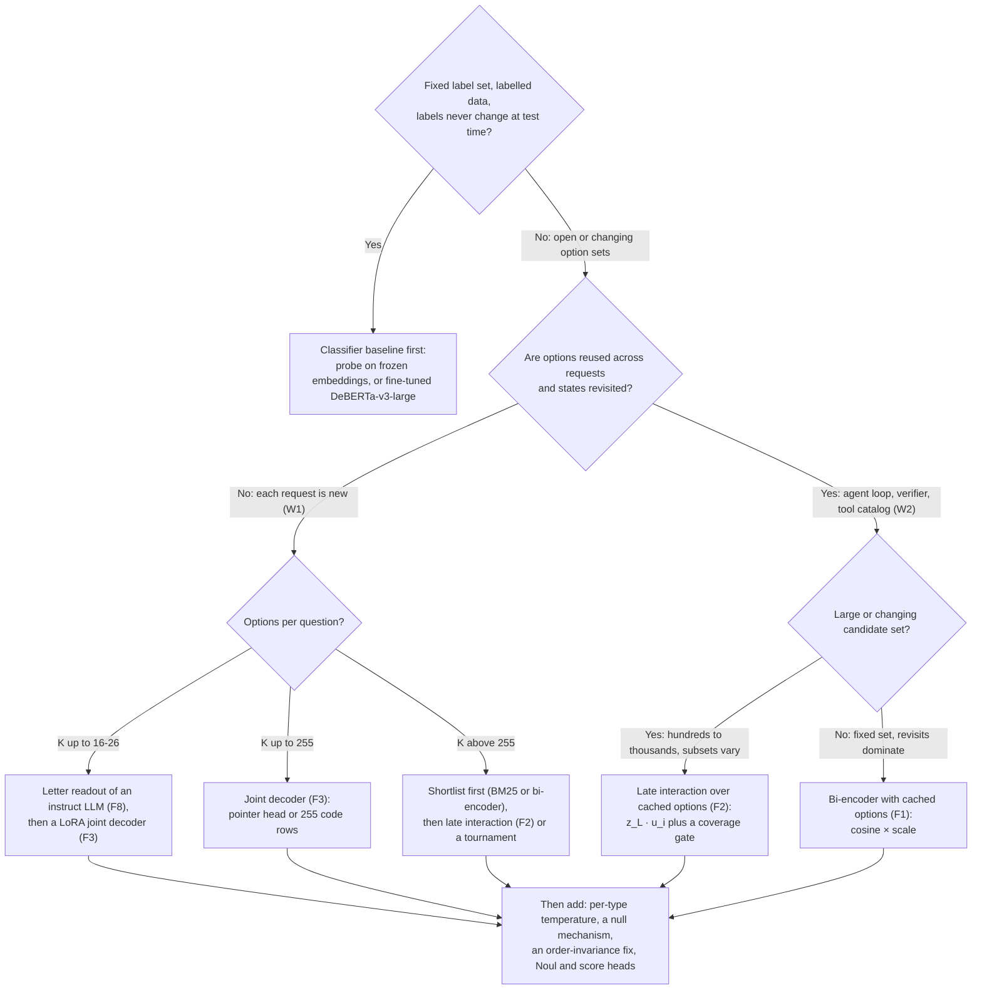
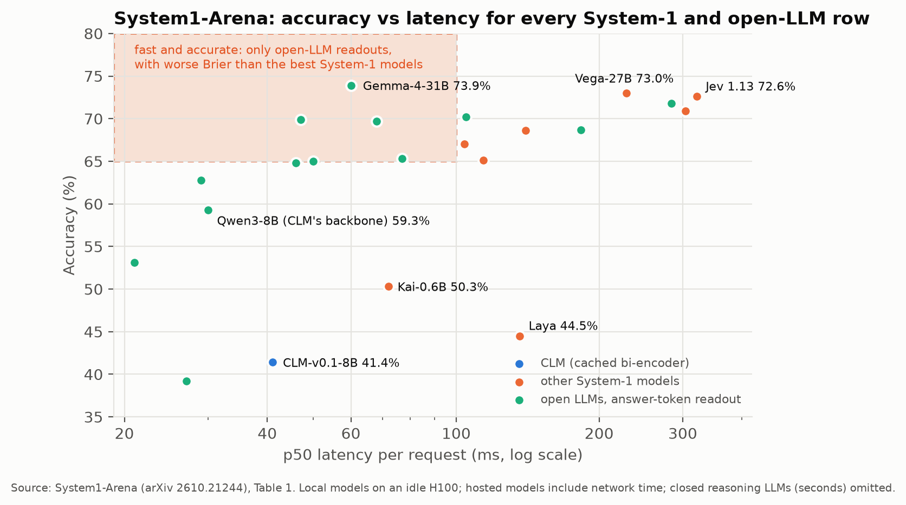

# System One decision models: start here

This page is the entry point to an open field guide on **System One decision models**: models that take a *state* (free text, a transcript, a document, an observation) plus one or more *typed questions*, each with a closed set of options, and return a calibrated probability for every option in a single forward pass, without generating text. The long-form [survey](survey.md) covers the field in depth; the [system notes](systems/) record each system from its primary sources; the [independent reviews](reviews/) check the survey and are authoritative where they disagree with it. This page adds what a reader needs before and around those documents: reading paths, a design decision guide, a worked example, notation, a glossary, name disambiguation, baselines, a benchmark card, evidence grades, a register of contradictions, a dated history and a hardware primer.

> **Status and conventions.** Compiled on 22 November 2026 from the sources listed under [Sources](#sources) only. Every number carries a citation key from [`research/papers/index.yaml`](../../research/papers/index.yaml) (for example [@s1arena]) or a link to the note that records it. *(inference)* marks reasoning that is ours, *illustrative* marks toy numbers, and *(est.)* marks the architecture review's own estimates. Where the [technical review](reviews/01-technical-review.md), the [fact-check](reviews/02-fact-check.md) or the [architecture review](reviews/03-architecture-review.md) corrects the survey, this page follows the review. The survey is under revision, so links into it point at the v1.0 section headings.

**Contents:** [1 Start here](#1-start-here) · [2 Which design fits](#2-which-design-fits-my-problem) · [3 Worked example](#3-a-worked-example-end-to-end) · [4 Notation](#4-notation) · [5 Glossary](#5-glossary) · [6 Names](#6-name-disambiguation) · [7 Baselines](#7-baselines-to-beat) · [8 Benchmarks](#8-benchmark-reference-card) · [9 Evidence grades](#9-evidence-grades) · [10 Contradictions](#10-open-contradictions-register) · [11 History](#11-a-short-dated-history) · [12 Hardware](#12-hardware-primer-for-one-mid-range-gpu)

## 1. Start here

Pick the path that matches what you need. Each is ordered; stop when you have enough.

**Newcomer: the field in 30 minutes**
1. [§2 of this page](#2-which-design-fits-my-problem) (the decision guide) and [§3](#3-a-worked-example-end-to-end) (one request traced through three designs). About 10 minutes.
2. [Survey abstract](survey.md#abstract) and [§1.1 Two workloads](survey.md#11-two-workloads): typed decisions (W1) versus cached action selection (W2), the distinction everything else hangs on.
3. [`figures/s1arena_frontier.png`](figures/s1arena_frontier.png), all 22 System1-Arena rows. Read it with [§9.2 of the survey](survey.md#92-the-latencyaccuracy-frontier). Zero-shot answer-token readouts of open LLMs are the fastest *accurate* models: Gemma-4-31B scores 73.9% at 60 ms. The System-1-native models are better calibrated: Vega-27B has Brier 0.343 and Jev 0.349, against 0.46–0.54 for the fast readouts [@s1arena].
4. [Survey §3](survey.md#3-a-taxonomy-of-system-one-architectures) (eight families). Note the technical review's warning that the families overlap and that vegaml, NDM and Bongard are misplaced ([review issue 8](reviews/01-technical-review.md#major)).
5. [Survey §7.2](survey.md#72-quantified-failure-modes) (fourteen failure modes) with [`figures/order_flips.png`](figures/order_flips.png). The protocols differ between rows, so do not compare across rows.
6. The fact-check's ["5 most important corrections"](reviews/02-fact-check.md), then [§6 of this page](#6-name-disambiguation) whenever two names blur.

**Builder: choosing and shipping a design**
1. [§2 decision guide](#2-which-design-fits-my-problem), [§7 baselines to beat](#7-baselines-to-beat), and [§12 hardware primer](#12-hardware-primer-for-one-mid-range-gpu).
2. One system note per family: [CLM](systems/clm.md) (bi-encoder), [Jeva](systems/jeva.md) (late interaction), [NDM](systems/ndm.md) (prefix-tree encoder), [Kev](systems/kev.md) (pointer readout with state reuse), [Jeff](systems/jeff.md) (letter readout plus LoRA), [Laya](systems/laya.md) (encoder option-marker) and [AnyJev](systems/anyjev.md) (training-free readout).
3. Objectives and calibration: [survey §4.2–4.3](survey.md#42-soft-targets-and-proper-scoring-rules-f2f6) and [§5](survey.md#5-calibration), plus [`figures/clm_calibration.png`](figures/clm_calibration.png) and [`figures/clm_reliability.png`](figures/clm_reliability.png). Then read the technical review's [issue 10](reviews/01-technical-review.md#major) on what temperature scaling costs.
4. Serving: [survey §9](survey.md#9-serving-and-efficiency), [`figures/clm_truncation.png`](figures/clm_truncation.png) (untrained Matryoshka truncation is lossy), and the architecture review's [§5 Serving feasibility on one GPU](reviews/03-architecture-review.md#5-serving-feasibility-on-one-gpu).
5. The architecture review's [§2 Technical risks](reviews/03-architecture-review.md#2-technical-risks-in-b), [§4.2 How a bi-encoder should consume S1-Arena items](reviews/03-architecture-review.md#42-how-a-bi-encoder-should-consume-s1-arena-items) and [§4.3 Evaluation pitfalls](reviews/03-architecture-review.md#43-evaluation-pitfalls-to-design-in).
6. [Survey §12](survey.md#12-benchmark-and-ablation-protocol) together with [§8 benchmark card](#8-benchmark-reference-card) of this page. The decision records under review are [ADR 0001](../adr/0001-architecture-late-interaction-two-path.md) and [ADR 0002](../adr/0002-data-licensing-and-decontamination.md).

**Researcher: what is established and what is not**
1. [§9 evidence grades](#9-evidence-grades) and [§10 open contradictions](#10-open-contradictions-register).
2. All three reviews: the [technical review](reviews/01-technical-review.md) (27 issues), the [fact-check](reviews/02-fact-check.md) (40 claims: 27 verified, 7 minor mismatches, 6 mismatches) and the [architecture review](reviews/03-architecture-review.md). How each finding is being addressed is tracked in [`review-response.md`](review-response.md).
3. [Survey §8.2 fix matrix](survey.md#82-the-fix-matrix), read against technical-review [issue 3](reviews/01-technical-review.md#critical): most evidence cells measure the flaw, not the fix.
4. [Survey §10 hypotheses](survey.md#10-open-problems-and-the-scope-for-improvement) and [§6.3 contamination](survey.md#63-contamination).
5. Primary-source notes: [raw/07](notes/raw/07-biencoder-late-interaction-and-flaw-papers.md) (bi-encoders, late interaction, evaluation papers), [raw/04](notes/raw/04-training-data-and-benchmarks.md) (data and benchmarks), [raw/08](notes/raw/08-s1arena-verification.md) (S1-Arena verification) and [raw/02](notes/raw/02-catalog-implementations-and-papers.md) (catalog and dates).
6. [§11 dated history](#11-a-short-dated-history) for who could have read whom.

## 2. Which design fits my problem?

Six inputs decide most of the design: the workload (W1 typed decisions or W2 cached action selection), the option count $K$, whether options are reused across requests, the latency budget, whether a "none of these" outcome is needed, and whether the probabilities themselves must be calibrated (for thresholds, cascades or risk budgets). The flowchart picks a family; the tables then add the readout, the modifiers and the strength of the evidence.



**Evidence key** (defined fully in [§9](#9-evidence-grades)): **IE** independently evaluated, **SR** self-reported, **IT** an issue-tracker report whose author the notes do not record, **RR** reproduced in this repo, **est.** an estimate, **none** no published evidence.

**Table 2.1. Situation → family and readout.**

| Situation | Start with (family) | Readout | Representative notes | Evidence and its strength |
|---|---|---|---|---|
| W1, $K \le 16$, little labelled data, needed now | Zero-shot answer-token readout of an instruct LLM (F8), plus a per-type temperature | Logits of the option-label tokens at the answer position | [SemIf](systems/semif.md), [Jeff](systems/jeff.md), [AnyJev](systems/anyjev.md) | **IE:** on System1-Arena, Qwen3-8B scores 59.3% at 30 ms and Gemma-4-31B 73.9% at 60 ms, but with Brier 0.715 and 0.474, and Gemma-4-31B puts ≥ 0.999 on its choice for 87% of questions [@s1arena]. **SR:** zero-shot Gemma-4-31B scores 79.6 OpenDecisions Capability vs Jev's 80.1 [@jeff]. Strong for accuracy; calibration needs fitting. |
| W1, labelled typed data, $K \le 255$, accuracy first | Joint decoder (F3) with LoRA on an instruct checkpoint | Letter rows initialised from the LM head (Jeff), a pointer (Kev, $d_p = 256$), 255 code rows (Strands v2, pplx-decider) or a pointer plus MLP (Decision 2.0) | [Jeff](systems/jeff.md), [Kev](systems/kev.md), [Decision 2.0](systems/decision2.md), [Strands](systems/strands-decider.md), [pplx-decider](systems/pplx-decider.md) | **IE:** Decision 2.0 Vega-27B 73.0%, Lux-9B 67.0%, Nox-4B 65.1%, Kai-0.6B 50.3% on S1-Arena [@s1arena]. **SR:** LoRA adds 7.8–15.7 Capability over zero-shot; a trained head on a frozen backbone (78.9) scored below zero-shot (79.6); base checkpoint + LoRA 70.3 [@jeff]. Costs: no option caching; about 6% flips on option reversal at 4B [@jeff]. |
| W1, many questions on one long state | Causal joint decoder with state-prefix reuse (per-question rows continuing from the cached state), or a prefix-tree encoder | As above; NDM uses a set head plus an adequacy logit | [Kev](systems/kev.md), [Decision 2.0](systems/decision2.md), [NDM](systems/ndm.md) | **SR:** Kev-4B 89.4 ms new vs 22.5 ms cached for a 2,200-token state with 5 questions (H100) [@kev-repo]; NDM 6.5 ms at 256 tokens and 59 ms at 4,096, plus 0.8–4.9 ms per extra question [@ndm]; StartLux's bidirectional mask forfeits a 2.8 → 27 decisions/s gain [@startlux]. Moderate. Avoid full bidirectional masks here. |
| W1 or W2, $K > 255$ or a catalog of thousands | Shortlist (BM25 or a bi-encoder), then late interaction (F2) over cached option keys and values | $z_L^\top u_i$ with a coverage gate | [Jeva](systems/jeva.md), [CLM](systems/clm.md) | **SR:** Jeva 69.88% on ToolRet at $K = 2{,}048$ [@jeva]. **IT:** CLM `/v1/rank` over 29,852 commands gets 0/20 top-1 vs BM25's 8/20 [@clm-repo]. **IE:** Laya falls from 0.852 at 20 options to 0.020 at 50 [@rafedas]. Weak to moderate: no controlled comparison exists. |
| W2, fixed action set, revisited states, single-digit-ms budget | Bi-encoder (F1) with cached option embeddings | $\lambda \cos(\cdot,\cdot)$, then softmax | [CLM](systems/clm.md), [sbert2s1](systems/sbert2s1.md) | **SR:** 28 ms for a new state, 0.6–0.7 ms for a revisit (RTX 4090) [@clm-repo]. **IE:** on S1-Arena's agentic loops CLM reaches 1.7% loop success vs Vega's 26.5%, so speed did not buy loop success [@s1arena]. **SR:** sbert2s1's trained bi-encoder loses 9.4 points on held-out tasks [@sbert2s1]. Strong for latency, weak for quality. |
| W2 with varying subsets of a large catalog | Late interaction (F2); the request side is not cached | $z_L^\top u_i$ with a coverage gate | [Jeva](systems/jeva.md) | **SR:** Hybrid-cache p50 2,102 → 75.1 ms on MLDR (28×), and 93.1 → 46.6 ms on shared Typed banks, on one H200 [@jeva]. The paper has no ablation of the block or the gate. Moderate for latency, none for the block's quality contribution. |
| Fixed closed label set with training data | Not a System One model: linear probe or logistic regression on frozen embeddings, or fine-tuned DeBERTa-v3-large | Softmax over the fixed classes | [CLM](systems/clm.md) (issue #13), [hosted APIs](systems/hosted-apis.md) (Rafe & Das) | **IT:** logistic regression on frozen Qwen3-8B embeddings scores 0.900 on Banking77 seen intents vs 0.795 for the fine-tuned CLM head, but is n/a on unseen intents [@clm-repo]. **IE:** DeBERTa-v3-large scores 0.793 / 0.953 / 0.938 vs Jev's 0.732 / 0.913 / 0.504 [@rafedas]. Strong, but only for seen labels. |
| CPU-only or a very small budget | Encoder option-marker (F4) or a schema-prompted encoder | MLP on each option's `[MASK]` or label marker | [Laya](systems/laya.md), [GLiNER2.5-Decide](systems/gliner-decide.md), [Phocinae](systems/phocinae.md) | **SR:** GLiNER2.5-Decide runs at 130 ms with 5 labels and 208 ms with 50 on CPU [@gliner-decide]; Laya 39.5 ms per question on a T4 [@laya-repo]. **IE:** Laya scores 44.5% on S1-Arena (inputs cut to 512 tokens) [@s1arena] and flips 91.3 of 100 yes/no answers under an identifier swap [@rafedas]. Weak. |
| Some decisions need deliberation | A calibrated fast path that escalates or reasons below a confidence gate | Any of the above | [Decision 2.0](systems/decision2.md) (System One Auto), [StartLux](systems/startlux.md), [Jeeves](systems/jeeves.md) | **SR:** System One Auto scores 82.25% vs Vega 87.88% and Kai 65.80% on 231 JevBench requests, at an *estimated* 54% saving [@s1auto]. Answers after reasoning are over-confident (Jeeves needs $T = 5.42$ after reasoning vs 1.52 direct) [@jeeves]. Moderate. |

**Table 2.2. Modifiers: what to add once the family is chosen.**

| If you need… | Do this | Avoid | Evidence (grade) |
|---|---|---|---|
| A "none of these" outcome | A coverage gate on the maximum score ($p_\perp = 1 - \rho$, Jeva), an adequacy logit (NDM), Kev-style none-pair training, or at minimum an appended "None of the above" option | A "none" option inside a flat softmax: its probability shrinks as $\log K$ grows ([survey §2.2 P4](survey.md#22-desired-properties)) | **SR:** Jeva null AUROC 98.66 vs Kev 93.61 on BANKING77 at $K = 16$ with the gold removed [@jeva]. NDM's adequacy logit is a trade-off: recall 0.66 vs 0.25 for an explicit "none" option, but false alarms 0.29 vs 0.025 and AUROC 0.76 vs 0.79 [@ndm]. An untrained appended "None of the above" letter reaches AUROC 0.920 [@startlux-repo]. Keep $p_\perp$ out of closed-set suites ([architecture review §2.7](reviews/03-architecture-review.md#27-is-the-coverage-gates-training-signal-in-the-planned-data)). |
| Calibrated probabilities | Post-hoc temperature per question type, fitted on held-out *source datasets*; refit per workload; Learn-then-Test for risk budgets | Fitting on held-out items of the training sources; leaderboard-tuned temperatures and snapping rules | **RR:** one scalar took CLM's ECE from 0.065 to 0.013, fitted in-distribution ([survey §5.6](survey.md#56-our-measurements)). **SR:** side effects in Jeff, Phocinae and Strands ([§3.6](#36-temperature-scaling-and-the-score-expectation)); per-(type, $K$) temperatures were worse out of distribution in Kev [@kev-repo]. **IE:** naive thresholds exceed a risk budget in 105 of 250 settings, Learn-then-Test in 12 of 153 [@riskbudget]. |
| Exact order invariance | Free in F1, F2 and prefix-tree encoders. For a joint decoder: sort options by text, use isolation masks with position restarts, rotation averaging, or Runoff | Assuming a fine-tuned joint decoder is invariant | **SR:** Jeff reports its invariant encodings within noise (one run per variant) and option sorting free (+1.0 / −0.4) [@jeff]; Kev's isolation cost −5.8 pp in one 4B run and nothing at 0.6B [@kev-repo]; Von 1.1 → 1.2 went from 49.5% flips to 0 across versions [@von]. **IE:** Runoff takes flips to 0.0 and is 3–4× faster than full rotation averaging at $K = 20$, but slower at $K \le 6$ [@runoff]. |
| Yes/no (`noul`) questions | A Noul head on the state and question that ignores option text (NDM), or initialise from the LM-head rows for "true" and "false" ([architecture review §2.5](reviews/03-architecture-review.md#25-yesno-questions)) | Scoring "Yes. This is true…" option texts with a bi-encoder | **SR:** label-word cosine gaps of about 1e-3; no encoder reliably above chance [@sbert2s1]. **IT:** CLM answers "no" on 498 of 500 BoolQ items [@clm-repo]. |
| Ordinal `score` questions | Keep levels unshuffled; add an RPS or CDF term or a per-level bias; report the expectation's MAE and RPS | Treating levels as unordered classes and reporting only accuracy | **IE:** Laya keeps level order on 1 of 4 ladders [@typedbench]. **SR:** Kev's ordinal CDF penalty was a negative result [@kev-repo]. Weak: no design has a clear win. |
| Long states | Keep the tail (conversations) or head plus tail (documents); log truncation rates; never cut the question | Server-default truncation | **IT:** CLM's vLLM truncation keeps the head and drops the question, cosine −0.0006 [@clm-repo]. **SR:** burying the evidence in 1–4k tokens cost Kev 22–43 pp; synthetic-burying training did not transfer to real documents [@kev-repo]. |

*(inference)* Two cross-cutting points follow from the tables. First, the strongest independent evidence concerns zero-shot readouts and the S1-Arena ranking; most architectural claims (Jeva's block, NDM's set head, cached-option designs) are self-reported without component ablations. Second, cached designs pay off only when options are reused or states are revisited; for a new 1k-token state with $K \le 10$ short options, the architecture review estimates that a joint decoder adds at most about 20% prefill *(est.)* ([architecture review §1.1](reviews/03-architecture-review.md#11-where-the-adrs-evidence-is-weaker-than-it-reads)).

## 3. A worked example, end to end

One request, three questions, three designs. **Every number in §3.3–§3.6 is *illustrative*: toy values chosen to show the arithmetic, not results of any system.** Real constants are cited where they appear (for example CLM's scale cap of 100 or Jeff's fitted temperatures).

### 3.1 The request

The wire format is TypeSafe's `POST /v1/systemone`: a `model`, a `state` (string, object or array), a map of named `questions` and optional image `assets`. `choice` takes 1–255 options, `noul` returns the probability of "yes", and `score` takes 1–10 ordered levels and reports a probability-weighted score [@jev-api]. The notes record those names but not the exact spelling of the fields inside each question, so `type`, `instructions`, `options` and `levels` below are *illustrative*.

```json
{
  "model": "any-system-one-model",
  "state": {
    "channel": "email",
    "customer_tier": "pro",
    "message": "I was charged twice for my October invoice and the second charge has not been refunded. Our finance team closes the books on Friday."
  },
  "questions": {
    "route": {
      "type": "choice",
      "instructions": "Which team should handle this ticket?",
      "options": {
        "billing": "Billing: charges, invoices and refunds",
        "technical": "Technical support: bugs and outages",
        "account": "Account management: plans, seats and access",
        "other": "Anything else"
      }
    },
    "refund_requested": {
      "type": "noul",
      "instructions": "Does the customer ask for money back?"
    },
    "urgency": {
      "type": "score",
      "instructions": "How urgent is this ticket?",
      "levels": ["1: can wait a week", "2", "3: this week", "4", "5: today"]
    }
  }
}
```

### 3.2 The response

The response below is what path (c) produces after temperature scaling (§3.5–§3.6). `choice`, `confidence`, `probabilities`, `score` and `legend` are documented response fields [@jev-api]; the `noul` field name and the `legend` contents are *illustrative*. TypeSafe's choice `confidence` is $(p_{\max} - 1/K)/(1 - 1/K)$, here $(0.705 - 0.25)/0.75 = 0.607$ [@jev-hume].

```json
{
  "questions": {
    "route": {
      "choice": "billing",
      "confidence": 0.607,
      "probabilities": { "billing": 0.705, "technical": 0.258, "account": 0.025, "other": 0.013 }
    },
    "refund_requested": { "probability": 0.770 },
    "urgency": {
      "score": 3.36,
      "probabilities": { "1": 0.056, "2": 0.139, "3": 0.342, "4": 0.309, "5": 0.154 },
      "legend": { "1": "can wait a week", "3": "this week", "5": "today" }
    }
  }
}
```

Probabilities are rounded to three decimals, so a row can sum to 1.001.

### 3.3 Path (a): bi-encoder, cosine × scale → softmax

The layout follows CLM [@clm-repo]; see [systems/clm.md](systems/clm.md).
- **State tower.** The text is `render(state) + "\n\n" + instructions`, embedded by a frozen Qwen3-8B (last-token, 4096-d, L2-normalised), then mapped by the state head $f_s$ to 512-d. Because the instructions are appended, each of the three questions needs its own state pass.
- **Option tower.** Each option text is embedded alone and mapped by the action head $f_a$. For `choice` it is the description; for `score`, the level text; for `noul`, the two fixed sentences "true: Yes. This is true: {instructions}" and "false: No. This is false: {instructions}". `choice` option vectors do not depend on the request, so they are cached and shared across questions and requests; `noul` texts embed the instructions, so they are reused only when the same question repeats ([systems/clm.md](systems/clm.md)).
- **Score.** $\ell_i = \lambda \cos\big(f_s(e_S), f_a(e_{o_i})\big)$, with $\lambda = \min(e^\theta, 100)$. The released checkpoint sits at the cap, $\lambda = 100$ [@clm-repo].

`route`, with toy cosines $c = (0.31, 0.27, 0.12, 0.05)$ for (billing, technical, account, other):

| Step | billing | technical | account | other |
|---|---|---|---|---|
| Cosine $c_i$ | 0.31 | 0.27 | 0.12 | 0.05 |
| Logit at the shipped scale, $100\,c_i$ | 31 | 27 | 12 | 5 |
| Softmax | 0.982 | 0.018 | ≈ 0 | ≈ 0 |
| Logit after a fitted $T = 5$ (effective scale 20) | 6.2 | 5.4 | 2.4 | 1.0 |
| Softmax | 0.677 | 0.304 | 0.015 | 0.004 |

The argmax does not move; only the confidence does. That is why one scalar removed 79–90% of the published CLM heads' calibration error at unchanged top-1 ([survey §5.6](survey.md#56-our-measurements); fitted scales 51.5–69.6, in-distribution fit).

`refund_requested`: the two boilerplate option texts differ by one word, so their cosines are nearly equal, for example 0.402 and 0.399. That gives $P(\text{yes}) = \sigma(100 \times 0.003) = \sigma(0.3) = 0.574$, close to a coin flip. Label-word cosine gaps of about 1e-3 are what sbert2s1 measured [@sbert2s1]. On BoolQ, the question suffix also collapses distinct states: CLM answered "no" on 498 of 500 items [@clm-repo].

`urgency`: the levels become five option texts and the reported score is $\sum_i i\,p_i$ [@clm-repo]. With short level labels the head can ignore the state entirely: CLM issue #3 measured a state sensitivity of 0.000 [@clm-repo].

### 3.4 Path (b): late interaction with a coverage gate

The null probability is $p_\perp = 1 - \rho$, where $\rho$ is the gate's coverage. The layout follows Jeva [@jeva]; see [systems/jeva.md](systems/jeva.md).
- **Request side.** $z_0 = P_x\,\mathrm{Enc}\big(T_x(t, \iota, S)\big)$. The template holds the decision type, the instructions and the state **together**, so the request side reads the state in light of the question. It is not a question-blind state tower ([technical review, issue 1](reviews/01-technical-review.md#critical)), and it is never cached [@jeva].
- **Option side.** $u_i = \mathrm{nrm}\big(P_o\,\mathrm{Enc}(T_o(t, o_i))\big)$. Only the type and the option go in, so $u_i$ and the block's per-head keys and values are cached across requests.
- **Decision block** ($L_b = 1$, $d = 768$). The request vector attends over the option keys and is updated; options never attend to each other, so the output is permutation-equivariant. The scores are $g_i = z_L^\top u_i$ and $\tilde p = \mathrm{softmax}(g/\tau_{\text{dec}})$.
- **Coverage gate.** $\rho = \sigma\big((\max_i g_i - b_{\text{cov}})/\tau_{\text{cov}}\big)$, then $p_\perp = 1 - \rho$ and $p_i = \rho\,\tilde p_i$.

`route`, with toy scores $g = (2.1, 1.6, 0.4, -0.3)$ and toy constants $\tau_{\text{dec}} = 0.5$, $b_{\text{cov}} = 1.0$, $\tau_{\text{cov}} = 0.5$. (Jeva initialises both temperatures at 0.10 and learns them [@jeva].)

| Step | billing | technical | account | other | none ($p_\perp$) |
|---|---|---|---|---|---|
| $g_i / \tau_{\text{dec}}$ | 4.2 | 3.2 | 0.8 | −0.6 | |
| $\tilde p_i$ (softmax) | 0.709 | 0.261 | 0.024 | 0.006 | |
| Gate: $(2.1 - 1.0)/0.5 = 2.2$, so $\rho = \sigma(2.2) = 0.900$ | | | | | |
| $p_i = \rho\,\tilde p_i$ | 0.639 | 0.235 | 0.021 | 0.005 | 0.100 |

- **Gold removed.** If "billing" is not offered, the maximum score is 1.6. Then $\rho = \sigma(1.2) = 0.769$ and $p_\perp$ rises to 0.231. This is the gold-removed null test that Jeva reports as AUROC 98.66 on BANKING77 at $K = 16$ [@jeva].
- **Why a gate rather than a "none" option.** Adding options that score below the current maximum leaves $\rho$ unchanged (Jeva's Prop. 2) [@jeva]. A "none" option inside a flat softmax instead loses mass as $K$ grows. With every option tied with "none", $p_\perp^{\text{flat}} = 1/(K+1)$: 0.20 at $K = 4$ but 0.024 at $K = 40$. In general, $p_\perp^{\text{flat}} = \sigma\big((b_0 - \bar g)/\tau - \log K\big)$, where $\bar g = \tau \log\big(\tfrac1K \sum_i e^{g_i/\tau}\big)$ ([technical review, issue 6a](reviews/01-technical-review.md#major)). The gate has its own $K$ effect: the expected maximum of $K$ distractor scores still rises with $K$.
- **`refund_requested`.** Noul is $\tilde p$ of the positive Boolean candidate [@jeva]. With toy scores $g_{\text{yes}} = 1.3$ and $g_{\text{no}} = 0.4$: $\sigma\big((1.3 - 0.4)/0.5\big) = \sigma(1.8) = 0.858$.
- **`urgency`.** The score is $\sum_i \tilde p_i v_i$, where the numeric rubric values $v_i$ are not fed to the encoder [@jeva].
- **Closed-set suites.** System1-Arena scores distributions over the listed ids only, so $p_\perp$ must be folded onto a none-like option or renormalised away ([architecture review §2.7](reviews/03-architecture-review.md#27-is-the-coverage-gates-training-signal-in-the-planned-data)).

### 3.5 Path (c): letter (answer-token) readout

The layout follows SemIf's prompt as adopted by Jeff [@semif; @jeff]; see [systems/jeff.md](systems/jeff.md).
- **Prompt.** A system message ("Apply the supplied criterion… Respond with only its uppercase letter"), then a JSON object `{evidence, criterion, options: [{letter, description}]}` with options labelled A, B, C, …. There is one prompt per question.
- **Readout.** Take the LM-head logits of the tokens "A"…"D" at the last prompt position and apply a softmax over the first $K$ letters. Jeff adds a zero-initialised affine correction, so training starts exactly at this zero-shot readout [@jeff].

| `route` | A billing | B technical | C account | D other |
|---|---|---|---|---|
| Letter logits $\ell_i$ | 12.0 | 10.5 | 7.0 | 6.0 |
| Softmax, $T = 1$ | 0.811 | 0.181 | 0.005 | 0.002 |
| Softmax, $T = 1.49$ (Jeff-1.1-Large's fitted *choice* temperature [@jeff]) | 0.705 | 0.258 | 0.025 | 0.013 |

- **`refund_requested`.** Toy logit gap $\ell_{\text{yes}} - \ell_{\text{no}} = 1.9$, so $P(\text{yes}) = \sigma(1.9) = 0.870$. With Jeff-1.1-Large's fitted *noul* temperature of 1.57: $\sigma(1.9/1.57) = 0.770$. Jeff's shipped model would then snap 0.770 to 0.801, because "JevBench counts a yes/no answer with 0.2 < P(yes) < 0.8 as wrong" [@jeff-repo]. That is a leaderboard rule, not calibration.
- **Order.** Each letter is tied to a position, so reversing the options can change the answer. Jeff's 4B model flips about 6% of answers on reversal [@jeff]. Paths (a) and (b) are invariant by construction.

### 3.6 Temperature scaling and the score expectation

Temperature scaling divides every logit by one fitted scalar: $p = \mathrm{softmax}(\ell / T)$ [@guo2017]. $T$ is fitted by minimising log loss on held-out data; Laya and sbert2s1 fit it by L-BFGS on $\log T$ [@laya-repo; @sbert2s1]. $T > 1$ softens an over-confident model, which is the usual case for instruct LLMs and for CLM at its cap. $T < 1$ sharpens an under-confident one: TypedBench fits $T = 0.66$ and $0.21$ for Jev, and Strands v19 fits 0.77–0.96 [@typedbench; @strands]. The argmax never moves, so accuracy on `choice` and `noul` is unchanged. **Anything computed from the distribution does change**, as the `urgency` question shows. Its five levels are read as letters A–E:

| `urgency` level $v_i$ | 1 | 2 | 3 | 4 | 5 | Reported score $\sum_i p_i v_i$ |
|---|---|---|---|---|---|---|
| Logits | −1.0 | 0.8 | 2.6 | 2.4 | 1.0 | |
| Softmax, $T = 1$ | 0.012 | 0.075 | 0.452 | 0.370 | 0.091 | **3.45** |
| Softmax, $T = 2$ | 0.056 | 0.139 | 0.342 | 0.309 | 0.154 | **3.36** |

The most likely level is 3 in both rows, but the reported score moves by 0.09. *(inference)* This is the mechanism behind three documented side effects:
- Strands: "Calibrating score changes its answer" [@strands].
- Jeff: temperature scaling took zero-shot Gemma-4-31B from 64.5 to 54.1 on score competence and from 76.3 to 52.5 on exact-probability items, while choice calibration rose from 58.6 to 84.0 [@jeff].
- Phocinae: recalibration cut ECE from 0.2519 to 0.0168 but raised Brier from 0.0207 to 0.1218 [@phocinae].

Calibration is a property of many predictions, not of one. Brier on S1-Arena's 0–2 scale, $\sum_i (p_i - y_i)^2$, for the `route` letter readout:

| If the gold answer is… | Brier at $T = 1$ | Brier at $T = 1.49$ |
|---|---|---|
| billing (the model is right) | 0.068 | 0.154 |
| technical (the model is wrong) | 1.329 | 1.049 |

Softening costs on confident hits and pays on confident misses. Whether a fitted $T$ helps is decided by the mix of hits and misses on held-out data, which is why the fit belongs on held-out *source datasets*, not on held-out items of the training sources ([survey §5.3](survey.md#53-where-to-fit)).

### 3.7 What the three paths have in common, and where they differ

| | (a) Bi-encoder | (b) Late interaction + gate | (c) Letter readout |
|---|---|---|---|
| Backbone passes for this request | 3 state passes (instructions are appended to the state), plus 1 pass per uncached option text | 3 request passes; options come from the cache | 3 full prompts (Jeff caches nothing; Kev-style rows can reuse the state prefix) |
| Reused across requests | Option vectors | Option vectors plus the block's keys and values | Nothing (or a state-prefix KV cache, for causal masks only) |
| "None of these" | Not built in | $p_\perp = 1 - \rho$ | Only via an appended option |
| Order invariance | By construction | By construction | No (about 6% flips at 4B on reversal) |
| Weak spot in this example | `noul` and short `score` labels | No published ablation of the block | Over-confidence before $T$; leaderboard snapping |
| Where calibration enters | The scale $\lambda$ and the post-hoc $T$ | $\tau_{\text{dec}}$, $\tau_{\text{cov}}$, $\lVert z_L \rVert$ *(inference)* and the post-hoc $T$ | The post-hoc per-type $T$ |

## 4. Notation

This guide fixes one symbol per concept. The survey and the sources reuse letters ([technical review, issue 26](reviews/01-technical-review.md#minor)); the second table shows how each collision is resolved here.

**Table 4.1. Symbols used in this guide.**

| Symbol | Meaning | Source notation it replaces |
|---|---|---|
| $S$ | The state: text, JSON or a conversation | survey §2.1 $s$; Jeva $x$ |
| $Q$, $N$ | A question; the number of questions per request | — |
| $t$ | Question type: `choice`, `noul` or `score` (Jev 1.14 adds `box`) | — |
| $\iota$ | The question's instructions | — |
| $O = (o_1, \dots, o_K)$ | Ordered option set | — |
| $K$ | Number of options (≤ 255 in the TypeSafe wire format). Attention keys and values are written out, never "K/V" with this $K$ | — |
| $v_i$ | Numeric value of score level $i$ | — |
| $y$ | Target distribution: one-hot, human votes, teacher or a mixture | survey §4 $t$ |
| $e_S$, $e_{o_i}$ | Raw backbone embeddings, e.g. Qwen3-8B last-token 4096-d | CLM $\mathbf e_s$ |
| $f_s$, $f_a$ | CLM's state and action heads (4096 → 1536 → 1536 → 512) | — |
| $h_S$, $h_Q$, $h_{S\oplus Q}$ | Hidden states pooled at the end of the state, of the question, and of state followed by question | NDM; architecture review |
| $u_i$ | Normalised option embedding | Jeva |
| $z_0$, $z_L$ | Jeva's request vector before and after the decision block (the only use of $z$ here) | Jeva |
| $L$, $L_b$ | Backbone depth (taps at $L/2$, $3L/4$); Jeva's decision-block depth ($L_b = 1$) | Jeva $L$ |
| $d$ | Width of the decision space (Jeva 768, CLM 512) | — |
| $c_i$ | Cosine similarity between state and option vectors | — |
| $g_i$ | Raw option score before temperature: $\lambda c_i$, $z_L^\top u_i$, a pointer or bilinear score | Jeva $s_i$ |
| $\ell_i$ | Logit fed to the final softmax | survey $z_i$ |
| $\tilde p_i$, $p_i$ | Pre-gate and final option probabilities | Jeva $q_i$ |
| $p_\perp$, $\rho$ | Null ("none fits") probability; coverage, the probability that some listed option fits ($p_\perp = 1 - \rho$) | Jeva |
| $b_{\text{cov}}$, $\tau_{\text{cov}}$, $\tau_{\text{dec}}$, $\tau_\ell$ | Jeva's gate bias, gate temperature, decision temperature and attention temperature (in-model, learned) | Jeva |
| $T$, $T_t$ | Post-hoc temperature: global, or per question type $t$ | — |
| $\theta$, $\lambda$ | CLM's learned `logit_scale` and the resulting scale $\lambda = \min(e^\theta, 100)$ | the CLM note calls the raw parameter $\lambda$ |
| $R$ | Loop or round count (SanSi runs $R = 8$ loops) | SanSi $T$ |
| $\vartheta$ | A decision threshold: a cascade gate or a risk threshold | survey §5.5 $\tau$ |
| $w_{(\cdot)}$ | Loss weights, e.g. Bongard's $w_{\text{aux}} = 0.004$, Laya's $w_{\text{sph}} = 0.75$ | Bongard $\lambda$ |
| $\mathrm{Enc}$ | An encoder, frozen or adapted | survey Table 1 $E$ |
| $\mathcal{E}_k$, $\zeta$ | vegaml's energy of option $k$'s well; its 64-d settled particle | vegaml $E_k$, $z_T$ |
| $\pi$ | A permutation of the options | — |
| $\sigma(\cdot)$ | Logistic sigmoid | — |
| $M$, $B$ | Number of ECE bins; batch size | survey uses $B$ for both |
| $\Delta^{K-1}$ | Probability simplex over $K$ options | — |

**Table 4.2. Collisions the technical review flagged, and the resolution used here.**

| Letter | Meanings in the survey and sources | Resolution in this guide |
|---|---|---|
| $s$ | The state (survey §2.1); Jeva's option scores; CLM's state embedding; the shared score in the P4 null formula | State $S$; scores $g_i$; embedding $f_s(e_S)$; P4 uses $\bar g$, the log-mean-exp of the scores ([§3.4](#34-path-b-late-interaction-with-a-coverage-gate)) |
| $x$ | The state in Jeva | $S$ |
| $\tau$ | A softmax temperature (InfoNCE, Jeva); a risk threshold (survey §5.5) | In-model temperatures keep subscripted $\tau$; thresholds are $\vartheta$ |
| $T$ | A temperature; a loop count (SanSi) | $T$ is only a post-hoc temperature; loops are $R$ |
| $\lambda$ | CLM's scale; Bongard's loss weight 0.004; length penalties (Jeeves $\lambda_{\text{len}}$, StartLux $\lambda = 10^{-4}$) | $\lambda$ only for CLM's scale; weights are $w_{(\cdot)}$ |
| $E$ | The encoder (survey Table 1); vegaml's energy $E_k$ | $\mathrm{Enc}$; $\mathcal{E}_k$ |
| $z$ | Logits (survey §2.1, Kev, Laya); Jeva's request vector; vegaml's particle | Logits $\ell$; Jeva keeps $z_0, z_L$; particle $\zeta$ |
| $t$ (extra) | Question type; target distribution (survey §4.2) | Type $t$; target $y$ |
| $L$ (extra) | Backbone depth; Jeva's block depth | $L$; $L_b$ |
| $K$ (extra) | Option count; attention keys ("K/V") | $K$ is always the option count |

## 5. Glossary

Alphabetical, one line each. Symbols follow [§4](#4-notation).

- **Adequacy logit**: NDM's per-option "does this option fit" logit, computed before the set head and used for abstention. Its recall is 0.66 vs 0.25 for an explicit "none" option, at 0.29 vs 0.025 false alarms and AUROC 0.76 vs 0.79 [@ndm].
- **Anisotropy**: raw embeddings crowd into a narrow cone, so unrelated items have high cosine: 0.93–0.996 in Bongard's raw readouts, and 0.947 for CLM states after the state head [@bongard; @clm-repo].
- **Answer-token readout**: System1-Arena's term for reading an open LLM's probabilities at the answer token, zero-shot [@s1arena]. See *Letter readout*.
- **Block / branch mask**: each question branch attends to the shared state and to itself, with position ids restarted after the state, so all questions sit at identical positions (Kev's packed mode) [@kev-repo].
- **Brier score**: $\sum_i (p_i - y_i)^2$, on a 0–2 scale for a $K$-way sum (S1-Arena). Some sources report a per-option mean or a binary Noul Brier, so values compare only within one normalisation ([technical review, issue 16](reviews/01-technical-review.md#major)).
- **Capability (OpenDecisions)**: $(I + C)/2$, the mean of an accuracy-type component $I$ and a calibration component $C$. Jeff-1.1-Large scores $I$ 83.5, $C$ 94.5, Capability 89.0 [@jeff; @opendecisions]. It is calibration-sensitive.
- **Cascade**: a cheap, calibrated first stage that escalates low-confidence decisions to a larger model (System One Auto: Kai-0.6B, then Vega-27B) [@s1auto].
- **`choice` / `noul` / `score` / `box`**: TypeSafe's question types. `choice` picks among 1–255 options; `noul` returns $P(\text{yes})$; `score` uses 1–10 ordered levels and reports the expectation; `box` (an image box) exists only in Jev 1.14 [@jev-api].
- **CISPO**: the clipped-importance-weight policy-gradient stage in Jeeves v1. It uses group size 8, advantage $r - \bar r_{\text{group}}$ and a detached importance weight capped at 1.2; "CISPO did not improve v2" [@jeeves].
- **Code rows**: 255 single-token output codes whose readout rows start from LM-head rows: Strands v2, and pplx-decider's $[255, 5120]$ readout [@strands; @pplx].
- **Coherence**: probabilities obey the axioms ($P(A) + P(\lnot A) = 1$; the parts of a partition sum to 1). Jev deviates from complementarity by 0.064 on average (noise floor 0.013), and its partition sums average 1.14 [@axioms].
- **Conformal sets**: option sets with a coverage guarantee at level $1 - \alpha$. vegaml ships split-conformal thresholds per type at $\alpha$ = 0.10 and 0.05 [@conformal; @vegaml].
- **Contamination**: evaluation items, or their source datasets, appearing in training data. S1-Arena has no train split, and many of its sources are test splits of datasets used in DecisionBank, kev-suites and ADP v2 ([survey §6.3](survey.md#63-contamination)).
- **Coverage gate**: Jeva's null mechanism, $\rho = \sigma\big((\max_i g_i - b_{\text{cov}})/\tau_{\text{cov}}\big)$, with $p_\perp = 1 - \rho$ and $p_i = \rho\,\tilde p_i$ [@jeva].
- **Coverage vs adequacy**: coverage is one request-level scalar ("some listed option fits") read from the maximum score (Jeva). Adequacy is a per-option fit logit computed before set interaction (NDM) [@jeva; @ndm].
- **Decision Index (Jev Decision Index, DI)**: a community leaderboard hosted as an HF Space. v0.4.1 has 110,201 requests over 37 benchmarks, and its headline has used private tests since v0.4. Versions 0.2.1, 0.3 and 0.4.1 are not comparable [@jdi].
- **DecisionBank**: Jeff's typed training set, with soft targets. The 260k config has 261,561 items, and there is also a 625k config. The card says "Do not use commercially" [@decisionbank].
- **ECE**: expected calibration error, $\sum_b \frac{|\mathcal{B}_b|}{n}\,|\mathrm{acc}(\mathcal{B}_b) - \mathrm{conf}(\mathcal{B}_b)|$ over $M$ confidence bins $\mathcal{B}_b$. Equal-width bins (15 in this repo's `heads.json`) and equal-mass bins (10, top-label, in S1-Arena) give different values for the same predictions.
- **ECE/null**: ECE divided by a Bernoulli resampling floor, so values near 1 mean "at the noise floor" (TypedBench) [@typedbench].
- **Equivariance (permutation)**: permuting the options permutes the output, $p(\pi(O)) = \pi(p(O))$. It is measured by flip rates ([survey §2.2, P2](survey.md#22-desired-properties)).
- **Flip rate**: the share of answers that change when options are shuffled or reversed. Protocols differ: Jev flips 17.0% in Jeva's protocol and 5.3% in Runoff's [@jeva; @runoff].
- **FP8 / NVFP4 / MXFP8**: low-precision number formats. FP8 is an 8-bit float with tensor-core support on Ada and Hopper but not on the A10. NVFP4 is NVIDIA's 4-bit float; MXFP8 is an 8-bit microscaling format. Native FP4/MX support is Blackwell-only ([technical review, issue 19](reviews/01-technical-review.md#major), which flags this as general knowledge rather than from the notes).
- **Gated DeltaNet**: the linear-attention (recurrent) layers of Qwen3.5 hybrids, 24 of 32 layers at 4B. They cannot honour block or bidirectional masks, so questions run as rows that continue from the cached recurrent state [@kev-repo].
- **Gold-removed null test**: remove the correct option and check that probability moves to "none". Jeva's protocol uses BANKING77 at $K = 16$: 3,080 requests, 588 of them with the answer absent [@jeva].
- **GRPO-style**: policy gradient with group-relative advantages (reward minus the group mean, sometimes divided by a standard deviation). Laya's REINFORCE with a group-mean baseline and StartLux's RLCD² (clipped to $[-5, 5]$, not std-normalised) are both described this way [@laya-repo; @startlux].
- **Hard negatives**: wrong candidates chosen to be close to the positive. CLM adds about 30M Gemini-generated ones in mid-training, and about 1 in 20 near-binary questions has a "negative" that paraphrases the answer [@clm-repo; @nemotron-text].
- **Hubness**: a few candidates sit near many queries. One CLM candidate appeared in the top 10 for 9 of 20 unrelated queries [@clm-repo].
- **IIA (Luce)**: independence of irrelevant alternatives. With independent scores, $\log(p_i/p_j) = (g_i - g_j)/T$ whatever else is offered. Jeva's Prop. 1 shows that one attention block can break it (an existence result only) [@jeva].
- **InfoNCE**: a contrastive softmax loss that scores each positive against in-batch and mined negatives [@cpc]. CLM uses a symmetric version, with initial temperature 0.07 and a scale cap of 100 [@clm-repo].
- **JevAdvBench**: a black-box adversarial benchmark: 862 questions, 12 attack types, 5,586 variants. 68% of its labels are Jev's own stable answers [@jevadvbench].
- **JevBench**: a community benchmark with a TypeSafe adapter, circulating in several incompatible versions (v1.5.4; v1.8 with 300 public and 1,200 sealed items; a 231-item public set in the repo). It counts a yes/no answer with $0.2 < P(\text{yes}) < 0.8$ as wrong [@jevbench; @jeff-repo].
- **KV cache**: stored attention keys and values of earlier tokens, so later tokens or questions skip re-encoding them. Qwen3-8B needs 144 KiB per token in bf16 ([§12](#12-hardware-primer-for-one-mid-range-gpu)).
- **Late interaction**: options are encoded independently and cached, and a cheap module after encoding lets the request read the option set. Examples are Jeva, and ColBERT in retrieval [@jeva; @colbert].
- **Learn-then-Test (LTT)**: risk control that certifies a decision threshold by multiple testing [@ltt]. It exceeded a false-omission budget in 12 of 153 settings, vs 105 of 250 for naive thresholds, but returned no policy in 129 of 282 [@riskbudget].
- **Letter readout**: the LM-head logits of the option-label tokens (A, B, …) at the answer position, often with a trained correction. Used by SemIf, Jeff, decider, StartLux and Intern-Decision [@semif; @jeff; @decider; @startlux; @interndecision].
- **Log loss (NLL)**: $-\sum_i y_i \log p_i$, a proper scoring rule. It is what temperature fitting minimises.
- **LoRA**: low-rank adapters on frozen weights [@lora]. Rank 16–128 was flat in Jeff; in Kev, lowering the learning rate from 2e-4 to 5e-5 gave +4.7 pp [@jeff; @kev-repo].
- **Matryoshka (MRL)**: training so that prefixes of an embedding work on their own [@mrl]. Truncating CLM's untrained 512-d head output to 128-d drops tricky-Q&A top-1 from 69.16% to 56.69% (this repo, [survey §4.5](survey.md#45-representation-level-regularizers)).
- **Noul**: TypeSafe's yes/no question type, returning $P(\text{yes})$ [@jev-api]. No source expands or defines the name ([technical review, issue 27](reviews/01-technical-review.md#nits)).
- **Null outcome**: the probability $p_\perp$ that no listed option fits.
- **Option isolation**: options share position ids and see only the state, the instruction and themselves, which gives exact order invariance in a joint decoder. Kev's flag cost −5.8 pp in one 4B run and nothing at 0.6B [@kev-repo].
- **Pack centring**: Bongard's anisotropy fix, which subtracts a stop-gradient batch mean per view before normalising [@bongard]. The 2.3% → 56.6% retrieval gain it is cited for comes from a loss-weight control (0 vs 0.004), not from centring alone ([technical review, issue 3](reviews/01-technical-review.md#critical)).
- **PG-LOO**: policy gradient with a leave-one-out baseline. It is sbert2s1's repair of Laya's RLCD estimator, whose scale is 3.6–15× too large [@sbert2s1].
- **Pointer head**: a bilinear score between a decision-token query and each option's closing-token key, e.g. Kev's with $d_p = 256$ [@kev-repo].
- **`prefix_bidir`**: a mask in which the state is bidirectional within itself and never sees the questions, and each question is bidirectional within itself (Strands v2). No matched causal-vs-`prefix_bidir` ablation exists [@strands].
- **Prefix tree mask**: the input is a tree (state → questions → options), and a token sees only its own block and its ancestors; siblings share positions (NDM). Question tokens therefore *do* attend to the state, and the reuse is of the state's keys and values within a request [@ndm].
- **Proper scoring rule**: a score whose expectation is optimised by reporting the true distribution, for example log loss, Brier, spherical and RPS.
- **Radix / prefix cache**: server-side reuse of keys and values for shared prompt prefixes (vLLM's automatic prefix caching, SGLang's radix cache). SGLang disables the radix cache for pplx-decider, whose global layers are non-causal [@pplx].
- **RLCD**: "reinforcement learning for calibrated decisions", TypeSafe's name for its unpublished training method [@jev-primer]. Laya's open version adds a Gaussian-perturbation policy gradient with proper-score rewards to soft cross-entropy [@laya-repo].
- **RPS**: ranked probability score, $\sum_k (\mathrm{CDF}_{p,k} - \mathrm{CDF}_{y,k})^2/(K-1)$, an ordinal proper score used by NDM and in Laya's reward [@ndm; @laya-repo].
- **Same-document masking**: removing pairs from the same source document, or the same `(task_id, step_idx)`, from contrastive denominators. In CLM only `finetune.py` does this; the README objective has no such mask ([technical review, issue 7a](reviews/01-technical-review.md#major)).
- **Schema-first prefix**: questions and options come before the state, so the schema prefix is reused across states (this-that) [@thisthat].
- **Set head**: a small, position-free attention layer over the option vectors. It adds option interaction while staying permutation-equivariant (NDM, NanoJev, AnyS1) [@ndm; @nanojev; @anys1].
- **Soft targets**: target distributions (votes, teacher probabilities) instead of one-hot labels. The effect is small but positive: Kev measured +1.1 accuracy and −0.011 Brier [@kev-repo].
- **State sensitivity**: CLM issue #3's measure of how much the output responds to the state. It was 0.000 with short score labels and rose from 0.256 to 1.059 when a trailing period was added [@clm-repo].
- **System One model**: a model that, given a state and typed questions with options, returns a probability for every option in one forward pass without generating text [@jev-docs].
- **Temperature scaling**: dividing all logits by one fitted scalar $T$ [@guo2017]. The argmax is unchanged; quantities derived from the distribution are not ([§3.6](#36-temperature-scaling-and-the-score-expectation)).
- **Tournament**: splitting a large option set into groups and running further rounds. Jeff uses groups of ≤ 16 plus a final round among the group winners (≤ 17 passes), and its mode "was not evaluated systematically"; StartLux uses groups of ≤ 25 with the top 3 of each advancing [@jeff; @startlux].
- **transfer-v4 / breadth-v1 / hard-v1**: Kev's evaluation suites. transfer-v4 has a 656-question locked test; breadth-v1 has 3,089 questions from 14 held-out sets; hard-v1 is programmatic (6,000 training records) [@kev-repo; @kev-suites].
- **TypedBench**: a benchmark with 7 generators and 9 suites. It reports accuracy as a range over framings, ECE/null and decision cost. Its states are templated: DistilBERT scores 1.000 [@typedbench].
- **U1D0 (reading right, acting wrong)**: Reading Right's outcome in which the fact probes (U) are answered correctly but the decision (D) is wrong. It accounts for 73–85% of the errors of the six most accurate systems [@readingright].
- **W1 / W2**: the two workloads. W1 is typed decisions on new states; W2 is cached action selection over reused candidates and revisited states ([survey §1.1](survey.md#11-two-workloads)).
- **Weight soup**: averaging the weights of several runs, e.g. Jeff's three-seed soup and Decision 2.0's six-arm uniform soup. Kev-27B ships a 0.85·SFT + 0.15·v1 blend, while Kev lists checkpoint averaging and WiSE-FT (−4.4 pp) as negatives [@jeff; @decision2-kai; @kev-repo].

## 6. Name disambiguation

The field borrowed one product name, Jev, and then reused a few others ("Vega", "Laya", "decider"). The tables below separate them. "Not to be confused with" lists the collisions that actually occur in the notes.

**Table 6.1. The "Jev" names.**

| Name | What it is | Who and when | Not to be confused with | Note |
|---|---|---|---|---|
| **Jev** (1.13, 1.14) | The closed, hosted System One model behind `POST /v1/systemone`. Architecture undisclosed; billed at \$0.042 per million input tokens; output free | TypeSafe; announced 15 Sep 2026, Jev 1.14.0 on 14 Oct 2026. System1-Arena evaluated Jev 1.13 (72.6%) | Everything below | [hosted-apis](systems/hosted-apis.md) |
| **Kev** | Open "Jev-like" family: LoRA plus a pointer head on Qwen3.5-*-Base at 0.8B, 4B and 9B; full weights on Qwen3.8-27B for 27B v2. Apache-2.0; speaks the `/v1/systemone` format | Jared Palmer; repo created 17 Sep 2026; Kev 1.0 on 1 Oct 2026 per the README | Not a typo for Jev. Also not `arjun988/Kev` ("NotJev : Kev"), an unrelated wrapper around any LLM | [kev](systems/kev.md) |
| **Jeva** | Research model with late interaction over cached options and a coverage gate. Jeva-4B is Qwen3.5-4B with LoRA r64; weights Apache-2.0 | Qi Li and Xinchao Wang (NUS); arXiv 2610.18773, 13 Oct 2026 | Jev, Jeff | [jeva](systems/jeva.md) |
| **Jeff**, **Jeff-1.1** | "Releasing the Inner Jev": a letter readout with an affine correction, LoRA, soft targets and per-type temperatures. Sizes: Large (Gemma-4-31B-it), Medium (Gemma-4-12B), Qwen-27B (Qwen3.6-27B), Qwen-4B (Qwen3.5-4B). "Jeff 1.0" is the earlier recipe behind the Table 5 ablations | Geuter, Cheng, Alvarez-Melis (Harvard, Kempner, MSR); arXiv 2610.17205, 12 Oct 2026 | Jeva, Jeeves | [jeff](systems/jeff.md) |
| **Jeeves** | Kev's delimiters and pointer on Qwen3.5-9B with LoRA, plus optional reasoning before the pointer. v1 added a CISPO stage; v2 did not benefit from it | PostHog; repo created 29 Sep 2026; MIT | Jeff | [jeeves](systems/jeeves.md) |
| **JEV-27B**, **JEV-9B** | HF-only models distilled from Jev 1.13 outputs. JEV-9B had 528k downloads, the most of any decision model the catalog checked | AutoTrust; Apache-2.0 tag. Check TypeSafe's terms before use | TypeSafe's Jev | [raw/02](notes/raw/02-catalog-implementations-and-papers.md) |
| **JevBench** | Community benchmark (harness `fstandhartinger/jevbench`, MIT) in several incompatible versions: v1.5.4 (BenchLM composite), v1.8 (300 public and 1,200 sealed items, per Parallel), v1.8.7 (Capability), a 231-item public set in the repo, "JevBench-Open" (Jeff) and "JevBench public / hard" (Jeeves) | Community | Jev Decision Index; JevAdvBench | [§8](#8-benchmark-reference-card) |
| **JevAdvBench** | Black-box adversarial benchmark: 862 questions, 12 attack types | arXiv 2609.31142, 25 Sep 2026 | JevBench | [raw/07 §11.7](notes/raw/07-biencoder-late-interaction-and-flaw-papers.md) |
| **Jev Decision Index** (DI) | Leaderboard on an HF Space, with versions 0.2.1, 0.3 and 0.4.1 | Community (`multimodalart` Space) | JevBench; DecisionBench; DecisionBank | [§8](#8-benchmark-reference-card) |
| **JevArena** | A suite on which the Vega-27B card reports 74.0; the notes do not define it | vLLM-SR team (team-reported) | System1-Arena | [decision2](systems/decision2.md) |
| **Jev-ToM** | Theory-of-mind evaluation of typed decision models, run on Valen | HKUST; arXiv 2610.18610, 13 Oct 2026 | Valen's own paper: Valen's README links to it, but it is not Valen's | [raw/02](notes/raw/02-catalog-implementations-and-papers.md) |
| **NanoJev** | A 0.6B game-focused model: full fine-tune of Qwen3-0.6B, one leaf path per candidate plus a set head. MIT | Tianyu Chen, first author of System1-Arena; repo created 17 Sep 2026 | System1-Arena (same author, different artefact) | [nanojev](systems/nanojev.md) |
| **AnyJev**, **Tacit** | AnyJev's L0 is a training-free readout of any instruction LLM (rotation averaging plus a label prior). Tacit is the self-distilled weights (1.7B–9B); Tacitus-31B scores DI 0.4.1 Full 66.47 | Nokia Applied Research, Tencent Hunyuan, PolyU; arXiv 2610.00831, 30 Sep 2026 | AnyS1 (USTC/NTU), an unrelated pointer model | [anyjev](systems/anyjev.md) |
| **JevK5**, **Jev-Omni** | Community models that appear as baselines (JevK5 in Jeva's tables) or as cards (Jev-Omni lists Inkling as a comparison point); no details in the notes | Community | — | [raw/02](notes/raw/02-catalog-implementations-and-papers.md) |

**Table 6.2. "Vega", "Laya" and the Decision 2.0 sizes.**

| Name | What it is | Not to be confused with | Note |
|---|---|---|---|
| **Vega-27B** (Decision-2.0-Vega-27B) | vLLM Semantic Router's largest Decision 2.0 model, a Qwen3.8-27B adapter with 32,768 context. Best System-1 row on System1-Arena (73.0%, Brier 0.343, 228 ms) | vegaml, vega-U. Every S1-Arena, cascade and "System-1 vs backbone +2.9" number for "Vega" belongs to this model | [decision2](systems/decision2.md) |
| **vegaml** ("Vega engine") | A 14.3M-parameter, attention-free decision engine over intermediate hidden states of a frozen causal LM. Repo created 9 Oct 2026; default backend of `laya.Agent()` since Laya 0.5 | Vega-27B | [vegaml](systems/vegaml.md) |
| **vega-U** | vegaml's released default: one engine serving several frozen readers through per-reader linear "ports". The card lists Qwen3.5-0.8B, gemma-3-1b-it, Qwen3.5-4B and Qwen3.8-27B | Vega-27B | [vegaml](systems/vegaml.md) |
| **"From Laya to Vega"** | The Laya authors' preprint (HTTP 403; only Crossref metadata read). *(inference)* Its "Vega" is the vegaml line, not vLLM-SR's model | Vega-27B | [laya](systems/laya.md) |
| **Laya** | Convai Innovations' encoder option-marker model: `laya` (ModernBERT-large, 421M, 512 context), `laya-multilingual` (mmBERT-base, 322M) and `laya-typed-decisions` (421M, 1,024 context). Apache-2.0; repo created 18 Sep 2026 | Laya 0.5's default engine, which is vegaml | [laya](systems/laya.md) |
| **Laya 0.5** | The library release (date not recorded) from which `laya.Agent()` routes to vegaml by default; the classic encoder needs `vegaml=False` | The `laya` encoder checkpoint that S1-Arena evaluated (44.5%, inputs cut to 512 tokens) | [laya](systems/laya.md) |
| **"Laya Router"** | A comparator name on the GLiNER2.5-Decide card (46.6%); the checkpoint is not specified | Laya | [gliner-decide](systems/gliner-decide.md) |
| **Decision 2.0 sizes** | Six Apache-2.0 models released 2 Oct 2026: **Kai**-0.6B (Qwen3-0.6B-Base, 8,192 context), **Eos**-0.8B, **Sol**-2B, **Nox**-4B, **Lux**-9B and **Vega**-27B (Qwen3.8-27B adapter). The notes do not record the backbones of Eos, Sol, Nox and Lux. S1-Arena's Table 1 has Vega, Lux, Nox and Kai; Sol appears only in its agentic Table 2 | "Nox" is a size name, not a system | [decision2](systems/decision2.md) |
| **System One Auto** | The Decision 2.0 cascade: Kai first, escalating to Vega when an (unstated) acceptance gate fails | Jev's hosted service | [decision2](systems/decision2.md) |

**Table 6.3. Inkling and CLM.**

| Name | What it is | Note |
|---|---|---|
| **Inkling** | Thinking Machines Lab's generative MoE, 975B total / 41B active, 1M context; released 15 Jul 2026. Not a System One model | [inkling](systems/inkling.md) |
| **Inkling-Small** | 276B / 12B active; released 30 Jul 2026 | [inkling](systems/inkling.md) |
| **Inkling 2 Small** | 594B / 17B active, NVFP4-native; on Tinker 5 Nov 2026, weights posted 12 Nov | [inkling](systems/inkling.md) |
| **Inkling 2 Mini** | 26.4B / 3.4B active (5.4B effective, because layers 6–18 run three times); about 20 GB in mixed NVFP4/MXFP8; released 20 Nov 2026. Verified only on H100/H200 ([§12](#12-hardware-primer-for-one-mid-range-gpu)) | [inkling](systems/inkling.md) |
| **Tinker** | TML's hosted training and sampling service, which serves log-probabilities for all four Inkling models but exposes no hidden states | [inkling](systems/inkling.md) |
| **CLM** | "Contrastive Language Models": the method and the repository `Contrastive-LM/CLM` (Stanford and NVIDIA groups). There is no paper; the Notion blog is the only write-up | [clm](systems/clm.md) |
| **CLM-v0.1-8B** | The released checkpoint: frozen Qwen3-8B plus two 9.44M-parameter heads. It is the row name in System1-Arena; the survey's "CLM-8B" means this model ([technical review, issue 27](reviews/01-technical-review.md#nits)). A CLM-35B(-A3B) was announced for early October 2026 but not found as released | [clm](systems/clm.md) |

**Table 6.4. Other look-alikes.**

| Names | How they differ |
|---|---|
| **decider** / **pplx-decider** / **Strands Decider** | decider is Mapika's open family (repo created 16 Sep 2026), whose data builders became most of DecisionBank. pplx-decider is Perplexity's (v1 = AutoJev-27B, v1.1, and a v1.3 that appears in Jeff's Table 3). Strands Decider is AWS Strands Labs' (v1 on 9 Oct 2026, v2 tagged 2611; "v7"–"v19" are research generations of the v1 line) ([decider](systems/decider.md), [pplx-decider](systems/pplx-decider.md), [strands-decider](systems/strands-decider.md)) |
| **Decision Index** / **DecisionBench** / **DecisionBank** / **DecisionPivot** | A leaderboard; Hanno Labs' 23,900-row evaluation set; Jeff's training set; StartLux's pair-accuracy suite ([§8](#8-benchmark-reference-card)) |
| **typed-decisions** / Jeva's "Typed" column / **TypedBench** | A 1,600-case dataset with a train split; Jeva's Typed Decisions test, "very likely the same suite" per the [architecture review](reviews/03-architecture-review.md#11-where-the-adrs-evidence-is-weaker-than-it-reads); a separate benchmark paper (arXiv 2610.11392) |
| **System1-Arena** / **S1-Arena** / **S1A** / **S1CogBench** | The first three are the same benchmark (UT Austin, arXiv 2610.21244). S1CogBench (arXiv 2611.00911) is a separate cognitive-experiments benchmark |
| **Von 1.1 / 1.2** / **Von 2** | Von is a Laya-style encoder; 1.1 flipped 49.5% of answers across orderings, 1.2 flips 0. "Von 2" is a post-mortem that moves to Qwen3.5-0.8B with Clef's joint-schema head. The repo was archived on 19 Oct 2026 ([von](systems/von.md)) |
| **Clef** / **clef-flash** / **clef-omni** | Cloudflare: Clef on Qwen3.8-27B, clef-flash on Qwen3.5-9B, clef-omni added 9 Oct 2026 ([clef](systems/clef.md)) |
| **Gemma-4-31B** as a row name | Four different things: a zero-shot readout (S1-Arena 73.9%), Jeff-1.1-Large (LoRA on Gemma-4-31B-it), Strands v2-31B (LoRA r64) and decider-chat-gemma4-31b (stock weights plus decider's readout) |
| **Microsoft-Decision-1** / **OpenAI Decisions API** | Hosted only: a post-trained Qwen3.5-9B, and `gpt-6-luna` behind a decisions endpoint ([hosted-apis](systems/hosted-apis.md)) |

## 7. Baselines to beat

An evidence audit of 28 early papers found that only 5 of 26 included a label log-probability baseline, 1 of 27 tested option-name invariance and 3 of 20 reported latency both with and without caching [@tdmaudit]. The technical review asks for this section explicitly ([issue 14](reviews/01-technical-review.md#major)). A new System One model should report against all five rows below, on the same harness, with the hardware and cache state stated.

**Table 7.1. The baselines.**

| # | Baseline | Why it is the bar | Numbers to beat | Source and caveats |
|---|---|---|---|---|
| 1 | **Same-backbone zero-shot answer-token readout, then calibrated** | It costs no training, and it isolates what a head or an adapter adds over the backbone | **S1-Arena:** Qwen3-8B 59.3%, Brier 0.715, 30 ms (idle H100), against CLM-v0.1-8B's 41.4%, 0.749 and 41 ms on the same backbone [@s1arena]. **OpenDecisions:** zero-shot Gemma-4-31B scores 72.9 Capability raw and 79.6 after temperature scaling alone [@jeff]. **Size curve:** Qwen3.5 zero-shot scores 48.9 / 57.6 / 76.8 / 82.2 / 86.5 at 0.8B / 2B / 4B / 9B / 27B on Jeff's seven held-out sets [@jeff] | No calibrated Qwen3-8B readout has been published on S1-Arena. Temperature can improve Brier but cannot change accuracy. The architecture review proposes a pre-registered bar: within about 3 points of the calibrated readout, *and* at least 5× lower W2 latency at $K \ge 50$ or on revisits ([architecture review §1.4](reviews/03-architecture-review.md#14-answer)) |
| 2 | **Linear probe or logistic regression on frozen embeddings** | It measures what the frozen features already contain; the cheapest information-ceiling diagnostic | **CLM issue #13, Banking77, seen intents:** logistic regression 0.900, vs fine-tuned CLM heads 0.775 (InfoNCE) and 0.795 (soft-CE), vs zero-shot CLM 0.051. **typed-decisions:** 0.737, vs 0.686 / 0.661 fine-tuned and 0.355 zero-shot [@clm-repo] | **Seen labels only:** the probe is n/a on unseen intents. There, fine-tuned CLM heads score 0.440 / 0.397 and a zero-shot letter readout (SemIf) scores 0.675 on Banking77 and 0.880 on Bitext ([architecture review §1.1](reviews/03-architecture-review.md#11-where-the-adrs-evidence-is-weaker-than-it-reads)). S1-Arena has no train split, so it is the unseen regime. In the risk-budget study a ridge classifier on PCA-reduced **Qwen3-Embedding-8B** vectors (not Qwen3-8B states) is competitive [@riskbudget] ([fact-check #39](reviews/02-fact-check.md)) |
| 3 | **Fine-tuned DeBERTa-v3-large** | A small supervised classifier wins most labelled benchmarks | **Rafe & Das:** 0.793 on D1 (typed-decisions, per the [hosted-APIs note](systems/hosted-apis.md)), 0.953 on CLINC and 0.938 on emotion, vs Jev's 0.732 / 0.913 / 0.504 [@rafedas] | Needs labelled training data for each task; not a general System One model |
| 4 | **BM25 for large catalogs** | Lexical retrieval is a strong first stage when $K$ runs into the thousands | **CLM issue #15:** over 29,852 tldr commands, BM25 gets 8/20 top-1 vs CLM `/v1/rank` 0/20; CLM re-ranking BM25's top 50 gets 2/20 [@clm-repo] | Only 20 queries, in an issue thread. Jeva's ToolRet protocol ($K$ up to 2,048) is the larger test, but it has no BM25 row in the notes |
| 5 | **Best published System-1 rows** | The state of the art on each suite | See Table 7.2 | Mostly self-reported outside S1-Arena |

**Table 7.2. Best published rows by suite.** S1-Arena latencies are p50 per request on an idle H100; hosted rows include network time [@s1arena].

| Suite | Row | Value | Grade ([§9](#9-evidence-grades)) |
|---|---|---|---|
| S1-Arena, System-1-native | Decision-2.0-Vega-27B | 73.0%, Brier 0.343, 228 ms | IE |
| | Jev 1.13 | 72.6%, Brier 0.349, 321 ms | IE |
| | Microsoft-Decision-1 / OpenAI Decisions API | 70.9%, 0.369, 304 ms / 68.6%, 0.424, 140 ms | IE |
| | Decision-2.0-Lux-9B / Nox-4B / Kai-0.6B | 67.0%, 0.397, 104 ms / 65.1%, 0.414, 114 ms / 50.3%, 0.537, 72 ms | IE |
| | Laya (input cut to 512 tokens) / CLM-v0.1-8B (last 2,048 tokens) | 44.5%, 0.660, 136 ms / 41.4%, 0.749, 41 ms | IE |
| S1-Arena, open-LLM readouts | Gemma-4-31B / Gemma-4-26B-A4B | 73.9%, 0.474, 60 ms / 69.9%, 0.528, 47 ms | IE |
| S1-Arena, closed LLMs (reasoning) | Claude Opus 5.5 | 81.1%, Brier 0.232, 1.3–6.7 s for the closed group | IE |
| S1-Arena agentic loops | Gemma-4-31B / Vega / Jev / CLM | 32.9 / 26.5 / 17.4 / 1.7% loop success | IE |
| OpenDecisions Capability | Strands v2-31B / Jeff-1.1-Large / StartLux-27B Instant / Jev 1.13 | 92.2 / 89.0 / 88.5 / 80.1 | SR (Jeff's recipe was selected on OpenDecisions [@jeff]) |
| Typed Decisions test (Jeva Table 1) | InternDecision-4B / Jeva-4B / CLM-8B (with an appended "None") | 78.70 / 78.30 / 43.05 | SR |
| typed-decisions | Teacher ceiling / majority class / random | 0.735 / 0.461 / 0.318 | SR [@laya-repo] |
| Null detection, BANKING77 $K = 16$, gold removed | Jeva / Kev / InternDecision-4B | AUROC 98.66 / 93.61 / 84.27 | SR [@jeva] |
| Large $K$: ToolRet at $K = 2{,}048$ | Jeva | 69.88% | SR [@jeva] |
| Order flips | F1, F2, NDM | 0 by construction; NDM within $1.5 \times 10^{-5}$ in fp32 | SR [@jeva; @ndm] |
| DI 0.3 public | StartLux-27B AutoThink | 73.37 | SR [@startlux] |



*Figure 7.1. System1-Arena, Table 1: accuracy against p50 latency per request (log scale) for every System-1 row and every open LLM read at the answer token. The shaded region (above 65%, below 100 ms) holds only open-LLM readouts, whose Brier is worse than the best System-1 models'. Local models ran on an idle H100; hosted rows include network time [@s1arena].*

**What to report alongside** *(inference, consolidating the audit's checklist and the architecture review's [§4.3](reviews/03-architecture-review.md#43-evaluation-pitfalls-to-design-in))*:
- hardware, batch size and cache state (cold, warm, revisit) for every latency, with p50 and p95;
- the ECE estimator (bin count, equal-width or equal-mass) and the Brier normalisation;
- flip rates under shuffle and reversal, the yes/no identifier swap, a $K$ sweep, and gold-removed null AUROC;
- seeds and confidence intervals (a task-cluster bootstrap on S1-Arena);
- a clean subset with contaminated sources removed;
- refusals and truncation rates, since S1-Arena scores refusals as wrong and as uniform for Brier.

## 8. Benchmark reference card

One row per suite. "Calibration-sensitive" means a model's reported probabilities, not just its argmax, change the score. Sources are [raw/04](notes/raw/04-training-data-and-benchmarks.md) and [raw/07 §11](notes/raw/07-biencoder-late-interaction-and-flaw-papers.md) unless a cell cites otherwise. The technical review asked for a validity column on the survey's benchmark table ([issue 14](reviews/01-technical-review.md#major)).

| Benchmark | Version / size | Scoring rule; calibration-sensitive? | Licence | Train split? | Contamination links | Validity issues | Systems evaluated |
|---|---|---|---|---|---|---|---|
| **System1-Arena** [@s1arena; @s1arena-repo] | Paper: 78,362 non-agentic questions (87 tasks, 13 domains), 3,481 agentic steps, 138 environments (127 count toward loop success). Release: about 92,125 questions, 105 tasks, 16 domains. The README now lists 52,199 static requests ([architecture review §4.1](reviews/03-architecture-review.md#41-gaps)). Types: boolean, choice (2–255), score (2–10 levels) | Accuracy, with failures scored 0. Brier on a 0–2 scale (**yes**; refusals count as uniform). Top-label ECE with 10 equal-mass bins is defined, but no per-model ECE is published. p50 latency per request | Code Apache-2.0; generated requests CC BY 4.0; otherwise per source (14 sources are rebuilt locally) | **No** (test only) | Banking77, CLINC150, MS MARCO (DecisionBank, kev-suites, embed-nemotron); ChaosNLI and Civil Comments (DecisionBank); SWE-rebench (ADP v2); BFCL v4, CSQA, MMLU-Pro | CLM received only its last 2,048 tokens and Laya 512, while other models saw full inputs. Jev, Vega and MS-Decision-1 give no answer on 13.2–13.7% of single steps. Paper and release differ, and the set is still moving. The intro counts 10 System-1 models; Table 1 has 9 | 7 closed LLMs, 13 open LLMs read at the answer token, and 10 System-1 models (9 in Table 1) |
| **OpenDecisions** [@opendecisions] | 2,352 items: 1,178 choice, 586 yes/no, 588 score (599 code-labelled, 1,443 author plus panel, 310 panel-only) | Capability $= (I + C)/2$ (**yes**) | CC BY-SA 4.0; "do not use for training" | No (DecisionBank is the companion training set) | DecisionBank's `j11_generator` rows come from the same generators with a new seed | Jeff's recipe settings were selected on OpenDecisions, and Jeff's teacher is an OpenDecisions panel model [@jeff]. Report with and without the 599 code-labelled items | Jeff variants, Jev 1.13 (80.1), Gemma-4-31B zero-shot (79.6), StartLux-27B Instant (88.5), pplx-decider-v1.3 (85.1), Strands v2-31B (92.2, self-reported) |
| **JevBench** [@jevbench] | v1.5.4 (BenchLM); v1.8 with 1,500 items (300 public, 1,200 sealed, per Parallel); v1.8.7; the repo holds 231 public items (72 original, 111 hard, 48 easy) | Capability and Composite. A yes/no answer with $0.2 < P(\text{yes}) < 0.8$ counts as wrong, and refusals count as wrong (**yes, through a threshold**) | MIT (harness and the 72 original items) | No; training on the public split "must be disclosed" | Not recorded | Several incompatible versions share the name. The threshold rule produced Jeff's snapping and decider-12b v2's Noul $T = 0.05$ ([survey §5.4](survey.md#54-leaderboard-induced-distortions)). "300 public" is Parallel's count; the repo holds 231 | Jev 1.13 / 1.14 (Capability 77.1 / 75.0 on v1.8.7), OpenAI Decisions (73.5 on a 600-item subset), CLM (composite 1.51, 77th, v1.5.4), Kai / System One Auto / Vega (231 requests), Jeeves, decider, SemIf, Tacit |
| **Jev Decision Index** [@jdi] | v0.4.1: 110,201 requests over 37 benchmarks (knowledge, language, retrieval, tools, arts, games). Also versions 0.2.1 and 0.3 public | Not recorded in the notes | Per source; results public; request corpus not found | Not found | MMLU and MMLU-Pro, ARC, HellaSwag, WinoGrande, CSQA, BANKING77, CLINC150, ANLI, BFCL, When2Call, ToolRet: many are in DecisionBank's `decider` part | The headline has used private tests since v0.4. Versions are not comparable, and some rows are internal runs (Clef). The landscape note gives 132,422 requests ([§10](#10-open-contradictions-register)) | decider (57.33, stock 31B plus readout, 0.2.1), StartLux 27B (73.37, 0.3), pplx-decider v1.1, Jev (57.96, 0.3), Liquid d1-3B, Sol-2B (30.05), Tacitus-31B (66.47, 0.4.1), Von (13.74), Vega-27B (56.5, card); CLM is listed |
| **TypedBench** [@typedbench] | 7 generators, 9 suites | Accuracy as the median over friendly framings, with the range; JSD and flip stability; ECE/null; fitted $T$; QWK, RPS and monotonicity for ordinal; "value of calibration" = cost(argmax) − cost(Bayes) (**yes**) | Paper under arXiv's non-exclusive licence; data release not found | Not found | — (templated generators) | States are templated: DistilBERT scores 1.000. 273 of 500 phishing states were duplicated before deduplication | Jev, Laya, Kev 0.8B / 4B / 9B, Gemma-4-31B (constrained). CLM not evaluated |
| **JevAdvBench** [@jevadvbench] | 862 questions, 12 black-box attack types, 5,586 variants kept | Attack success rate: an attack succeeds if at least 2 of 3 attacked calls are wrong; also coverage and risk at a confidence gate (**partly**) | CC BY 4.0 (paper) | No | — | 68% of the labels are Jev's own stable answers, and the adaptive search was run only on Jev. No defence is evaluated | Jev (ASR 46.3), open models (34.0–51.7), CLM v0.1 (34.5; clean accuracy 51.3) |
| **DecisionBench** (Hanno Labs) [@decisionbench] | 23,900 rows, 43 task ids, 28 domains, up to 255 candidates | Accuracy; Bongard also reports ECE (**partly**) | "other" | No (evaluation split only) | Not recorded | Harness not verified. 139 of 293 DecisionBench-medium states exceed 2,048 tokens, which matters for CLM's truncation [@clm-repo] | Bongard (78.05%, 4th of 61; ECE 0.063 vs Jev 0.128) [@bongard] |
| **typed-decisions** [@typed-decisions] | 1,600 cases (400 test cases, 2,000 test decisions); 4 workflows × 5 typed questions; distribution targets | Accuracy, Brier, ECE (**yes** for Brier and ECE) | Apache-2.0 | **Yes** | Intern-Decision trains on 4 of its 7 evaluation suites' sources, including Typed Decisions; Laya fine-tunes on the train split | Saturates around 0.74–0.79, so it cannot separate architectures ([architecture review §1.1](reviews/03-architecture-review.md#11-where-the-adrs-evidence-is-weaker-than-it-reads)). Teacher ceiling 0.735. Laya's 0.766 has no committed result file [@laya-repo] | Laya (0.766 fine-tuned, 0.362 zero-shot), Jev (0.727), CLM (0.355 zero-shot, 0.686 fine-tuned), logistic regression (0.737), Phocinae (0.791, in-distribution) |
| **Jeva suites** [@jeva] | Typed; BANKING77 and MASSIVE at $K$ = 8 and 16; Mind2Web; ToolRet ($K$ up to 2,048); nested sets (83 queries, $K$ from 32 to 2,048); MLDR caching; null detection (BANKING77, $K = 16$: 3,080 requests, 588 without the answer) | Accuracy, flip rate, binary Noul Brier, score MAE, null AUROC (**partly**) | CC BY 4.0 (paper) | n/a | Jeva's ~1.1M-item curriculum is unnamed, so overlap cannot be checked | CLM was given an appended "None" candidate. No component ablation. MLDR counts 46 vs 50 requests. InternDecision fits only 65 of 84 requests at $K = 32$ | Jeva-4B, CLM-8B, Jev 1.13, InternDecision-4B, JevK5, Kev |
| **Kev suites** [@kev-suites; @kev-repo] | transfer-v4 (656-question locked test), breadth-v1 (3,089 questions, 14 held-out sets; not in the HF mirror), hard-v1, documents-v1 (CFPB), decision-v1 to v8 | Accuracy, Brier, ECE; a breadth index (**partly**) | No licence on the card | **Yes** (train / dev / calibration / test) | decision-v7 sources Banking77, SST-5 and DBpedia appear in S1-Arena; so do CodeReviewer and conventional commits | Author-built. The shipped temperature was fitted in-distribution | Kev 0.8B–27B; Jev (breadth-v1 0.757; breadth index 54.0 vs Kev-27B's 52.3) |
| **Reading Right, Acting Wrong** [@readingright] | 19,663 paired states; each decision (D) paired with fact probes (U) | DD and UU accuracy, the U1D0 share, code composition (**no**, beyond a reported ECE) | CC BY 4.0 | No | — | The +16.3 on ALFWorld needs the *oracle* sub-goal; Jev's own sub-goal answers (66.8% correct) add 6.4 ([fact-check #37](reviews/02-fact-check.md)). No CLM input details | 14 competent systems, including Jev (DD 0.763), Clef, Gemma, Qwen3.5-9B, Vega (ECE 26.6%) and CLM (DD 0.123) |
| **Rafe & Das stress test** [@rafedas] | Neutral identifiers o1…oK; yes/no swap under 4 identifier pairs; $K$ from 5 to 150; Learn-then-Test coverage | Accuracy, flips per 100, ECE, out-of-scope acceptance, cascade cost (**yes**) | arXiv non-exclusive | Uses each task's labelled data for the DeBERTa baseline | — | Design-implications section truncated in the HTML that was read | Jev, Laya, Kev-0.8B and 9B, Nimble-9B, decider-2b, this-that, Gemma, fine-tuned DeBERTa-v3-large. CLM not evaluated |
| **Runoff** [@runoff] | Banking20 and others, $K$ up to 20 | Flip rate, accuracy (**no**) | CC BY 4.0 | — | — | Flip protocols differ from Jeva's (Jev 5.3 here vs 17.0 there) | Qwen3-8B, AnyJev averaging, Jev, Laya |
| **Probability axioms** [@axioms] | 160 ChaosNLI and PubMedQA items with 3 labels each | Complement, partition, disjunction and monotonicity checks against a repeat-noise floor (**yes**) | CC BY 4.0 | No | ChaosNLI is also an S1-Arena test source and a DecisionBank component | Small $n$ (160) | Jev; Qwen3.8-27B (first-token and verbalized) |
| **ProbabilityBench** [@probabilitybench] | Three simulated worlds with exact $p^*$ (Bayes error 0.019–0.167) | Expected KL to $p^*$, clipped to [0.001, 0.999]; multicalibration (**yes**) | CC BY 4.0; code released | Simulated | — | Clipping hits 27% of DeepSeek V4 Flash's outputs | Jev, Luna, DeepSeek V4 Flash and decision models. CLM not evaluated |
| **Risk-budgeted decisions** [@riskbudget] | 47 model–dataset pairs; false-omission budget $\alpha$ from 0.05 to 0.5 | Budget exceedance under naive, empirical and LTT thresholds (**yes**) | arXiv non-exclusive | Calibration sets per dataset | — | Denominators differ by rule: 250, 209 and 153 settings, not 282 ([fact-check #39](reviews/02-fact-check.md)) | Span-01, Solar-Decide, Kev-ft, PCA-Ridge on Qwen3-Embedding-8B |
| **CLM's own tasks** [@clm-repo] | Held-out tricky Q&A (about 100k questions × 10 negatives; this repo scores $n$ = 191,161); DeepSWE (Bo4 on 38 tasks); Terminal-Bench 2.1 (30 tasks); T-Rex; WikiRacing; Super Mario; BFCL v4 | Top-1; task success; latency (**no**) | Code Apache-2.0; DeepSWE embeddings MIT | Tricky Q&A: exclude the hold-out by `doc_id` | DeepSWE train and eval share all 113 tasks (task folds only) | 31/38 vs 27/38 on DeepSWE is a 4-task difference. *(inference)* T-Rex's 5/5 parity comes mostly from the safety harness: 4,883 shield interventions vs Jev's 28. The only suite where W2 dominates | CLM, Jev |

**Licences of the systems themselves** (the technical review asked for this, [issue 8 of §3](reviews/01-technical-review.md#3-missing-content-for-a-one-stop-guide-in-priority-order)): StartLux weights are CC BY-NC 4.0 [@startlux-repo]; Liquid d1 uses the LFM Open License, which is not OSI-approved [@liquid-d1]; Bongard's weights are under Gemma terms [@bongard]; the AutoTrust JEV models are distilled from Jev outputs; Nimble's GitHub repo has no licence file although its weights are Apache-2.0; Jeeves, NanoJev, SemIf and this-that are MIT; most others (CLM, Kev, Laya, vegaml, Decision 2.0, Clef, Jeva-4B, decider, Strands, Intern-Decision code, GLiNER2.5-Decide, Phocinae, Von) are Apache-2.0 ([raw/02](notes/raw/02-catalog-implementations-and-papers.md); system notes).

## 9. Evidence grades

**Legend.**

| Grade | Meaning | Typical source |
|---|---|---|
| **RR**: reproduced in this repo | Measured by this project's code on the authors' released artefacts | [survey §5.6](survey.md#56-our-measurements), Appendix A, `results/benchmark/heads.json` |
| **IE**: independently evaluated | Measured by someone other than the system's authors, under a protocol they did not choose | Benchmark papers (System1-Arena, Rafe & Das, Reading Right, TypedBench, JevAdvBench); issue reports whose third-party author is recorded (Laya #741) |
| **SR**: self-reported | From the system's own paper, model card, README or maintainer issues | Most rows in the system notes |
| **IT**: issue-tracker report | Posted on the system's own tracker, where the notes do not record whether the author is a maintainer | CLM issues #3, #6, #13, #15 and #29 |
| *inference* / *est.* | Reasoning or arithmetic by the notes, the survey or the reviews, with no direct measurement | Marked in the sources |
| **contested** | Sources disagree, or a review contradicts the claim | [§10](#10-open-contradictions-register) |

A grade describes who measured a number, not whether it is right. The fact-check found no wrong digits in 40 claims and about 45 spot-checks; most of its problems were stripped context ([fact-check](reviews/02-fact-check.md)).

**Table 9.1. Headline claims of the field, graded.**

| # | Claim | Key numbers | Grade | Caveats and status | Sources |
|---|---|---|---|---|---|
| 1 | On System1-Arena the fastest *accurate* models are zero-shot answer-token readouts of open LLMs | Gemma-4-31B 73.9% at 60 ms; Gemma-4-26B-A4B 69.9% at 47 ms | **IE** | Idle H100, full inputs, no calibration. Verified against Table 1 ([fact-check #7](reviews/02-fact-check.md)) | [@s1arena] |
| 2 | System-1-native models lead on calibration | Brier: Vega 0.343, Jev 0.349; fast readouts 0.46–0.54 | **IE** | Brier only; no per-model ECE is published; no temperature-scaled readout has been measured on S1-Arena | [@s1arena] |
| 3 | CLM-v0.1-8B is the fastest System-1-native model and the least accurate; its own backbone, read zero-shot, beats it | 41.4% at 41 ms vs Qwen3-8B 59.3% at 30 ms | **IE** | Four open-LLM readouts are faster than CLM ([fact-check #8](reviews/02-fact-check.md)). CLM saw only its last 2,048 tokens | [@s1arena] |
| 4 | The 41.4 → 59.3 gap traces to specific, fixable causes | Question suffix (state cosine 0.958 vs 0.452), short options (sensitivity 0.000), scale at the cap, no null, no typed training | ***inference*, contested** | No experiment on S1-Arena isolates any cause. A rescaled softmax cannot move the argmax, so the cap explains Brier, not accuracy. Truncation and training data are omitted confounds ([technical review, issue 2](reviews/01-technical-review.md#critical)) | [@clm-repo] |
| 5 | One fitted scalar removes most of CLM's calibration error | ECE 0.065 → 0.013 (mid head); 79–90% across three heads; top-1 unchanged | **RR** | Fitted on tricky-Q&A chunk 0028 and evaluated on chunk 0029 of the same distribution, with 15 equal-width bins; the lowest-confidence bin is anomalous ([technical review, issue 4](reviews/01-technical-review.md#major)) | [survey §5.6](survey.md#56-our-measurements) |
| 6 | The published CLM heads reproduce the README's curriculum ablation | 51.73 / 69.16 / 68.63% vs 52.1 / 69.2 / 68.5% | **RR** | Within 0.4 pp, on a different $n$ (191,161 vs about 100k) | [@clm-repo]; [survey §4.1](survey.md#41-contrastive-pre-training-with-hard-negatives-f1) |
| 7 | Late interaction plus a coverage gate beats a bi-encoder on typed decisions, with zero flips and a strong null | Typed 78.30 vs CLM 43.05; flips 0.00% vs Jev 17.0%; null AUROC 98.66 vs Kev 93.61 | **SR** | No ablation separates the block, LoRA and a ~1.1M-item curriculum. CLM was zero-shot with an appended "None". InternDecision-4B, a plain letter readout, scores 78.70 on the same column ([architecture review §1.1](reviews/03-architecture-review.md#11-where-the-adrs-evidence-is-weaker-than-it-reads)) | [@jeva] |
| 8 | Late interaction helps on a frozen backbone | — | **none** | Jeva's frozen mode exists in code but is unreported. The closest analogues are negative: Jeff's frozen-head arm (78.9) is below its zero-shot readout (79.6) | [@jeva; @jeff] |
| 9 | An open recipe beats Jev on OpenDecisions | Jeff-1.1-Large 89.0 vs Jev 1.13 80.1 Capability | **SR** | Recipe settings were selected on OpenDecisions, and the teacher is an OpenDecisions panel model | [@jeff] |
| 10 | RL ("RLCD") adds nothing over soft cross-entropy for single-step decisions | Laya #741: 80.50 / 79.08 / 79.92% (one seed); PR #1012, three seeds: 0.7763 vs 0.7762 | **IE** (third-party run, replicated) plus **SR** from sbert2s1, NanoJev, SanSi and Jeeves | "No gain from RL" holds. "Soft-CE is better" did not replicate ([fact-check #23](reviews/02-fact-check.md)) | [@laya-repo; @sbert2s1; @nanojev; @sansi; @jeeves] |
| 11 | Exact order invariance costs accuracy in joint decoders | Kev isolation −5.8 pp (one 4B run; no cost at 0.6B); Jeff's invariant variants −0.6 to −2.4 | **SR, contested** | Jeff calls its differences "within noise" with one run per variant, and sorting options is invariant at no cost (+1.0 / −0.4) ([fact-check #16](reviews/02-fact-check.md)) | [@kev-repo; @jeff] |
| 12 | Temperature scaling is a free calibration fix | Accuracy unchanged by construction; Gemma-4-31B 72.9 → 79.6 Capability | **SR, contested**; **RR** for CLM | Side effects: Jeff score competence 64.5 → 54.1 and exact-probability items 76.3 → 52.5; Phocinae Brier 0.0207 → 0.1218; Strands "calibrating score changes its answer" ([technical review, issue 10](reviews/01-technical-review.md#major)) | [@jeff; @phocinae; @strands] |
| 13 | Fine-tuned classifiers beat Jev on labelled tasks | DeBERTa-v3-large 0.793 / 0.953 / 0.938 vs Jev 0.732 / 0.913 / 0.504 | **IE** | Needs labelled data per task | [@rafedas] |
| 14 | A probe on frozen embeddings beats a fine-tuned bi-encoder head | Logistic regression 0.900 vs CLM 0.795 on Banking77 seen intents | **IT** (CLM #13's results table, re-read by the architecture review) | Seen labels only; n/a on unseen intents, where a zero-shot letter readout scores 0.675 | [@clm-repo] |
| 15 | Yes/no identifier swaps break hosted and encoder models | Flips per 100: Jev 50.5 (AUC 0.89 → 0.31), Laya 91.3; four fine-tuned checkpoints 4.2–6.5; Kev-0.8B 14.3 | **IE** | The mechanism behind the fine-tuned models' robustness is not isolated | [@rafedas] |
| 16 | Top systems mostly fail after reading the state correctly | 73–85% of errors are U1D0; composing fact probes in code lifts Jev 0.791 → 0.996 on rule states | **IE** | ALFWorld's +16.3 needs the oracle sub-goal; Jev's own sub-goals give +6.4 ([fact-check #37](reviews/02-fact-check.md)) | [@readingright] |
| 17 | Adversarial states defeat System One models | ASR: Jev 46.3%, open models 34.0–51.7%, CLM 34.5% | **IE**, with a validity caveat | 68% of the labels are Jev's own stable answers, and adaptive search ran only on Jev | [@jevadvbench] |
| 18 | Pure bi-encoders lose held-out generalisation | sbert2s1 B −0.6 (n.s.) on seen tasks, −9.4 held-out (23.4 vs 32.8) | **SR** | One study, on biomedical sentence encoders | [@sbert2s1] |
| 19 | Backbone scale dominates head design, and gains level off after about 4B | 0.53M cosine head ≈ 27.3M joint head; 0.6B → 4B: +11 OOD; 4B ≈ 8B | **SR, contested** | Small Heads LoRA-adapts every size (single seed). Jeff's zero-shot curve keeps rising after 4B (76.8 → 82.2 → 86.5), and frozen zero-shot 9B (82.2) beats LoRA'd Jeff-Qwen-4B (79.3) ([technical review, issue 13](reviews/01-technical-review.md#major)) | [@smallheads; @jeff] |
| 20 | Cached designs are the only route to single-digit milliseconds | CLM revisit 0.6–0.7 ms (RTX 4090) | **SR, contested** | NDM adds 0.8–4.9 ms per extra question; Laya's TileLang path takes 4.6 ms (RTX 4070 Ti S); Beveridge runs in 4.9 ms on an H200 ([technical review, issue 15](reviews/01-technical-review.md#major)) | [@clm-repo; @ndm; @laya-repo; @beveridge] |
| 21 | Inkling 2 Mini can run as a frozen reader on an L4, A10 or L40S | About 20 GB in mixed NVFP4/MXFP8; about 53 GB in BF16 | ***inference*, contradicted** | Verified only on H100/H200. FP4/MX formats are Blackwell-only and the A10 has no FP8. Not runnable as specified ([§12](#12-hardware-primer-for-one-mid-range-gpu)) | [@inkling2mini]; [architecture review §5](reviews/03-architecture-review.md#5-serving-feasibility-on-one-gpu) |

## 10. Open contradictions register

Disagreements between sources that the notes and reviews record. "Status" says whether a later reading resolved it. Rows 1–5 are the ones the technical review lists ([§3, item 11](reviews/01-technical-review.md#3-missing-content-for-a-one-stop-guide-in-priority-order)).

| # | Topic | Value A (source) | Value B (source) | Status |
|---|---|---|---|---|
| 1 | pplx-decider v1.1 on the Decision Index | 61.56 (HF card and SGLang cookbook; DI version not stated) | 62.25 (StartLux Table 4, DI 0.3 public) | Open: the notes do not say whether the versions match ([pplx-decider](systems/pplx-decider.md)) |
| 2 | Size of the Jev Decision Index | 110,201 requests over 37 benchmarks (v0.4.1 `methodology.json`, [raw/04](notes/raw/04-training-data-and-benchmarks.md)) | 132,422 requests over 37 benchmarks (landscape note, via AI Weekly, [raw/00](notes/raw/00-landscape-full.md)) | Open; *(inference)* probably different versions |
| 3 | System1-Arena composition | Paper: 78,362 non-agentic questions, 87 tasks, 13 domains (verified, [fact-check #1](reviews/02-fact-check.md)) | Release: about 92,125 questions, 105 tasks, 16 domains, 49,592 requests ([raw/04](notes/raw/04-training-data-and-benchmarks.md)); README two days later: 52,199 static requests, of which 43,226 requests / 78,362 questions / 13 domains are non-agentic ([architecture review §4.1](reviews/03-architecture-review.md#41-gaps)) | Open: the set is moving; pin the dataset and harness commits |
| 4 | Kev-4B ECE on hard-v1 | 0.084 at the shipped $T$ (Kev-4B card) | 0.137 "served" hard-v1, 0.067 after a workload refit (PLAN.md) | Open: the notes cannot reconcile them ([technical review, issue 24](reviews/01-technical-review.md#minor)) |
| 5 | Von's Noul band rule | $p' = 0.8 + 0.1(p - 0.5)$, fitted on JevBench public [@von] | As transcribed, it maps every probability into [0.75, 0.85] ([survey §5.4](survey.md#54-leaderboard-induced-distortions)) | Open: the condition under which the rule applies is missing from the notes |
| 6 | CLM vs its own backbone on S1-Arena | −17.8 pp (paper text, Fig. 5 paired comparison) | 17.9 points (Table 1: 59.3 − 41.4) | *(inference)* rounding; the notes flag it ([clm](systems/clm.md), [raw/08](notes/raw/08-s1arena-verification.md)) |
| 7 | Number of System-1 models in S1-Arena | 10 (paper introduction; the landscape note's "lowest of 10") | 9 rows in Table 1; Decision-2.0-Sol-2B appears only in the agentic Table 2 | Open: CLM is lowest among the 9 rows; the 10th is unconfirmed ([raw/08](notes/raw/08-s1arena-verification.md)) |
| 8 | CLM head size | "20M-parameter trainable projection head" (README) | 9,443,840 parameters per head (code arithmetic) | Resolved *(inference: arithmetic)*: the README's figure is the pair, 18.9M ([clm](systems/clm.md)) |
| 9 | CLM's learned logit scale $\theta$ | 4.6132 (issue #15; `CLM_v0.1-8B.pt` rev e939398d) | 4.6423 (this repo's inspection of `qwen3_8b_pretrained_head.pt`) | Resolved: different heads, both above $\ln 100$ ([fact-check #26](reviews/02-fact-check.md)) |
| 10 | CLM's ECE at the shipped scale | 0.065 (chunk 0029, survey Table 6) | 0.064 (full test, survey §5.1) | Resolved: different evaluation sets ([technical review, issue 24](reviews/01-technical-review.md#minor)) |
| 11 | Direction of Jev's miscalibration | Under-confident: TypedBench fits $T$ = 0.66 and 0.21, both in Suite A [@typedbench] | Over-confident: StartLux reports a 13.8 pp calibration error on DecisionPivot [@startlux]. Near-calibrated: Hume measures MMLU ECE 0.0313 [@jev-hume] | Open: suites differ; *(inference)* the direction may depend on the suite |
| 12 | Jev's option-order flips | 17.00% (Jeva Table 2) [@jeva] | 5.3 (Runoff's own protocol) [@runoff] | Open: different suites and protocols |
| 13 | Jev on the Decision Index | 57.96 (StartLux Table 4) | 57.91 (StartLux repo, via the catalog); 57.9 (pplx-decider card) | Open; small, but no version is stated for the last two ([hosted-apis](systems/hosted-apis.md)) |
| 14 | StartLux on the Decision Index | 63.88 vs Jev 57.91 (repo, via the catalog; version unstated) | 73.37 (27B AutoThink, Table 4, DI 0.3 public) | Open ([startlux](systems/startlux.md)) |
| 15 | StartLux AutoThink gate | 0.9 (paper) | 0.6 (repo's serving default) | Open: report the shipped gate ([startlux](systems/startlux.md)) |
| 16 | Jeeves on JevBench | "JevBench-231 0.935 vs Jev 0.866" (catalog, citing the README) | 0.896 (v2) and 0.913 (v1) on JevBench public (dossier's reading of the same README) | Open; *(inference)* possibly a different README revision ([jeeves](systems/jeeves.md)) |
| 17 | Laya's calibration vs Jev's | Laya claims post-refit ECE 0.081 vs 0.246 for Jev | Laya's own typed-decisions table shows Jev better: 0.144 vs 0.213 for `laya-typed-decisions`. 0.246 also appears as Laya's own JevBench-Hard ECE in Intern-Decision's README | Open ([laya](systems/laya.md)) |
| 18 | Laya issue #741 (RL vs soft-CE) | "The repository's own three-arm ablation"; soft-CE best (Laya note; survey v1.0) | A single-seed run by an external user; the merged three-seed PR #1012 found the arms tied, 0.7763 vs 0.7762 ([fact-check #23](reviews/02-fact-check.md)) | Resolved in favour of the fact-check: "no gain from RL" holds; "soft-CE best" does not |
| 19 | Jeff's order-invariant encodings | 0.6–2.4 points below the letter format; "the encoding does not help" (Jeff note) | App. G: "within noise" with one run per variant; sorting options gives the same invariance at no cost ([fact-check #16](reviews/02-fact-check.md)) | Resolved in favour of the fact-check |
| 20 | NDM's adequacy logit as a null "fix" | Recall 0.66 vs 0.25 for an explicit "none" option (survey v1.0, Table 10) | False alarms 0.29 vs 0.025 and AUROC 0.76 vs 0.79; the paper presents a trade-off ([fact-check #38](reviews/02-fact-check.md)) | Resolved: it is a trade-off, not an improvement |
| 21 | Reading Right's sub-goal fix | ALFWorld +16.3 (survey v1.0, Table 10) | +16.3 needs the *oracle* sub-goal; Jev's own sub-goal answers (66.8% correct) give +6.4; Clef and Gemma gain −1.2 to +0.3 ([fact-check #37](reviews/02-fact-check.md)) | Resolved in favour of the fact-check |
| 22 | Risk-budget baseline and denominators | "PCA-Ridge on Qwen3-8B embeddings"; "42.0% of 282 settings" ([raw/07](notes/raw/07-biencoder-late-interaction-and-flaw-papers.md)) | Qwen3-Embedding-8B, a retrieval-trained model; rates over 250, 209 and 153 settings ([fact-check #39](reviews/02-fact-check.md)) | Resolved in favour of the fact-check |
| 23 | vega-U held-out accuracy | 0.765–0.811 (survey Table 2) | 0.738–0.811 across four readers ([vegaml](systems/vegaml.md)) | Open ([technical review, issue 24](reviews/01-technical-review.md#minor)) |
| 24 | Kev 1.0 release date | 1 Oct 2026 (README) | Kev-4B card dated 24 Sep 2026 (landscape note) | Open ([kev](systems/kev.md)) |
| 25 | Kev-27B decontamination rule | "8-gram Jaccard > 0.2 removed 6,388 records" (Kev note) | Exact match, *or* 8-gram Jaccard > 0.2, *or* containment ≥ 0.5, against 102 evaluation partitions ([fact-check #20](reviews/02-fact-check.md)) | Resolved in favour of the fact-check |
| 26 | Jeff-1.1-Large latency on an H200 | About 58 ms per decision (landscape note) | 61 ms, or 44 ms compiled (App. J, Table 25) | Open: the landscape figure matches neither ([jeff](systems/jeff.md)) |
| 27 | Bongard's head size | 1.3M (introduction) | 4.26M (Table 2) | Open ([raw/07](notes/raw/07-biencoder-late-interaction-and-flaw-papers.md)) |
| 28 | Jeva's MLDR request count | 46 | 50 | Open ([raw/07](notes/raw/07-biencoder-late-interaction-and-flaw-papers.md)) |
| 29 | Inkling's size | 975B announced | 952B in the BF16 safetensors | Open ([inkling](systems/inkling.md)) |
| 30 | Microsoft-Decision-1 order flips | 0 "under option paraphrase, reversal or shuffle" (decoder-family dossier) | 0 "under option shuffle or reversal", with no paraphrase (landscape note); vendor: 1.3% averaged over 8 perturbation types | Open ([hosted-apis](systems/hosted-apis.md)) |
| 31 | Jev on Banking77 | 0.870 (Laya card) | 79.8 (Bongard); 79.2 (Beveridge) | Open: different harnesses and splits |
| 32 | Jev on "JevBench" | Capability 77.1 (Parallel, v1.8.7) | JevBench-Open 86.6% (Jeff); JevBench public 0.866 (Jeeves) | Open: same name, different protocols |
| 33 | Liquid d1 variants | d1-3B and d1-omni-600M (decoder-family dossier) | d1-3B, d1-2B and d1-Omni-2B (catalog) | Open ([liquid-d1](systems/liquid-d1.md)) |
| 34 | CLM's choice `confidence` vs TypeSafe's | The CLM note calls CLM's "top probability minus the mean of the others" a different quantity from $(p_{\max} - 1/K)/(1 - 1/K)$ ([clm](systems/clm.md)) | *(inference: algebra)* Both equal $(K p_{\max} - 1)/(K - 1)$ whenever the $K$ probabilities sum to 1; they differ only when mass goes elsewhere, e.g. to $p_\perp$ | Ours; unverified against either implementation |

## 11. A short dated history

Only dates stated in the notes are used. Kinds of date: **launch** (vendor announcement or release), **repo** (GitHub repository created), **arXiv** (the paper's date in arXiv metadata, as listed in [`research/papers/MANIFEST.md`](../../research/papers/MANIFEST.md) and [raw/02](notes/raw/02-catalog-implementations-and-papers.md)), **HF** (weights posted). An arXiv date is a submission date, not proof of when the work was done. Undated events are listed at the end.

*Context before the window:* Thinking Machines Lab released Inkling on 15 Jul 2026 and Inkling-Small on 30 Jul 2026 [@inkling].

| Date (2026) | Event | Kind | Source |
|---|---|---|---|
| 15 Sep | TypeSafe announces **Jev** and `POST /v1/systemone` after "two years in stealth" | launch | [hosted-apis](systems/hosted-apis.md) |
| 16 Sep | **decider** (Mapika) | repo | [decider](systems/decider.md) |
| 17 Sep | **Kev** (Jared Palmer) and **NanoJev** (Tianyu Chen) | repo | [kev](systems/kev.md), [nanojev](systems/nanojev.md) |
| 18 Sep | **Laya** (Convai Innovations); HF weights around the same date, per secondary sources | repo | [laya](systems/laya.md) |
| 19 Sep | **CLM** engine constant `RELEASE="2026-09-19"` | code | [clm](systems/clm.md) |
| 19–24 Sep | The 28 early papers covered by the evidence audit are posted | arXiv | [raw/07 §11.10](notes/raw/07-biencoder-late-interaction-and-flaw-papers.md) |
| 20 Sep | **this-that-model-1.0** | arXiv | [@thisthat] |
| 23 Sep | **CLM** GitHub repository created; **GLiNER2.5-Decide** released | repo, launch | [clm](systems/clm.md), [gliner-decide](systems/gliner-decide.md) |
| 24 Sep | Kev-4B card dated (landscape note) and Kev's `research-archive-2026-09-24` tag; PixelJev, Rubric judges, Jev in the Wild, Pentest harnesses | card, arXiv | [kev](systems/kev.md); MANIFEST |
| 25 Sep | **JevAdvBench** | arXiv | [@jevadvbench] |
| 26 Sep | **Evidence audit** (28 papers, 14-item checklist) | arXiv | [@tdmaudit] |
| 27 Sep | **Probability axioms**; agent-security decisions | arXiv | [@axioms; @agentsecurity] |
| 29 Sep | OpenAI announces the **Decisions API** at DevDay; **Jeeves** and **Strands Decider** repos; **Rafe & Das**, Chinese-Jev, "Evaluating and Benchmarking Jev" | launch, repo, arXiv | [hosted-apis](systems/hosted-apis.md), [jeeves](systems/jeeves.md), [strands-decider](systems/strands-decider.md); MANIFEST |
| 30 Sep | **Clef** weights on HF; **Bongard** and **AnyJev** | HF, arXiv | [clef](systems/clef.md); [@bongard; @anyjev] |
| 1 Oct | **Kev 1.0** (per its README); Clef and Strands launch blogs; **sbert2s1** | launch, arXiv | [kev](systems/kev.md); [@sbert2s1] |
| 2 Oct | **Decision 2.0**: six models from Kai-0.6B to Vega-27B, plus System One Auto | launch | [decision2](systems/decision2.md) |
| 5 Oct | CLM repository's last push | repo | [clm](systems/clm.md) |
| 6 Oct | **SanSi** | arXiv | [@sansi] |
| 7 Oct | **Liquid d1** open models | launch | [liquid-d1](systems/liquid-d1.md) |
| 8 Oct | **Jeff** code repository; **Phocinae** released; **TypedBench** | repo, launch, arXiv | [jeff](systems/jeff.md), [phocinae](systems/phocinae.md); [@typedbench] |
| 9 Oct | **Microsoft-Decision-1**; **vegaml** repo; **Strands Decider v1**; `clef-omni`; Indonesian-transfer study | launch, repo, arXiv | [hosted-apis](systems/hosted-apis.md), [vegaml](systems/vegaml.md), [strands-decider](systems/strands-decider.md), [clef](systems/clef.md); [@s1transfer] |
| 12 Oct | **Jeff-1.1** ("Releasing the Inner Jev"); **StartLux-Decision**; ProbabilityBench | arXiv | [@jeff; @startlux; @probabilitybench] |
| 13 Oct | **Jeva**; **Runoff**; **Reading Right, Acting Wrong**; VideoJev; Jev-ToM | arXiv | [@jeva; @runoff; @readingright; @videojev; @jevtom] |
| 14 Oct | **Jev 1.14.0**; risk-budgeted decisions | launch, arXiv | [hosted-apis](systems/hosted-apis.md); [@riskbudget] |
| 15 Oct | **System1-Arena**; **Intern-Decision** | arXiv | [@s1arena; @interndecision] |
| 17 Oct | **Beveridge** (arXiv's date for id 2611.18655, which the catalog flags as odd for a 2611 id) | arXiv | [@beveridge] |
| 18 Oct | **Narrow Decision Models** | arXiv | [@ndm] |
| 19 Oct | **Von** archived after its last commit, pointing users to `LiquidAI/d1-omni-600M`; Tinker prices recorded | repo | [von](systems/von.md), [inkling](systems/inkling.md) |
| 20 Oct | StartLux paper v2 (the version the notes read) | arXiv | [startlux](systems/startlux.md) |
| 22 Oct | **OpenAI Decisions API** generally available (`gpt-6-luna`, \$0.10 per M input tokens, up to 400 questions per request) | launch | [hosted-apis](systems/hosted-apis.md) |
| 31 Oct | S1CogBench | arXiv | [@s1cogbench] |
| 5 Nov | **Inkling 2 Small** on Tinker (weights posted 12 Nov) | launch | [inkling](systems/inkling.md) |
| 11 Nov | **Small Heads, Strong Decisions** | arXiv | [@smallheads] |
| 13 Nov | `awesome-decision-models` catalog updated | repo | [raw/02](notes/raw/02-catalog-implementations-and-papers.md) |
| 16 Nov | System One models for malware detection (uses CLM-8B embeddings) | arXiv | [@malware] |
| 18 Nov | **AnyS1** | arXiv | [@anys1] |
| 19 Nov | Jeff paper v2 (the version the notes read); Kev repository's latest push | arXiv, repo | [jeff](systems/jeff.md), [raw/02](notes/raw/02-catalog-implementations-and-papers.md) |
| 20 Nov | **Inkling 2 Mini**; landscape study and catalog snapshot (star counts) | launch | [inkling](systems/inkling.md), [raw/00](notes/raw/00-landscape-full.md) |
| 20–21 Nov | Survey sources read in full | this repo | [survey §1.3](survey.md#13-method-and-caveats) |
| 21 Nov | Survey draft v1.0 | this repo | [survey](survey.md) |
| 22 Nov | Technical review, fact-check and architecture review | this repo | [reviews](reviews/) |

**Undated in the notes:** Strands Decider v2 (tagged "2611"), Laya 0.5 (vegaml becomes the default engine), pplx-decider v1 and v1.1, SemIf, Von's first release, and the announced but unreleased CLM-35B ("early October").

*(inference)* Three orderings matter when reading "who fixed whom" claims ([technical review, issue 8](reviews/01-technical-review.md#major)):
- Kev's repository (17 Sep) predates Jeva's paper (13 Oct) by almost four weeks, so the survey's F2 → F3 arrow describes no actual move.
- Jeff (12 Oct) adopted SemIf's prompt byte for byte [@jeff], so SemIf's method predates it even though SemIf itself is undated.
- System1-Arena's Table 1 (15 Oct) covers only the hosted APIs, four Decision 2.0 sizes, Laya and CLM among System-1 models. Kev, Jeff and Jeva predate it but are absent, and NDM (18 Oct), Small Heads (11 Nov) and AnyS1 (18 Nov) came later. Absence from Table 1 says nothing about quality.

## 12. Hardware primer for one mid-range GPU

The project targets one mid-range GPU: an L4, A10 or L40S. Most published latencies were measured on H100, H200 or RTX-class cards, so this section gives the arithmetic needed to translate them. Hardware facts are from the datasheets as read by the [architecture review §5](reviews/03-architecture-review.md#5-serving-feasibility-on-one-gpu). Figures marked *(est.)* are that review's own estimates, "to help set thresholds", which "should not be quoted as results".

### 12.1 The three GPUs

| GPU | Generation | Memory | Bandwidth | BF16 dense | FP8 dense | FP4 / MX formats | Modal price |
|---|---|---|---|---|---|---|---|
| L4 | Ada | 24 GB | 300 GB/s | 121 TFLOPS | 242.5 TFLOPS | No | \$0.80/h |
| A10 | Ampere | 24 GB | 600 GB/s | 125 TFLOPS | **none** | No | \$1.10/h |
| L40S | Ada | 48 GB | 864 GB/s | 362 TFLOPS | 733 TFLOPS | No | \$1.95/h |

- **FP8.** Ada (L4, L40S) has FP8 tensor cores; Ampere (A10) has none. So "FP8" means W8A8 on the L4 and L40S, and the A10 runs bf16 only ([architecture review §7](reviews/03-architecture-review.md#7-recommended-changes-to-adr-0001-and-planmd)).
- **FP4 and MX formats** (NVFP4, MXFP8) are native only on Blackwell. The technical review flags this as general knowledge, not from the notes ([issue 19](reviews/01-technical-review.md#major)). Even on Hopper, the original Inkling's NVFP4 checkpoint falls back to BF16 dequantization, per its vLLM recipe ([inkling](systems/inkling.md)).
- **Qwen3-8B FP8 caveats.** The official Qwen3-8B FP8 checkpoint is block-wise. On Ada it reportedly falls back to Marlin weight-only kernels, which saves memory but not compute. This comes from a third-party write-up that could not be fetched, so treat it as unverified. vLLM lists per-channel W8A8 as supported on Ada.
- **Reference prices.** An H100 costs \$3.95/h on Modal. System1-Arena's latencies were measured on an idle H100 (an A100 for agentic runs) [@s1arena]. The survey expects our target GPUs to be roughly 2–4× slower for prefill-bound requests *(inference)* ([survey §9.2](survey.md#92-the-latencyaccuracy-frontier)).

### 12.2 Memory arithmetic for weights

Weight bytes ≈ parameters × bytes per parameter: 2 for bf16, 1 for FP8, 0.5 for 4-bit formats. Scales, activations, the KV cache and runtime overhead come on top.

| Model or component | Parameters | Footprint | Fits on 24 GB (L4, A10)? | Fits on 48 GB (L40S)? |
|---|---|---|---|---|
| Qwen3-8B, bf16 (CLM's frozen backbone) | 8B | 16.4 GB; leaves about 5–6 GB on an L4 and about 28 GB on an L40S | Yes, with modest headroom | Yes |
| Qwen3-8B, FP8 W8A8 per-channel | 8B | about 8.5 GB | L4 yes; **A10 cannot run FP8** | Yes |
| Qwen3.5-4B + LoRA (the Kev / Jeva class) | 4B | about 8 GB. Kev-4B is served at 14.3 GB resident on an H100, including runtime [@kev-repo] | Yes | Yes |
| Inkling 2 Mini | 26.4B total, 3.4B active | about 20 GB as shipped (mixed NVFP4/MXFP8); about 53 GB in BF16 (26.4B × 2 B) | **No**: the shipped formats need Blackwell, and BF16 does not fit | **No**: BF16 (about 53 GB) exceeds 48 GB |
| CLM heads (two MLPs) | 2 × 9,443,840 | about 75.5 MB at fp32 | — | — |
| Jeva decision block with projections | 13.37M (about 9.4M for the block alone) | about 27 MB in bf16 *(inference: arithmetic)* | — | — |

**Inkling 2 Mini cannot run as a frozen reader on an L4, A10 or L40S as specified.** The reasons:
- its card verifies it only on H100 and H200, and vLLM needs a dedicated `inkling-2-mini` docker image [@inkling2mini];
- it needs about 53 GB in BF16;
- its native FP4/MX formats are Blackwell-only, and the A10 has no FP8;
- its layers 6–18 run three times, so hidden-state hooks fire three times;
- the note itself calls it "not a guaranteed upgrade over Qwen3-8B".

The architecture review therefore drops the frozen-reader arm and keeps the API readout ([§7](reviews/03-architecture-review.md#7-recommended-changes-to-adr-0001-and-planmd); [inkling](systems/inkling.md)).

### 12.3 KV cache per token

Per-token KV bytes = layers × KV heads × head dim × 2 (keys and values) × bytes per element. For Qwen3-8B, whose config has 36 layers, 8 KV heads and head_dim 128:

$$36 \times 8 \times 128 \times 2 \times 2\ \text{B} = 147{,}456\ \text{B} = 144\ \text{KiB per token (bf16)}.$$

| State length | KV for Qwen3-8B (bf16) |
|---|---|
| 1,000 tokens | about 0.15 GB |
| 8,192 tokens | about 1.21 GB |
| 32,768 tokens | about 4.83 GB (4.5 GiB) |

The architecture review's "1.2 GB for an 8k-token state, 4.7 GB for 32k" matches 8,000 and 32,000 tokens *(inference: arithmetic)*. On an L4 with bf16 weights, only one 32k-token state fits at a time. Qwen3-8B's `max_position_embeddings` is 40,960; the review recommends a context of at least 8k and ideally 32k, since S1-Arena counts over-length inputs as refusals ([architecture review §2.4](reviews/03-architecture-review.md#24-long-states)).

Hybrid backbones differ. In Qwen3.5-4B, only the 8 full-attention layers of 32 keep a KV cache; the 24 Gated DeltaNet layers keep a fixed-size recurrent state [@kev-repo]. Memory still grows with the number of question rows: Kev-4B on MLX with a 4.8k-token state and 64 questions uses 24.7 GB in one pass vs 8.9 GB row by row [@kev-repo].

### 12.4 Option-cache bytes per option

| Representation | Bytes per option | Per 1M options | Source |
|---|---|---|---|
| CLM 512-d projection, fp16 | 512 × 2 = 1,024 B (about 1 KB) | about 1 GB | [survey §9.5](survey.md#95-implications-for-one-mid-range-gpu-l4--a10--l40s) |
| CLM's arena as actually logged ("505.0 MB reserved (215,764×512d + 3,852×4096d)") | 2,048 B per 512-d entry, i.e. fp32 *(inference: arithmetic in the [CLM note](systems/clm.md))* | about 2 GB | [@clm-repo] |
| Jeva $u_i$, $d = 768$, bf16 | 1.5 KB | 1.5 GB | [architecture review §5](reviews/03-architecture-review.md#5-serving-feasibility-on-one-gpu) |
| Jeva $u_i$ plus the block's keys and values ($L_b = 1$) | 1.5 + 3 = about 4.5 KB | about 4.5 GB | [technical review §3](reviews/01-technical-review.md#3-missing-content-for-a-one-stop-guide-in-priority-order); architecture review |
| Raw 4096-d fp16 vector, kept for retraining heads | 8 KB | 8 GB | architecture review |
| 128-d Matryoshka, int8 | 128 B | 0.13 GB | [survey §9.5](survey.md#95-implications-for-one-mid-range-gpu-l4--a10--l40s) *(inference)* |

- **Memory is not the binding constraint.** From $u_i$ alone (1.5 KB) up to $u_i$ plus the block's keys and values plus the raw 4096-d vector (12.5 KB), a cache costs 0.15–1.25 GB per 100k options and 1.5–12.5 GB per million. The architecture review therefore defers Matryoshka and int8 caches until catalogs exceed about 1M options.
- **Keys and values can be recomputed.** Jeva's per-option keys and values are presumably projections of $u_i$ *(inference)*. Caching only $u_i$ and recomputing them costs $2d^2$ multiply-adds per option.
- **Compression has a measured cost.** Untrained truncation of CLM's head from 512-d to 128-d drops tricky-Q&A top-1 from 69.16% to 56.69% (this repo, [`figures/clm_truncation.png`](figures/clm_truncation.png)). Published retrieval results keep about 97–99.3% of quality with int8. Binary quantization keeps about 92.5% without rescoring and about 96% with it ([survey §9.3](survey.md#93-kernels-graphs-and-quantization); [technical review, issue 27](reviews/01-technical-review.md#nits)).
- **A joint-decoder alternative.** A fixed catalog placed before the state becomes a reusable prefix. Its KV is about 0.5 GB at $K = 255$ on Qwen3-8B *(est.)*. No published system does this ([architecture review §1.2](reviews/03-architecture-review.md#12-steelmen-of-the-alternatives)).

### 12.5 Latency arithmetic

- **Weight-streaming floor.** A forward pass must read every weight once, so the floor is the weight bytes divided by the bandwidth. For Qwen3-8B (16.4 GB): L4 55 ms in bf16 and 27 ms in FP8; A10 27 ms; L40S 19 ms in bf16 and 9.5 ms in FP8.
- **Prefill compute.** About 16.4 TFLOP per 1k tokens for Qwen3-8B. At about 50% MFU *(est.)*, a 1k-token prefill takes about 270 ms in bf16 or 135 ms in FP8 on an L4, about 265 ms on an A10, and about 90 ms in bf16 or 45–60 ms in FP8 on an L40S.
- **Short-state numbers mislead.** CLM's 28 ms for a new state was measured on an RTX 4090 with short states, and S1-Arena's 41 ms on an idle H100.

**Table 12.1. Starting latency targets** *(est.; to be replaced by measurements)*.

| Path | L40S p50 (p95) | L4 p50 (p95) |
|---|---|---|
| 1k-token new state, 1–3 questions, $K \le 10$ (8B in FP8 W8A8, or 4B in bf16) | 70 (120) ms | 180 (300) ms |
| Same, 8B in bf16 | 120 (200) ms | 320 (500) ms |
| Revisited state with cached options, $K \le 255$ | 2 (5) ms | 2 (5) ms |
| W2 step: 200 new trajectory tokens, $K = 50$ cached | 45 (80) ms | 120 (200) ms |
| Escalation to a slow path, with shared state KV / without | +45 / +120 ms | +120 / +320 ms |

The last row is why the architecture review asks for a contract that lets the fast and slow paths share the state's KV. Without it, an escalated request re-prefills the whole state.

### 12.6 Measured latencies, with their hardware

Every published latency is tied to a card and a cache state, so none transfers directly to an L4, A10 or L40S.

| System | Setting | Latency | Hardware | Source |
|---|---|---|---|---|
| CLM | New state / revisited state; 3 or 50 cached actions | 28 ms / 0.6–0.7 ms | RTX 4090 | [@clm-repo] |
| CLM-v0.1-8B | S1-Arena p50 per request | 41 ms | Idle H100 | [@s1arena] |
| Kev-4B | 6 questions, short state, new / cached | 18.1 / 12.9 ms | H100 | [@kev-repo] |
| Kev-4B | 2,200-token state, 5 questions, new / cached | 89.4 / 22.5 ms | H100 | [@kev-repo] |
| Kev-4B | Short state, new / cached | 41.5 / 27.7 ms | **L40S** | [@kev-repo] |
| Jeva-4B | MLDR, full option reuse (Hybrid cache); Typed shared banks | 2,102 → 75.1 ms; 93.1 → 46.6 ms | One H200 | [@jeva] |
| NDM | State encoding at 256 / 4,096 tokens; each extra question | 6.5 / 59 ms; +0.8–4.9 ms | Not recorded | [@ndm] |
| Jeff-1.1 | Large / Medium / Qwen-4B, compiled | 44 / 21 / 30 ms | One H200 | [@jeff] |
| StartLux Instant | 27B / 4B, median | 51.9 / 27.4 ms | H200, vLLM | [@startlux] |
| Jeeves | Without / with reasoning (gate 0.9), p50 | 22 ms / 1.2 s | H100, FP8 | [@jeeves] |
| AnyS1 | Per decision | 21.8–31.7 ms | H100 | [@anys1] |
| Beveridge | Per decision | 4.9 ms | H200 | [@beveridge] |
| Bongard | Short items, median; 32 questions in one request vs separately | 36 ms; 221 ms vs 1.16 s | RTX PRO 6000 | [@bongard] |
| Laya | 1 / 5 / 10 / 50 questions | 39.5 / 84.5 / 158.6 / 771 ms | T4 | [@laya-repo] |
| Laya, TileLang path | One question | 17.7 → 4.6 ms | RTX 4070 Ti S | [@laya-repo] |
| Phocinae | Per case | 21.0 ms | RTX 5090 | [@phocinae] |
| GLiNER2.5-Decide | 5 / 50 labels | 130 / 208 ms | CPU | [@gliner-decide] |

*(inference)* For planning on an L40S, the closest measured anchor is Kev-4B: 41.5 ms for a new short state and 27.7 ms cached. Everything else needs the floor-and-prefill arithmetic of §12.5, and a measurement before any target is quoted.

---

## Sources

This page uses only these sources:
- the survey, [`survey.md`](survey.md) (v1.0, under revision);
- the 31 system notes in [`systems/`](systems/);
- the primary-source notes in [`notes/raw/`](notes/raw/);
- the three reviews in [`reviews/`](reviews/), which are authoritative where they conflict with the survey;
- the citation keys in [`research/papers/index.yaml`](../../research/papers/index.yaml) and the dates in [`research/papers/MANIFEST.md`](../../research/papers/MANIFEST.md).

The rendered bibliography is in [`references.md`](references.md).
