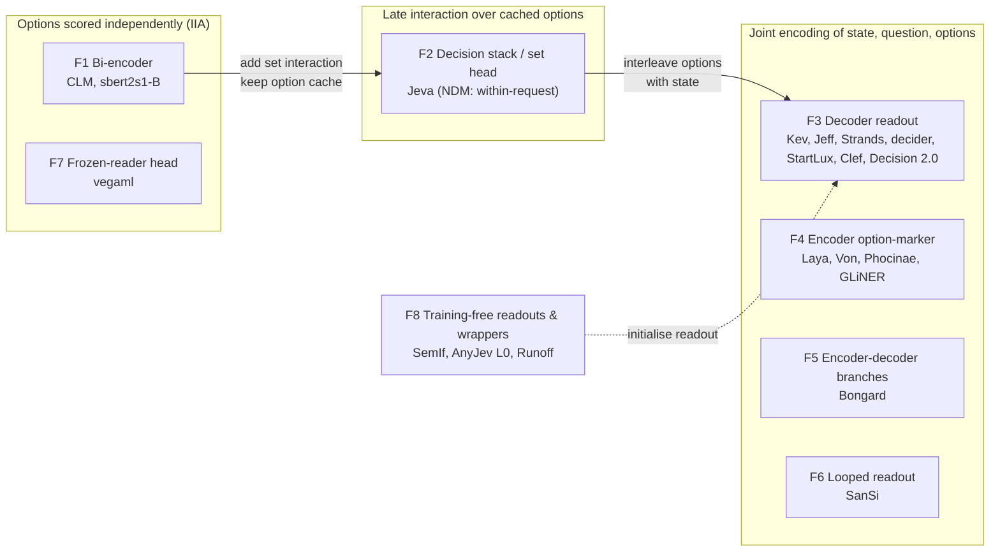

# System One Decision Models: A Survey of Architectures, Objectives, Calibration and Serving

*With lessons for a from-scratch implementation*

**Sourav Dhar** · `system-one-from-scratch` · Draft v1.0 · 21 November 2026

---

## Abstract

A *System One* model does not generate text. Given a situation (the *state*) and one or more typed questions, each with a finite set of options, it returns a probability for every option, ideally in a single forward pass and within tens of milliseconds. Since TypeSafe launched Jev in September 2026, at least forty open implementations and two dozen evaluation papers have appeared in about ten weeks. Their architectures differ in what they encode jointly, what they cache, how they read out a distribution, and how they calibrate it.

This survey organizes the field from primary sources (code, model cards, papers and issue trackers read in full) into eight architectural families, each defined by its scoring equation. For about thirty systems it compares sequence layouts, attention masks, readouts, training objectives, calibration procedures, data and serving paths.

We catalogue fourteen failure modes that independent evaluations have quantified:
- option-order flips;
- yes/no polarity swaps;
- collapse at large option counts;
- question-ignoring and state collapse;
- negation blindness;
- ordinal compression;
- long-context burying;
- reading right but acting wrong;
- adversarial states;
- step-versus-loop gaps;
- knowledge erosion;
- runtime nondeterminism;
- out-of-scope acceptance;
- the blind spot of short-label options in bi-encoders.

We trace which laboratory's design fixed which other's flaw, at what cost, and whether the fix preserves the cacheability that makes contrastive bi-encoders fast.

Three conclusions stand out:
1. **The fastest System-1-native model is the least accurate, and its gap has plausible, fixable causes that are not yet isolated.** The contrastive bi-encoder CLM-8B scores 41.4% on System1-Arena at 41 ms. Zero-shot answer-token readout of its own frozen backbone scores 59.3% at 30 ms. The gap is consistent with several candidate causes, none tested in isolation on that benchmark: the question appended to the state before last-token pooling, context-free short option texts, option-independent scoring without a null outcome, no training on typed decisions, and a 2,048-token tail cut that the readout did not face. The scale saturated at its cap explains CLM's Brier score, not its accuracy: rescaling cannot change an argmax. More broadly, zero-shot readouts of mid-size open LLMs (e.g. Gemma-4-31B, 73.9% at 60 ms) are the fastest *accurate* models on that benchmark. Specialized System-1 models still lead on calibration (Brier 0.34 vs 0.46–0.54).
2. **Late interaction over cached option representations can add set-dependence, null coverage and exact permutation equivariance without giving up caching**, as Jeva shows. Narrow Decision Models corroborates the value of a set head and an adequacy (null) logit, although its option vectors are state-conditioned and therefore cached only within a request.
3. **For single-step decisions, no controlled evidence shows reinforcement learning beating direct proper-score losses.** Laya's three-seed ablation ties soft cross-entropy with its RL term, and the largest gains credited to RL-style stages elsewhere come from direct cross-entropy or proper-score training against outcome or closed-form targets. Temperature scaling fitted on held-out *datasets* is the common finishing step, though it can hurt other metrics. Several published calibration choices are tuned to leaderboard scoring rules rather than to calibration.

We complement the literature with our own measurements on the published CLM heads. They show an expected calibration error of 0.065 at the shipped scale, reduced to 0.013 by one scalar fitted in-distribution; a cross-dataset fit and a tie-corrected re-measurement are pending (§5.6). We close with a design space and a benchmark protocol for a from-scratch implementation that targets both cached action selection and typed decisions on a single mid-range GPU.

---

## 1. Introduction

Large language models answer by generating tokens. Many decisions inside software do not need an essay. Examples:
- Is this message phishing?
- Which of 77 intents is this?
- Which of these 12 shell commands should the agent run next?
- How urgent is this ticket on a 1–5 scale?

What these calls need instead is a *calibrated distribution over a fixed set of outcomes, fast*. Kahneman's System 1 is the metaphor the field adopted. TypeSafe's Jev, launched on 15 September 2026 after two years in stealth, popularized a hosted API, `POST /v1/systemone` [@jev-launch; @jev-api]. A request carries one state and named questions of three types:
- `choice`: 1–255 options;
- `noul`: the probability of "yes";
- `score`: 1–10 ordered levels, reported as an expectation.

Jev never generates text and is billed only on input tokens [@jev-docs].

Within weeks, open alternatives appeared from independent developers, start-ups, big-tech research labs and universities:
- Kev [@kev-repo], Laya [@laya-repo], Strands Decider [@strands], vLLM-SR Decision 2.0 [@decision2];
- Cloudflare Clef [@clef], Perplexity's pplx-decider [@pplx], Liquid d1 [@liquid-d1];
- Jeff-1.1 [@jeff], Jeva [@jeva], Bongard [@bongard], SanSi [@sansi] and others.

So did a wave of evaluations: System1-Arena [@s1arena], TypedBench [@typedbench], JevAdvBench [@jevadvbench] and others. A community catalog lists several dozen projects [@awesome-decision].

### 1.1 Two workloads

Two workloads hide under one name, and they pull architectures in opposite directions.

- **Typed decisions (W1).** Classification, intent routing, yes/no policy checks, rubric scoring and triage. States are documents or conversations. Options are few and often short labels. Every request is new, and accuracy depends on reading the state *in light of the question*. Jev's API surface and most leaderboards measure W1.
- **Cached action selection (W2).** Agent loops, verifiers, game controllers and retrieval over a tool catalog. The candidate set is large and *reused across requests*, and the agent revisits states. Latency per step and the ability to cache option representations dominate.

CLM-8B (Stanford and NVIDIA) was designed for W2. It is a frozen Qwen3-8B encoder with two small contrastive heads. Its option embeddings are cached in a GPU arena, so a revisited state is scored in 0.6–0.7 ms on an RTX 4090 [@clm-repo]. It beats Jev as a fine-tuned verifier on DeepSWE (31/38 vs 27/38 tasks) at 79 ms vs 449 ms, measured on an H100 [@clm-repo].

On System1-Arena, a broad W1 benchmark, the picture is different [@s1arena, Table 1]:
- CLM is the least accurate of the nine System-1-native models (41.4%, Brier 0.749). It is also the fastest of them, at 41 ms.
- Vega-27B scores 73.0% and Jev 72.6%.
- The same table reads open LLMs zero-shot at the answer token. Several are faster *and* more accurate than CLM: CLM's own backbone Qwen3-8B scores 59.3% at 30 ms, and Gemma-4-31B 73.9% at 60 ms. They are less well calibrated than the best System-1 models (§9.2).

The tension between the two workloads, and whether one model family can serve both, is the organizing question of this survey.

### 1.2 Contributions

1. **A formal problem statement and taxonomy** (§2–§3). We state the properties a System One model should have (calibration, permutation equivariance, set-dependence, null coverage, coherence, question sensitivity, cacheability). We classify about thirty systems into eight families, each defined by its scoring equation and by what it can cache.
2. **A code-level comparison** of sequence layouts, masks, readouts and training objectives (§3–§4), with measured deltas from the systems' own ablations.
3. **A calibration analysis** (§5) separating evidence-backed practice from leaderboard-driven distortion, including our own measurements on the published CLM heads.
4. **A training-data and contamination map** (§6).
5. **A quantified catalogue of failure modes** (§7) and **a cross-laboratory "who fixed whom" matrix** (§8). The matrix records cost and cache compatibility for each fix.
6. **A serving analysis** for a single mid-range GPU (§9), followed by open problems, a design space and a benchmark protocol for our implementation (§10–§12).

### 1.3 Method and caveats

All sources were read between 20 and 21 November 2026: papers in full including appendices, plus code, model cards, documentation and issue trackers. Numbers are copied from the cited table, section or file. Our own reasoning is marked *(inference)*. Appendix A logs the numbers we re-verified directly against the primary source.

Three caveats:
- The field is about ten weeks old. Most numbers are self-reported in preprints or model cards and have not been reproduced.
- Several leaderboards share names but not protocols. "JevBench" in particular refers to different item sets and scoring rules in different sources.
- Some primary sources could not be read. The CLM Notion blog renders client-side. The "From Laya to Vega" preprint returned HTTP 403. These gaps are stated where relevant.

Long-form notes per system are in [`docs/research/systems/`](systems/), and the raw source notes in [`docs/research/notes/raw/`](notes/raw/).

---

## 2. Problem formulation

### 2.1 Notation

A request consists of:
- a **state** $s$: text, JSON or a conversation, possibly tens of thousands of tokens long;
- **questions** $q_1,\dots,q_N$.

Question $q$ has a **type** $t \in \{\texttt{choice}, \texttt{noul}, \texttt{score}\}$, instructions $\iota$, and an ordered **option set** $O = (o_1,\dots,o_K)$ with $K \le 255$ in the TypeSafe wire format [@jev-api]. A model returns, for each question,

$$p(\cdot \mid s, q, O) \in \Delta^{K-1} \quad\text{or, with an explicit null outcome,}\quad (p_\perp, p_1,\dots,p_K),\ p_\perp + \textstyle\sum_i p_i = 1 .$$

Each type has its own interpretation:
- `noul`: $K = 2$, reported as $P(\text{yes})$.
- `score`: options are ordered levels with values $v_i$, and the reported score is $\mathbb{E}[v] = \sum_i p_i v_i$.

Most systems score each option with a logit $z_i$ and set $p = \mathrm{softmax}(z/T)$ with a temperature $T$.

### 2.2 Desired properties

**P1 Calibration.** Among decisions reported with confidence $c$, a fraction $c$ should be correct. It is measured by the expected calibration error over $B$ confidence bins $\mathcal{B}_b$,

$$\mathrm{ECE} = \sum_{b=1}^{B} \frac{|\mathcal{B}_b|}{n}\,\bigl|\mathrm{acc}(\mathcal{B}_b) - \mathrm{conf}(\mathcal{B}_b)\bigr|,$$

and by the Brier score $\sum_i (p_i - y_i)^2$, the log loss, and decision costs. TypedBench reports ECE relative to a Bernoulli resampling floor ("ECE/null") and judges probabilities by the *cost of the decisions they induce* [@typedbench].

*Conventions differ across sources, so calibration numbers from different tables are not directly comparable.*
- **ECE** is top-label (the confidence of the predicted option) unless stated otherwise. System1-Arena uses 10 equal-mass bins [@s1arena]. This project's measurements (§5.6) use 15 equal-width bins. Several systems do not state their binning. The two estimators diverge most when confidences cluster near 1.
- **Brier** in this survey is the multi-class sum $\sum_i (p_i - y_i)^2 \in [0, 2]$, as in System1-Arena. Some sources instead report a per-option mean: Laya issue #741's 0.0501 at 80.5% accuracy implies one *(inference)*. Jeva reports a binary Brier for yes/no questions.
- **ECE/null** (TypedBench) divides ECE by a Bernoulli resampling floor.

For our own results we will report both ECE estimators (15 equal-width and 10 equal-mass bins), with bootstrap confidence intervals, and the multi-class Brier.

**P2 Permutation equivariance.** For any permutation $\pi$ of the options, $p(\pi(O)) = \pi(p(O))$. It is measured by flip rates under shuffling or reversal.

**P3 Set-dependence vs. independence of irrelevant alternatives (IIA).** An *independent scorer* $z_i = g(s, q, o_i)$ gives log-odds $\log(p_i/p_j) = (g_i - g_j)/T$, which no other option can change (the Luce/IIA property). Jeva's Proposition 1 shows that a single attention block over the option set can prefer $a$ in one candidate set and $b$ in another set containing both. No independent scorer with set-independent tie-breaking can do this [@jeva, §3, App. B.1]. IIA costs the ability to model "compared with what?". Independent scoring is sufficient for order invariance and cacheability but not necessary: Jeva is set-dependent yet exactly permutation-equivariant, and it still caches option keys and values [@jeva, Prop. 3]. What IIA saves is the per-request computation over the set. Proposition 1 is an existence result: it shows what one block can represent, not what trained models learn.

**P4 Null coverage.** Models need to say "none of these fits". Appending a "none" option with logit $b_0$ to a flat softmax over option scores $u_1, \dots, u_K$ yields, exactly,

$$p_\perp^{\mathrm{flat}} = \sigma\!\left(\frac{b_0 - \bar u}{\tau} - \log K\right), \qquad \bar u = \tau \log \frac{1}{K} \sum_{i=1}^{K} e^{u_i/\tau},$$

where $\bar u$ is the log-mean-exp of the option scores. Holding the typical option score fixed, the null loses $\log K$ in log-odds simply because more options are listed. A coverage gate on the maximum score removes this bias for options added below the current maximum [@jeva, Prop. 2], but not every $K$-drift: for i.i.d. distractor scores the expected maximum still rises with $K$.

**P5 Coherence.** Probabilities should obey the axioms: $P(A) + P(\lnot A) = 1$, and a partition's parts should sum to one. Jev's yes/no answers to a question and to its negation deviate from complementarity by a mean absolute 0.064 (noise floor 0.013). Its per-option yes/no probabilities over a three-way partition sum to 1.14 on average, exceeding 1 on 159 of 160 items [@axioms].

**P6 Question sensitivity.** The output must depend on the question, not only on the state. Strands Decider v7 gave the same answer to a *changed* question 94–99% of the time [@strands].

**P7 Cost and cacheability.** For a request with $N$ questions and $K$ options per question, write the cost as

$$C = C_{\text{state}}(|s|) + N\,C_{\text{question}} + N K\,C_{\text{option}} + C_{\text{head}}(N, K).$$

An architecture is *state-cacheable* if $C_{\text{state}}$ is paid once for many questions or requests (prefix or KV reuse). It is *option-cacheable* if option representations are independent of the request and can be stored across requests, making $C_{\text{option}} \approx 0$ on reuse. W2 workloads live or die by option caching. W1 workloads with many questions per state benefit from state caching.

### 2.3 The design tension in one sentence

Every additional piece of joint computation trades cacheability for accuracy and, often, for order sensitivity:
- **state ⊗ question**: question-aware state encoding;
- **question ⊗ options**: options rendered in the prompt;
- **option ⊗ option**: set-dependence.

The families below differ precisely in which of these interactions they compute, and where.

---

## 3. A taxonomy of System One architectures

We distinguish eight families by their scoring function. Table 1 summarizes them, Table 2 lists representative systems, and Figure 1 shows how they relate.

*Figure 1. The families arranged by how much they compute jointly. Arrows show the design moves papers have made between families.*

**Table 1. Families, scoring functions and cacheability.** $E$ is a (frozen or adapted) encoder, $h_x$ the hidden state at token $x$, $\oplus$ concatenation.

| Family | Score $z_i$ | Passes per request | State reuse | Option reuse | Order invariant |
|---|---|---|---|---|---|
| **F1** Bi-encoder | $\lambda \cos\!\big(f_s(E(s \oplus q)),\, f_a(E(o_i))\big)$ | 1 state + $K$ options (options cached) | no: the question is appended before pooling, so each question needs a state pass; a prefix cache saves the shared state tokens [@clm-repo] | **yes** | by construction |
| **F2** Late interaction | $z_L^\top u_i$, with $z_L = \mathrm{Block}(z_0;\{u_i\})$ | as F1 + one small block | no: the request side is recomputed; only options are cached [@jeva] | **yes** (plus per-option K/V) | by construction |
| **F3** Decoder readout | pointer $\langle W_q h_{\text{decide}}, W_k h_{o_i}\rangle$, or LM-head row of label $\ell_i$ at the answer slot | 1 joint pass (or 1 row per question) | causal / `prefix_bidir`: **yes**; full bidirectional: no | no, except a schema-first prefix reused across states [@thisthat] | no (needs isolation, averaging or augmentation) |
| **F4** Encoder option-marker | $\mathrm{MLP}(h_{[\mathrm{MASK}]_i})$ after a small head | 1 row per question | usually no | no | no (unless masks reset positions) |
| **F5** Encoder-decoder | bilinear $w^\top h_i + (W_c h_i)^\top (W_g g)$ on decoder branch | 1 encoder + ⌈N/8⌉ decoder | only for identical question instructions, which the encoder reads from stage 3 [@bongard] | no | no |
| **F6** Looped readout | letter logits after each loop $t$, averaged | $T$ loops of a shared stack | KV per loop | no | no |
| **F7** Frozen-reader head | energy readout over pooled tapped layers | 1 reader pass per question | long states only | no | depends |
| **F8** Training-free | label-token logits, rotation-averaged or pointwise-then-listwise | $1$ to $K$ passes | prefix | no | via averaging |

### 3.1 F1: Dual (bi-)encoders

**CLM** [@clm-repo] embeds two texts separately with frozen Qwen3-8B, taking the last token's final hidden state (4096-d), L2-normalized:
- the state text, which is the state rendered as prose plus "\n\n" plus the question's instructions;
- each option text.

Two MLP heads, each $4096 \to 1536 \to 1536\,(\text{LayerNorm}) \to 512$ with GELU and 9,443,840 parameters, map the embeddings to a joint space. The score is the cosine times a learned inverse temperature $\lambda = \min(e^{\theta}, 100)$. The released checkpoint has $\theta = 4.6132$, i.e. $\lambda$ sits *at the cap* [@clm-repo, issue #15].

Option texts depend on the question type:
- choice: the bare option description;
- score: the level text;
- noul: two boilerplate sentences, "Yes. This is true: {instructions}" and its negation.

Option embeddings are request-independent and cached on-GPU in a preallocated LRU arena keyed by `head@generation\x00text` [@clm-repo, `cache.py`].

The family's appeal is cost. A new state costs one 8B encoder pass (about 28 ms on an RTX 4090). Scoring 50 cached options costs a 512-d matrix-vector product. A revisited state costs 0.6–0.7 ms [@clm-repo].

The family's weakness on W1 is now well documented (§7.1, §7.7, §7.14):
- Appending the question to the state collapses distinct states. The mean cosine between different BoolQ states is 0.958 with the question suffix vs. 0.452 for the state alone [@clm-repo, issue #15].
- Context-free short options make the head ignore the state (§7.14).
- A logistic regression on the *same frozen embeddings* outperforms the fine-tuned head on Banking77 (0.900 vs. 0.795) [@clm-repo, issue #13].

The sbert2s1 study converts sentence encoders into System One models. Its variant B, a trained bi-encoder whose state embeddings can be precomputed, matches a cross-encoder on seen tasks (−0.6, n.s.) but loses 9.4 points on held-out tasks [@sbert2s1, RQ2].

### 3.2 F2: Late interaction over cached options

**Jeva** [@jeva] keeps two towers but lets the *state* read the *option set* before scoring:

$$z_0 = P_x E_\theta(T_x(t, \iota, x)), \qquad u_i = \mathrm{nrm}\!\big(P_o E_\theta(T_o(t, o_i))\big).$$

The option template contains only the decision type and the option, so $u_i$ is request-independent. One decision block ($L=1$, $d=768$, 8 heads, SwiGLU width 3,072; 13.37M trainable parameters together with the projections) updates only the state vector, by cosine attention over option keys:

$$\tilde z = z + \alpha\, W^O\, \mathrm{Concat}_h \textstyle\sum_i a_i^h v_i^h, \qquad z' = \tilde z + L^{-1/2}\, \mathrm{SwiGLU}(\mathrm{RMSNorm}(\tilde z)).$$

Here $a_i^h$ is head $h$'s attention weight on option $i$: cosine attention, with queries and keys L2-normalised and divided by a learned $\tau_\ell$ initialised at 0.15. The step size is $\alpha = \tau\,\sigma(\gamma)/\sqrt{L}$, with $\alpha/\tau$ initialised at 0.6; the q, k, v and o projections start at the identity and the FFN output at zero [@jeva, Eq. 10; @jeva-repo].

Scores and outputs follow:
- $s_i = z_L^\top u_i$ with $u_i$ normalized but $z_L$ *not*, so $\lVert z_L\rVert$ acts as a per-request inverse temperature *(inference)*;
- $q = \mathrm{softmax}(s/\tau_{\text{dec}})$;
- a coverage gate $\rho = \sigma((\max_i s_i - b_{\text{cov}})/\tau_{\text{cov}})$ gives $p_\perp = 1-\rho$ and $p_i = \rho\, q_i$.

Per option, the cache stores $u_i$ and every layer's per-head keys and values [@jeva-repo, `matrix_decision.py`]. Options never attend to each other; all set-dependence flows through the state, so the output is permutation-*equivariant* (Prop. 3).

Jeva-4B (Qwen3.5-4B with LoRA r64) reaches 78.30 on the Typed Decisions test against 43.05 for CLM-8B, with zero order flips (Jev 17.0%; Table 2) and null-detection AUROC 98.66 (§4.2, Fig. 6b) [@jeva]. The paper has no component ablation, so the stack, LoRA and data contributions cannot be separated [@jeva].

**Narrow Decision Models (NDM)** [@ndm] reach F2-like behaviour from an encoder. One caveat: under the prefix-tree mask each option attends to its ancestors, i.e. to the state and the question. Its option vectors are therefore *state-conditioned*, and the cache it exploits is the state's K/V within a request, not option representations across requests *(inference from the mask definition)*.
- A *prefix-tree* attention mask encodes the state once and gives sibling options shared logical positions, so no option sees another.
- A two-layer position-free **set head** over the per-option vectors replaces independent scoring. It lowers NLL from 1.181 to 0.799 and raises accuracy from 0.655 to 0.705 (§10.4 of the paper).
- An **adequacy** logit, computed before the set head, provides abstention. Its recall is 0.66 vs. 0.25 for an explicit "none" option.

### 3.3 F3: Joint decoders with a trained readout

The dominant family puts the state, the question and the *rendered options* into one decoder sequence, then reads a distribution from hidden states. Three readouts are in use.

1. **Pointer heads** score each option's closing token against a decision token. In Kev [@kev-repo, `kev/model.py`]:

   $$z_i = \frac{(W_k h_{\langle/\text{opt}\rangle_i}) \cdot (W_q h_{\langle\text{decide}\rangle})}{\sqrt{256}},$$

   with $d_p = 256$, an fp32 head and LoRA r16 on all projections of Qwen3.5. Variants:
   - Strands Decider v1: a 1M-parameter pointer on Qwen3.5-2B [@strands].
   - Jeeves: Kev's pointer read *after* optional reasoning, with the question repeated [@jeeves].
   - Decision 2.0's `CandidateHead`: adds an MLP term $w\cdot\mathrm{GELU}(M_c\,\mathrm{LN}(h_k) + M_q\,\mathrm{LN}(h_q))$ [@decision2-kai].
   - AnyS1: adds one position-free bidirectional self-attention layer over the decision and option vectors [@anys1].
2. **LM-head (letter) readouts** label options A, B, … and take the logits of those label tokens at the answer position, $z_i = w_{\ell_i}^\top h_{\text{ans}}$, often with a trained correction. Jeff-1.1 uses
   $$z = c\tanh(W_0 h / c) + A\,\frac{h-\mu}{\sigma} + b,$$
   with $W_0$ the LM-head rows for A–P and $A$, $b$ zero-initialized, so training starts *exactly* at the instruct model's zero-shot readout [@jeff-repo, `head.py`]. Other letter readouts: SemIf [@semif], decider [@decider], StartLux [@startlux], AnyJev [@anyjev], Intern-Decision [@interndecision], Liquid d1 [@liquid-d1] and this-that [@thisthat].
3. **Learned code rows** extend the label set to 255 single-token codes initialized from LM-head rows: Strands v2 [@strands] and pplx-decider (a $[255, 5120]$ readout) [@pplx].

The **attention mask** decides what can be cached.

| Mask | Used by | What it allows |
|---|---|---|
| Causal with per-question rows continuing from a cached state prefix | Kev, Strands v1, Decision 2.0 | State reuse across questions |
| Block / branch masks plus position-id restarts | Kev (packed mode) | All questions sit at identical positions after the state |
| Option isolation, where options share positions and see only the state | Kev (flag) | Exact order invariance. In earlier Qwen3-generation runs it cost 5.8 pp in a single 4B run; at 0.6B it gave flip rate 0.0 at parity [@kev-repo, archived PLAN.md] |
| **`prefix_bidir`**: the state attends bidirectionally within itself and never sees the question; each question is bidirectional within itself | Strands v2 | The state is encoded once and reused [@strands] |
| Full bidirectional attention in global layers | pplx-decider, StartLux Instant, Jeff (every model except Gemma-4-31B) | Gains are small and mixed: StartLux up to +2.4 Decision-Index points; Jeff −0.2 ± 1.1; Small Heads reports bidirectional attention *costs* 3.5–6.0 points in distribution. Serving pplx causally changed the top answer on 101 of 2,167 items. It also prevents prefix reuse: SGLang disables the radix cache for pplx; StartLux reports 2.8 → 27 decisions/s when document representations *are* reused [@startlux, App. D.4; @pplx; @smallheads] |

On hybrid linear-attention backbones (Qwen3.5's Gated DeltaNet layers), block masks cannot be honoured. Kev therefore runs each question as one causal row that *continues* from the cached state, forking the convolution and recurrent state. This equals the packed form to fp32 noise [@kev-repo].

Joint decoders lead typed-decision accuracy. Examples:
- Jeff-1.1-Large scores 89.0 on OpenDecisions Capability vs. Jev 1.13 at 80.1 [@jeff, Table 3].
- Strands Decider v2-31B: Decision Index 0.3 71.5 [@strands].
- StartLux-27B AutoThink: Decision Index 0.3 public 73.37 [@startlux, Table 4].

They pay for joint encoding with order sensitivity (§7.1), with no option caching, and, under bidirectional attention, with no prefix caching.

### 3.4 F4: Encoder option-marker models

**Laya** [@laya-repo] fine-tunes ModernBERT-large (421M) on the layout
`[CLS] "{type} question: {ι}" [SEP] [MASK] o1 [MASK] o2 … [SEP] state [SEP]`.
It adds a type embedding and a 2-layer transformer head, then scores each `[MASK]` with a small MLP. Each option is capped at 48 tokens, and the whole option block must fit in a 192-token "head budget" (256 for the multilingual and typed-decisions models). The budget also counts the question text. When it overflows, every option is cut to $\max(4, (192-16)/K)$ tokens [@laya-repo, `common.py`].

Derivatives include:
- **Von**: order-invariant masks with restarted position ids reduce its flip rate from 49.5% to 0 [@von].
- **Phocinae**: Laya's configuration on mmBERT-small [@phocinae].
- **GLiNER2.5-Decide**: label markers on DeBERTa-v3-large, which score several tasks in one pass [@gliner-decide; @gliner2].

The encoder family's weaknesses are documented in its own trackers (§7):
- near-chance zero-shot accuracy;
- collapse when many options share the fixed head budget (banking77 at 0.425 on both checkpoints);
- polarity flips at confidence 1.0;
- a saturated auxiliary head.

Von's post-mortem reports that seven encoder-side interventions were null under McNemar tests. Moving to Qwen3.5-0.8B with LoRA r64 and Clef's joint-schema head gained 6.5 points pooled [@von, `docs/von-2.md`].

### 3.5 F5–F7: Encoder-decoder, looped and frozen-reader designs

**Bongard** [@bongard] (T5Gemma-2 4B-4B) encodes the state once with a *bidirectional* encoder and decodes each question on its own branch. The question-prefix and shared-state attention partitions are merged by log-sum-exp in the style of Hydragen [@hydragen]. It reads options with a bilinear head

$$z_i = w^\top h_i + \frac{(W_c h_i)^\top (W_g g)}{\sqrt{256}},$$

where $h_i$ is the hidden state at the candidate-end marker and $g$ the one at the decision marker. In a 1B probe, the bidirectional encoder beats a forward-only one (69.8% vs. 64.6%, NLL 0.677 vs. 2.944) [@bongard, Table 3a].

**SanSi** [@sansi] runs a looped LM (Ouro-1.4B, 24 shared layers, 8 loops) and reads letters after *every* loop with a loss averaged over loops. It gains 13.5 points over a same-shape non-looped model, at 7.7× the compute of one pass. Averaging the 8 loop distributions halves ECE (0.093 → 0.044).

**vegaml** [@vegaml], the engine behind Laya 0.5, runs a frozen causal LM only up to its deepest tapped layer; for a 24-layer 0.8B reader, layers 13 and 19. It pools state, question, last-token and option spans, then settles a 64-d "particle" among option-specific Gaussian wells:

$$U(z) = \tfrac12 \kappa \lVert z\rVert^2 - \sum_k a_k \exp\!\left(-\frac{\lVert z - c_k\rVert^2}{2\sigma_k^2}\right), \qquad E_k = \frac{\lVert z_T - c_k\rVert^2}{2\sigma_k^2} - \log a_k, \qquad p_k = \mathrm{softmax}(-E/\tau)_k,$$

where $z_T$ is the particle after it settles. Because $z_T$ settles in the landscape of all the wells, $p_k$ depends on the whole option set: vegaml is not an independent scorer [@vegaml].

It is the closest published analogue to a frozen-reader head with intermediate-layer taps, a cheap latency lever (§9). Its reported gains over a scalar temperature are about 0.002 NLL (§5).

### 3.6 F8: Training-free readouts and wrappers

**SemIf** [@semif] reads frozen Qwen3.5-4B letter logits for 2–16 options (balanced accuracy 0.813). Its prompt became Jeff's.

**AnyJev**'s L0 readout averages label log-probabilities over all $K$ cyclic rotations of the options, which cancels absolute-position effects that are additive in log-probability (not neighbour effects, since a rotation changes each option's neighbours), and divides by a running label prior raised to the power 0.75 [@anyjev]. At $K = 20$ the flip rate falls from 0.328 to 0.138 at the cost of $K$ prefills [@anyjev, Table 1]. On an 18-option serving task, adaptive stopping used 7.3 rotations on average; verified on disjoint data it uses 10.6 of 18 [@anyjev, Table 3].

**Runoff** [@runoff] scores options *pointwise*, keeps the top set holding 99% of the mass (at least 3 options), and runs cyclic listwise averaging only on that shortlist. This takes flips to 0.0 at 3–4× the speed of full averaging at $K = 20$; pointwise-only scoring costs about 6 points (63.3 vs. 69.0). These methods matter as *baselines*: the evidence audit found that only 5 of 26 papers compared against a same-backbone label log-probability readout [@tdmaudit].

### 3.7 Representative systems

**Table 2. Representative systems.** Trainable parameters exclude frozen weights. "DI" is the Decision Index (version noted), "OD" OpenDecisions Capability, "S1A" System1-Arena non-agentic accuracy. All numbers are as reported by the cited source.

| System | Family | Backbone (trainable) | Readout / head | Max K | Headline number |
|---|---|---|---|---|---|
| CLM-v0.1-8B [@clm-repo] | F1 | Qwen3-8B frozen (2 × 9.44M heads) | cosine × scale | unbounded (cached) | S1A 41.4 / Brier 0.749 / 41 ms [@s1arena] |
| Jeva-4B [@jeva] | F2 | Qwen3.5-4B, LoRA r64 (13.37M + LoRA) | decision block + coverage | 2,048 tested | Typed 78.30; null AUROC 98.66 |
| NDM [@ndm] | F2/F4 | mmBERT-base, 110M body | set head + adequacy | — | 91.2% agreement with production LLM (legal) |
| Kev-4B [@kev-repo] | F3 pointer | Qwen3.5-4B, LoRA r16 (33.8M) | pointer $d_p$=256 | 255 | transfer-v4 0.838; breadth 0.690 vs Jev 0.757 |
| Jeff-1.1-Large [@jeff] | F3 letter | Gemma-4-31B, LoRA r32 | LM-head rows + affine | 16 (tournament to 256) | OD 89.0 vs Jev 80.1 |
| Strands v2-31B [@strands] | F3 codes | Gemma-4-31B, LoRA r64 | 255 code rows, `prefix_bidir` | 255 | DI 0.3 71.5; OD 92.2 |
| StartLux-27B [@startlux] | F3 letter | Qwen 27B, full SFT + adapters | letters A–Z, AutoThink | 25/group | DI 0.3 73.37 (AutoThink) |
| decider [@decider] | F3 letter | Qwen3.5 / Gemma-4, full FT | LM-head rows, many slots | 255 | DI 0.2.1 57.33 (stock 31B + readout) |
| Decision 2.0 Vega-27B [@decision2] | F3 pointer+MLP | Qwen3.8-27B | `CandidateHead` | 255 | S1A 73.0 / Brier 0.343 [@s1arena] |
| pplx-decider v1.1 [@pplx] | F3 codes | Qwen3.8-27B, full SFT | 255 rows, non-causal global layers | 255 | DI 61.56 |
| Clef [@clef] | F3 joint schema | Qwen3.8-27B, LoRA r256 | routing layers + lexical prior | — | DI 0.2.1 BANKING77 94.2 |
| Laya [@laya-repo] | F4 | ModernBERT-large 421M, full FT | [MASK] scorer | bounded by a 192-token option budget | typed-decisions 0.766 fine-tuned / 0.362 zero-shot |
| Bongard [@bongard] | F5 | T5Gemma-2 4B-4B | bilinear | — | DecisionBench 78.05% |
| SanSi [@sansi] | F6 | Ouro-1.4B looped, LoRA r64 | letters per loop | — | 72.0 (8 loops) |
| vega-U [@vegaml] | F7 | frozen reader (0.8B–27B) + 14.3M engine | energy wells | — | 0.765–0.811 in-distribution held-out |
| Jev 1.13 (closed) [@jev-docs] | ? | undisclosed | typed | 255 (+ two-stage) | S1A 72.6 / Brier 0.349 / 321 ms [@s1arena] |

---

## 4. Training objectives and curricula

### 4.1 Contrastive pre-training with hard negatives (F1)

CLM trains its heads with symmetric InfoNCE over a batch of $B$ (state, action) pairs:

$$\mathcal{L} = -\frac{1}{2B}\sum_{i}\left[\log\frac{e^{\lambda\, s_i^\top a_i}}{\sum_{j\notin D(i)} e^{\lambda\, s_i^\top a_j} + \sum_{k} e^{\lambda\, s_i^\top n_{ik}}} + \log\frac{e^{\lambda\, a_i^\top s_i}}{\sum_{j\notin D(i)} e^{\lambda\, a_i^\top s_j}}\right],$$

The terms are:
- $D(i)$: rows masked from the denominators. CLM's `finetune.py` masks the rows that share `(task_id, step_idx)` with row $i$ (the same-document mask); the README states the pre- and mid-training objective without a mask, so whether those stages masked is not documented [@clm-repo];
- $n_{ik}$: up to 10 mined hard negatives, used only from mid-training onward [@clm-repo].

The recipe stored in the checkpoints is batch 16,384, a constant learning rate of 0.00653 (pre-training) or 0.001 (mid-training), an initial temperature of 0.07, and a scale cap of 100.

**Table 3. The curriculum's ablations** (≈100k held-out questions, 10 negatives each) [@clm-repo]. Our evaluation code reproduces the published heads to within 0.4 pp: 51.73 / 69.16 / 68.63% on $n$ = 191,161, against the README's 52.1 / 69.2 / 68.5 on about 100k (a different sample; this project, `results/benchmark/heads.json`).

| Setting | Top-1 |
|---|---|
| Pre-training only | 52.1% |
| + mid-training with hard negatives | 69.2% |
| Hard negatives from the start | peaks at 62.4%, then overfits |
| Post-training on agent data, with Q&A replay | 68.5% |
| Post-training on agent data, without replay | 56.2% |

Two lessons transfer beyond F1:
- **Hard negatives belong after a general pre-training stage.**
- **Replay is what prevents forgetting.** Kev uses replay between its SFT stages for the same reason [@kev-repo].

The mid-training negatives were generated by Gemini 2.5 Flash-Lite. Their dataset card warns that about 1 in 20 near-binary questions has a "negative" that paraphrases the answer [@nemotron-text]. Positive-aware filtering [@nvretriever] is the standard remedy *(inference)*.

### 4.2 Soft targets and proper scoring rules (F2–F6)

Almost every typed-decision system trains with cross-entropy over the option set, $-\sum_i t_i \log p_i$, against a target distribution $t$. The target is one of:
- one-hot labels;
- human vote distributions;
- teacher distributions;
- mixtures of these.

Jeff-1.1's DecisionBank mixes dataset labels 50/50 with a reasoning teacher (Qwen3.8-27B, mean of two samples) for public data, and uses teacher-only targets for LLM-written questions [@jeff, Table 2; @decisionbank]. The marginal value of soft targets is positive but small:
- Jeff: hard labels −0.2 ± 2.1 Capability; removing LM-labeled data −1.9 [@jeff, Table 5].
- Kev: ambiguity soft targets gave +1.1 accuracy and −0.011 Brier [@kev-repo, PLAN.md].

Changing the training objective is a cheap lever with mixed results. Label smoothing helped AnyS1 and a Brier term helped SanSi, but CE+Brier did not help AnyS1, and in Kev label smoothing, CE+Brier and focal loss "produced no candidate" [@kev-repo]:

| Objective change | Effect on ECE | Source |
|---|---|---|
| Add Brier to CE (SanSi) | 0.104 → 0.093 | [@sansi, Table 3] |
| Label smoothing (ε = 0.1) vs hard-label CE vs CE+Brier (AnyS1) | 0.094 vs 0.146 vs 0.148 | [@anys1, Table 3c] |
| Various calibration losses vs plain CE, after temperature scaling (Jeff: Brier, focal, soft-ECE, MMCE) | none lowers ECE by more than 0.01 | [@jeff] |

The last row is the important caveat: once temperature scaling is applied, the choice of calibration loss barely matters.

### 4.3 Reinforcement learning for calibrated decisions

"RLCD" (reinforcement learning for calibrated decisions) is the name TypeSafe gives its unpublished training method [@jev-primer]. Laya's released trainer implements a version of it [@laya-repo, `train.py`]:

$$\tilde z = \mathrm{sg}(z) + \epsilon,\ \ \epsilon \sim \mathcal{N}(0,\sigma^2 I)\ (\text{row-centred}),\quad q = \mathrm{softmax}(\tilde z),$$

$$r(q, t) = \sum_k t_k \max(\log q_k, -9.21) + w_{\text{sph}}\frac{t\cdot q}{\lVert q\rVert} - w_{\text{rps}}\,\mathbb{1}[\text{score}]\,\frac{\sum_k (\mathrm{CDF}_{q,k}-\mathrm{CDF}_{t,k})^2}{K-1},$$

$$\mathcal{L} = -\overline{A \log \pi(\tilde z\mid z)} + \mathrm{CE}_{\text{soft}}(z, t), \qquad A = \frac{r - \bar r_{\text{samples}}}{\mathrm{std}_{\text{batch}}(r - \bar r_{\text{samples}})},\quad \log\pi = -\frac{\lVert \tilde z - z\rVert^2}{2\sigma^2}.$$

The defaults are 4 samples, $\sigma$ annealed from 0.4 to 0.1, $w_{\text{sph}} = 0.75$ and $w_{\text{rps}} = 1$. This differs from the author's blog, which describes pure policy gradient with 8 samples and $\sigma$ from 1.0 to 0.3 [@laya-repo].

A three-arm ablation of Laya's objective on typed-decisions (issue #741, a single-seed run by an external contributor) found **no gain from the RL term**:

| Arm | Accuracy | ECE | Brier |
|---|---|---|---|
| Soft-CE only | **80.50%** | 11.82% | **0.0501** |
| RLCD (PG + soft-CE) | 79.08% | **11.18%** | 0.0543 |
| Direct proper-score gradient | 79.92% | 12.04% | 0.0516 |

The merged three-seed follow-up (PR #1012) found the arms tied: 0.7763 vs 0.7762 accuracy, per-seed differences −0.0145, +0.0135 and +0.0015. So the single-seed soft-CE lead did not replicate, but neither did any RL gain [@laya-repo]. The explanation offered in the issue holds only approximately. Soft-CE is the expected log score, while the policy-gradient term estimates the gradient of a noise-smoothed reward that also contains a spherical score (weight 0.75) and, for score questions, an RPS term; the two coincide only for the log-score part and only as the noise scale $\sigma \to 0$ [@laya-repo]. Independent work agrees:
- sbert2s1 finds Laya's estimator 3.6–15× too large in scale and fixes it with a leave-one-out baseline (PG-LOO). After temperature scaling, all objectives sit at 3.6–4.4 ECE [@sbert2s1, Tables 4, 6].
- NanoJev's unbiased sampled-Brier policy gradient scored test L2 0.1184 vs. 0.1242 (CE) and 0.1384 (Brier). The numbers are slightly lower than CE, but with one seed the authors describe it as matching rather than beating [@nanojev].
- SanSi's RL variant gave no gain (71.7 vs. 72.0) [@sansi].
- Jeeves's CISPO stage "did not improve v2" [@jeeves].

The largest gains credited to RL-style stages come from direct proper-score training against outcome or closed-form targets:
- **Outcome-grounded sandbox decisions.** Bongard's stage 3 moved a frozen evaluation panel from 50.6 to 64.8 and Brier from 0.482 to 0.289 [@bongard]. The stage labels every legal action with an outcome distribution (rollout frequencies or exact oracles) and trains with direct CE, which replaces REINFORCE. The gain is a whole-stage effect, not an RL ablation.
- **Belief log-scores against exact laws and reasoning-gated fusion.** decider's RL stage combines four terms, one of them a direct belief log-score against exact laws; together they cut belief excess from 0.473 to 0.219 nats, and no ablation credits PPO itself [@decider, `docs/RL.md`]. StartLux's RLCD² rewards post-reasoning improvement over the direct answer [@startlux, Eqs. 3–6].
- **Mixed evidence elsewhere.** Jeeves v1, which used CISPO, beats v2 on JevBench public and hard [@jeeves]; StartLux finds RL hurts long computations (−5.9) [@startlux]; sbert2s1's PG-LOO adds +2.5 [@sbert2s1].

*(Inference)* For single-step typed decisions there is no controlled evidence that RL beats direct proper-score losses (soft-CE, optionally plus Brier). RL remains a candidate for multi-step outcomes and for deciding when to deliberate.

### 4.4 Ordinal, null and coherence objectives

**Score questions.** These are typically trained as plain classes, and evaluations find ordinal compression: Laya keeps level order on 1 of 4 ladders [@typedbench]. Remedies:
- an RPS or CDF term (Laya's reward, NDM, Jeva's expectation-plus-CDF auxiliary losses);
- ordinal label smoothing (Strands v1).

Kev's ordinal CDF penalty was a reported negative [@kev-repo, PLAN.md].

**Null outcomes.** Three approaches:
- **Coverage gate** with BCE on "any candidate correct": Jeva, AUROC 98.66 vs. Kev's 93.61 [@jeva].
- **Adequacy logit before set interaction**: NDM. It catches more absent answers than an explicit "none" option (recall 0.66 vs. 0.25), but with more false alarms (0.29 vs. 0.025) and a slightly lower AUROC (0.76 vs. 0.79). The paper presents it as a trade-off [@ndm, §10.4].
- **Data augmentation**: Kev's "none-pair" minimal pairs present the same question with and without the true option [@kev-repo]. StartLux shows that even an *untrained* appended "None of the above" letter gives AUROC 0.920 [@startlux-repo, `docs/none_probability.md`].

**Coherence.** NDM computes Noul from $[h_Q; h_S]$ *without option embeddings*, avoiding the label-word pathology of F1/F4 (§7.14) [@ndm].

### 4.5 Representation-level regularizers

- **Matryoshka training** [@mrl] makes prefixes of an embedding usable on their own. The published CLM heads were not trained this way. Truncating the mid-training head's 512-d output to 256 / 128 / 64 dimensions drops tricky-Q&A top-1 from 69.16% to 63.28 / 56.69 / 51.02% (this project).
- **Anisotropy.** Bongard found raw readout cosines between unrelated items of 0.93–0.996 and fixed this with *pack centring*, subtracting a stop-gradient batch mean per view before normalizing. With $\lambda = 0.004$ this moved within-source retrieval from 2.3% to 56.6% [@bongard, §4.2]. CLM's state embeddings show the same pathology after the state head (cosine 0.947) [@clm-repo, issue #15].

### 4.6 What to adapt: head-only, LoRA or full fine-tuning

The strongest finding in the literature concerns *where* to spend trainable parameters.

**Table 4. Adaptation regime.** Rows come from different systems and recipes, so read them as directions, not controlled effect sizes. A counterpoint not in the table: Kev's same-data full fine-tune gained nothing and raised ECE by about 0.045 [@kev-repo].

| Evidence | Head only (frozen) | LoRA | Full FT | Source |
|---|---|---|---|---|
| Jeff 1.0, Gemma-4-31B, OD Capability | 78.9 ± 2.5 | **84.4** (recipe); 84.9 with the head frozen at init | — | [@jeff, Table 5] |
| Zero-shot instruct readout, same model | 79.6 | | | [@jeff, Table 5] |
| Base (non-instruct) checkpoint + LoRA recipe | | 70.3 | | [@jeff, Table 5] |
| CLM fine-tuned head vs logistic regression on the same frozen Qwen3-8B embeddings, Banking77 | 0.795 vs **0.900** | | | [@clm-repo, issue #13] |
| Kev-27B v1 (merged LoRA) vs v2 (full FT on a new 145,840-record corpus, so data is confounded), breadth index | | 50.2 | 52.3 | [@kev-repo] |
| decider: stock Gemma-4-31B + readout vs trained 35B, DI 0.2.1 | **57.33** (stock) | | 47.11 | [@decider] |

Four further results sharpen the picture:
1. **Backbone scale dominates head design.** Small Heads finds a 0.53M cosine head equals a 27.3M joint-schema head when options are read *in context*. Moving the backbone from 0.6B to 4B adds about 11 out-of-distribution points, with little change from 8B to 14B; every size is LoRA-adapted [@smallheads, Tables 3, 7].
2. **Zero-shot letter readout keeps improving past 4B, with diminishing returns.** Qwen3.5 0.8B / 2B / 4B / 9B / 27B score 48.9 / 57.6 / 76.8 / 82.2 / 86.5 on seven held-out sets: +19.2 from 2B to 4B, then +9.7 from 4B to 27B. The paper describes this as levelling off [@jeff, App. F].
3. **Learning rate, not rank, is the lever.** LoRA rank 16 to 128 is flat in Jeff. In Kev, lowering the LR from 2e-4 to 5e-5 gave +4.7 pp, by limiting drift [@kev-repo, PLAN.md].
4. **Fine-tuning erodes knowledge.** Kev reports −11 pp MMLU at 8B and −14 pp PAWS at 0.6B. Date arithmetic is lost *in the representation*, not at the readout: 0.53 through both the LM head and the pointer. Weight blending (Kev-27B ships 0.85·SFT + 0.15·v1) and multi-seed soups (Jeff, Strands, StartLux; Decision 2.0's 6-arm uniform soup) are the common mitigations [@kev-repo; @jeff; @strands; @decision2-kai].

*(Inference)* Head design matters less than backbone scale and data, but it is not irrelevant: in Strands a pointer head beats a linear slot, 0.7250 vs 0.6619, and "roughly half the gain is having option representations at all" [@strands]. For a frozen-backbone design, *what the frozen encoder is asked to encode* (FM7, FM14) and the calibration of the readout (§5) matter most. For a typed-decision path, LoRA at a conservative learning rate is the evidence-backed default; base, instruct and thinking checkpoints tie within 0.25 points in distribution [@smallheads, Tables 8–9].

### 4.7 Curricula, augmentation and data shortcuts

**Kev-4B's curriculum** [@kev-repo, model card]. Four SFT stages with replay:
1. decision-v7: 12,576 records from ten public datasets, plus policy minimal pairs and random rule trees.
2. Dates and missing evidence: 1,425 records.
3. CFPB documents: 5,219 records.
4. Skills and devtools: 11,320 records.

**Jeva's curriculum** [@jeva, App. C.1]. Ten stages totalling about 1.1M items, including:
- a teacher-blended hard stage (7:3 original to teacher, kept only when the teacher agrees under two shuffles);
- a long-text stage with large option pools.

**decider's mixture** builds 1.47M examples per epoch from about 95 datasets [@decider]. It includes:
- full 255-label sets;
- padded distractor labels;
- Qwen3.5-27B-written option descriptions;
- JSON states;
- per-level yes/no versions of score questions;
- programmatic rules with state and rule twins;
- contrastive pairs;
- 200k replay rows.

Augmentations shared by most systems:
- **Option shuffling** every epoch, which Laya's default trainer leaves *off* [@laya-repo].
- **"None of the above" insertions and minimal pairs**: Kev's `p_none` 0.1, distractors 0.15, none-pairs on a quarter of choice records.
- **Polarity and negation twins**: Von traced a persistent yes-bias to their absence [@von].
- **Many questions per state.** Strands v7's question-ignoring came from training data with one fixed question per task. The v11 fixes both lost on JevBench, and one drifted to "yes" on 60 of 74 yes/no tasks [@strands].

Liquid's summary is representative: "long inputs, shuffled answer options, and fixing data shortcuts mattered more" than advanced techniques [@liquid-d1].

---

## 5. Calibration

### 5.1 Where models start

Calibration error has a sign, and it differs by family and checkpoint.

**Over-confident:**
- *Instruct models.* With a plain prompt Gemma-4 needs temperatures of 2.7–6.0; with Jeff's chat prompt, zero-shot Gemma-4-31B fits 5.96 / 7.24 / 7.24. The pretrained checkpoint is close to calibrated [@jeff, App. I, Table 19]. Every StartLux fitted temperature exceeds 1 [@startlux]. Gemma-4-31B puts ≥ 0.999 on its chosen option in 87% of System1-Arena questions [@s1arena].
- *Answers after reasoning.* Jeeves needs $T = 5.42$ after a reasoning trace vs. 1.52 for direct answers [@jeeves].
- *CLM.* Its scale is saturated at the cap. In our measurement, the published mid-training head has ECE 0.064 on the 11-way tricky test at its own scale (this project).

**Under-confident:**
- Jev's fitted temperatures are below 1 (0.66 for ticket priority and 0.21 for phishing, both in TypedBench Suite A; its other fits are degenerate) [@typedbench, Table 8]. The sources disagree here: StartLux reports Jev as *over*-confident on its DecisionPivot suite (13.8 pp calibration error) [@startlux], and third-party probing measured MMLU ECE 0.0313 [@jev-hume]. The direction appears to depend on the suite.
- Strands v19's per-primitive temperatures are 0.91 / 0.77 / 0.96 [@strands].

### 5.2 Temperature regimes

**Table 5. Calibration regimes.**

| Regime | Systems | Evidence |
|---|---|---|
| One global $T$ | Kev ($T$ = 2.41 for 4B), Intern-Decision (1.99–2.75), pplx-decider (1.0087) | Kev 4B: transfer-v4 ECE 0.017; hard-v1 0.084; documents 0.101 [@kev-repo] |
| Per type (choice / noul / score), with $T \ge 1$ | Jeff (Large: 1.49 / 1.57 / 1.11) | Temperature scaling alone took zero-shot Gemma-31B Capability from 72.9 to 79.6 [@jeff] |
| Per (type, $K$-bucket) | Laya ($K \in \{2, 3\text{–}5, 6\text{–}10, 11+\}$), sbert2s1, NDM (bounded $T$) | Laya: as-shipped ECE 0.466 → 0.081 after refit [@laya-repo]. NDM choice ECE 0.188 → 0.033 [@ndm]. **Kev: per-(type, K) made calibration *worse* OOD** [@kev-repo] |
| A function of $\log K$ | decider: $T(n) = \max(T_{\min}, a + b \ln n)$ | — [@decider] |
| Input-conditioned | Von ($T$ from entropy, state length, $K$); vegaml "thermal" $\log\tau = b + w\cdot[\text{kinetic}, \text{distance}, \text{steps}, \log K]$ | vegaml held-out NLL 0.48719 (scalar) vs 0.48476 (thermal) [@vegaml]. Von's map is fit in-sample and "does not carry to other distributions" [@von] |
| Separate pre- and post-reasoning $T$ | Jeeves, StartLux | Required: reasoning makes answers over-confident [@jeeves; @startlux] |

### 5.3 Where to fit

Three results converge:
- **Fit on held-out *datasets*, not held-out *items* of the training sources.** Kev's in-distribution $T$ did not transfer to hard workloads: served hard-v1 ECE 0.137 / 0.073 / 0.047 for 4B / 9B / 27B, vs. 0.067 / 0.034 / 0.041 after a workload refit. Kev lists in-distribution fitting as a failure mode [@kev-repo, PLAN.md #5].
- **Temperatures do not transfer across domains.** In NDM, MASSIVE NLL went 0.123 → 0.232 with a borrowed temperature [@ndm].
- **Stored temperatures break at large $K$.** Kev-9B's ECE rose from 0.051 at $T = 1$ to 0.377 with the shipped $T$ at 150 options [@rafedas].

*(Inference)* A deployable System One model needs:
- a calibration *procedure*, not just a constant;
- a held-out-dataset fit at release;
- a cheap per-workload refit tool (Kev ships `kev.calibrate`; vegaml a per-question refit from 10–100 examples);
- $K$ as an explicit input to the calibrator.

### 5.4 Leaderboard-induced distortions

Several shipped calibration choices optimize a benchmark's scoring rule rather than calibration:
- **Jeff snaps** $P(\text{yes}) \in (0.2, 0.8)$ to 0.199 or 0.801, because "JevBench counts a yes/no answer with 0.2 < P(yes) < 0.8 as wrong" [@jeff-repo, `model.py`].
- **decider-12b v2 ships Noul $T = 0.05$** "chosen for JevBench". That gives AUROC 0.878 and ECE 0.151, vs. 0.934 and 0.038 at $T = 1$, and "most answers round to exactly 0 or 1" [@decider].
- **Von's Noul band rule** $p' = 0.8 + 0.1(p - 0.5)$ was fit on JevBench public [@von]. As transcribed, it would map every probability into [0.75, 0.85]. The condition under which it applies is not in our source notes.
- **Laya shipped a `choice:11+` temperature of 0.1006**, a 10× sharpener that published coin flips as 1.0 confidence. It was later clamped to [0.5, 5] [@laya-repo, issue #394].

*(Inference)* Any comparison should report ECE and Brier on suites whose scoring rule the model was not tuned to, and flag thresholding rules.

### 5.5 Beyond ECE: decisions, risk and sets

**Bayes cost.** Calibration is instrumentally valuable only if it improves decisions. TypedBench finds Bayes-optimal decisions from Jev's probabilities cost *more* than argmax: −1,220 per 10⁴ decisions on one suite [@typedbench].

**Risk budgets.** Under a false-omission budget, naive thresholds ($\tau = \alpha$) exceed the budget in 42.0% of settings (105 of the 250 with a defined risk) and empirical thresholds in 51.7% (108 of 209). Learn-then-Test [@ltt] exceeds it in only 7.8% (12 of the 153 that return a policy), but returns no policy in 129 of 282 cases [@riskbudget, Table 3]. A ridge classifier on PCA-reduced *Qwen3-Embedding-8B* vectors, a retrieval-trained embedding model, is a competitive baseline there [@riskbudget, Table 4].

**Conformal sets.** vegaml ships split-conformal thresholds per type at α = 0.10 / 0.05, plus selective-risk abstention [@vegaml]. Laya fits abstention thresholds at a 10% target error [@laya-repo].

### 5.6 Our measurements

For each of the authors' published CLM heads, we fit one inverse temperature on the first held-out chunk of the tricky-Q&A test and evaluate on the second, untouched chunk (n = 95,929).

**Table 6. Post-hoc temperature for the published CLM heads** (this project, `results/benchmark/heads.json`).

| Head | Scale: shipped → fitted | ECE | NLL | Brier | Top-1 |
|---|---|---|---|---|---|
| pre | 100 → 51.5 | 0.160 → **0.015** | 1.651 → 1.406 | 0.647 → 0.609 | 0.517 (unchanged) |
| mid | 100 → 69.6 | 0.065 → **0.013** | 0.938 → 0.886 | 0.407 → 0.399 | 0.691 (unchanged) |
| post | 100 → 69.4 | 0.067 → **0.014** | 0.957 → 0.903 | 0.414 → 0.406 | 0.686 (unchanged) |

One scalar removes 79–90% of the calibration error; top-1 cannot change, because rescaling preserves the argmax. Two caveats apply. The fit and the evaluation are two chunks of the same distribution, the in-distribution setting that §5.3 warns may not transfer. And this ECE (15 equal-width top-label bins) counted exact ties between the gold option and a negative as hits, a bug fixed in PR #41. Table 6 will be re-measured in M0 with tie-correct scoring, a randomised gold position and a cross-dataset fit. The cap of 100 is tuned for retrieval among about 16k in-batch candidates, not for 11-way decisions *(inference)*.

---

## 6. Training data

### 6.1 What systems train on

**Table 7. Training data by system** [@clm-repo; @kev-repo; @jeff; @decider; @strands; @laya-repo; @interndecision; @jeva; @bongard].

| System | Data (stage) | Label source |
|---|---|---|
| CLM | 62.45M Nemotron-CC v2.1 HQ document-Q&A pairs (pre); Gemini-2.5-Flash-Lite hard negatives (mid, 3M pairs public as vectors); about 1M ADP v2 / Endless-Terminals / LiteCoder trajectories with 40% replay (post) | NVIDIA synthetic Q&A; Gemini negatives; agent rollouts |
| Kev-4B | 30k records in 4 stages (decision-v7, dates/missing evidence, CFPB, hard/devtools) | Native labels, code, agreement of two open teachers |
| Kev-27B | 145,840 records / 337,130 questions, states ≤ 32k tokens | Code or open models (GLM-5.3, DeepSeek-V4-Pro, Inkling, Mistral Large 3, gpt-oss-120b, MiMo); decontamination (exact match, 8-gram Jaccard > 0.2, or containment ≥ 0.5 against 102 evaluation partitions) removed 6,388 records |
| Jeff-1.1 | DecisionBank-260k: decider public/custom 163,732; human votes 9,168; LLM-written 60,219; programmatic 28,442 | 50/50 label + Qwen3.8-27B teacher; exact for programmatic |
| decider | about 95 public datasets, 1.47M examples per epoch | Labels + local Qwen3.5-27B teacher |
| Strands v1 / v2 | 246,678 rows / 17.48M rows (not released) | gemma-4-31B teacher where it agrees with gold |
| Laya | Undisclosed base corpus; fine-tune on typed-decisions (6,000 decisions) | Teacher distributions |
| Intern-Decision | 17,880 samples, partly the same sources as 4 of its 7 evaluation suites | deepseek-v4.1-flash teacher |
| Jeva | about 1.1M over 10 stages; datasets and teacher unnamed | — |
| Bongard | Program-exact synthesis, retrieval judgments, sandbox rollouts (not released) | Oracles, rollout frequencies |

### 6.2 Public datasets usable for our model

**Table 8. Public datasets.**

| Dataset | Size | Format | Licence (commercial?) | Notes |
|---|---|---|---|---|
| Nemotron-CC-2.1 HQA text + negatives [@nemotron-text] | 7.8M documents → 62.45M Q&A, 595M negatives, 18.8 GB | text | NVIDIA Data Agreement terms: internal training, no redistribution | **Joins 1:1** with the CLM vectors on `(doc_id, pair_idx)`, enabling re-embedding with other backbones or layers |
| CLM pre-training vectors [@clm-vectors] | 62.45M pairs, about 1.02 TB | Qwen3-8B last-token fp16 | none stated | What our scaled pre-training uses |
| CLM hard-negative vectors [@clm-negs] | 3M pairs, 26.7M negatives, about 229 GB | fp16 | — | shard_00 only |
| DecisionBank [@decisionbank] | 260k / 625k items | typed JSONL, soft targets | mixed; card says "do not use commercially"; a `source_license` field allows filtering | `j11_generator` rows are template siblings of OpenDecisions |
| kev-suites [@kev-suites] | 211 MB | typed JSONL with train/dev/calibration/test splits | none on card | Several sources overlap S1-Arena |
| typed-decisions [@typed-decisions] | 1,600 cases | typed, distribution targets | Apache-2.0 | Has a train split |
| ADP v2 [@adp] | 17.68M standardized rows, 52 configs | agent trajectories | per source | Some configs share tasks with S1-Arena code and Terminal-Bench |

The embedding cost of re-encoding is modest at our scale. Nemotron questions plus answers are about 1.66B tokens, roughly 20–35 H100-hours. DecisionBank-625k is about 0.3B tokens *(inference, from token counts)*.

One property of causal last-token pooling makes trajectories cheap. With causal attention, the hidden state at the last token of step $j$ depends only on the trajectory up to step $j$. So one forward pass over a trajectory yields every step's state embedding *(inference)*. This holds only if each step's input is an exact prefix of the trajectory and pooling happens at the end of that prefix. CLM's layout breaks both conditions: it appends instructions after the state, wraps the state in a chat template and keeps only the last 2,048 tokens. A design that wants the shortcut must put nothing after the state, pool at a sentinel token, match the truncation, and validate against per-step encodings on a sample.

### 6.3 Contamination

No System1-Arena training split exists [@s1arena-repo]. Many of its sources are test splits of datasets that appear in training mixtures:
- Banking77, CLINC150 and MS MARCO (DecisionBank, kev-suites, embed-nemotron);
- ChaosNLI and Civil Comments (DecisionBank's human-vote part);
- SWE-rebench trajectories (ADP v2).

OpenDecisions shares generators with DecisionBank's `j11_generator` rows [@decisionbank; @opendecisions]. Intern-Decision evaluates on four sources it trains on [@interndecision]. vega-U's "held-out" splits are in-distribution splits of its own 708k-item mixture [@vegaml].

*(Inference)* A credible protocol needs three things:
1. An evaluation registry: hashed, normalized states, questions and options from every benchmark used.
2. Removal of training rows by exact hash, 13-gram overlap or MinHash similarity.
3. Exclusion at the *source-dataset* level when train and test splits are not verifiably disjoint.

---

## 7. Evaluation landscape and failure modes

### 7.1 Benchmarks

**Table 9. Benchmarks.**

| Benchmark | Content | Access | Notes |
|---|---|---|---|
| System1-Arena [@s1arena] | 78,362 non-agentic questions (87 tasks, 13 domains); 3,481 agentic steps; 138 closed-loop environments | Apache-2.0 harness [@s1arena-repo], CC-BY generated data [@s1arena-data] | Accuracy, Brier, p50; failures count as wrong; CLM queried via its official library keeping the last 2,048 tokens |
| OpenDecisions [@opendecisions] | 2,352 items (choice / noul / score) | CC-BY-SA; "do not train" | Capability = (accuracy + calibration)/2 |
| JevBench [@jevbench] | 300 public / 1,200 sealed (v1.8) | MIT harness | Several incompatible versions in circulation |
| Jev Decision Index [@jdi] | 110,201 requests, 37 benchmarks (v0.4.1) | results public, request corpus not found | Headline uses private tests since v0.4 |
| TypedBench [@typedbench] | 7 generators, 9 suites | data release not found | Accuracy as a range over framings; ECE/null; decision cost |
| DecisionBench [@decisionbench] | 23,900 rows, ≤ 255 candidates | "other" | Bongard 78.05% |
| Jeva suites [@jeva] | Typed, BANKING77 / MASSIVE at K = 8 / 16, Mind2Web, ToolRet (K up to 2,048), nested sets | paper | Includes CLM as a baseline |
| CLM tasks [@clm-repo] | Held-out DQA (tricky Q&A), DeepSWE, Terminal-Bench 2.1, T-Rex, WikiRacing, Mario, BFCL | partly public | The only suite where cached-action workloads (W2) dominate |

**Evaluation hygiene is uneven.** An audit of 28 early papers found [@tdmaudit]:
- only 5/26 included a label log-probability baseline;
- 1/27 tested option-name invariance;
- 3/20 reported latency both with and without caching;
- 12/27 lacked confidence intervals.

Repeat runs changed up to 1.33% of decisions.

### 7.2 Quantified failure modes

**FM1: Option-order sensitivity.**

| System | Flip rate under shuffling / reversal | Source |
|---|---|---|
| Jev | 17.0% (Runoff measures 5.3 under its own protocol) | [@jeva, Table 2; @runoff] |
| Laya | 30.6% (native) | [@runoff] |
| Jeff-4B | ~6% on reversal | [@jeff, App. G] |
| SemIf | 10 / 36 | [@semif] |
| AnyJev raw, K = 20 | 0.328 | [@anyjev] |
| Von 1.1 | 49.5% | [@von] |
| Bi-encoders and Jeva | 0 (by construction) | JevAdvBench option-order attack on CLM: 0.0 [@jevadvbench]; Jeva 0.00% [@jeva] |

Whether exact invariance costs accuracy in joint models is unsettled:
- Kev's option isolation cost −5.8 pp in a single 4B run, but nothing at 0.6B [@kev-repo].
- Jeff's order-invariant encodings scored 0.6–2.4 points lower, which the authors call "within noise" with one run per variant.
- Jeff also notes that sorting options by text gives the same invariance at no cost (+1.0 / −0.4) [@jeff, App. G].

**FM2: Yes/no polarity.** Swapping which identifier means "yes" flips 50.5 of 100 answers for Jev (AUC 0.89 → 0.31) and 91.3 for Laya. Four fine-tuned decision checkpoints (Kev-9B, Nimble-9B, decider-2b, this-that) flip 4.2–6.5, while fine-tuned Kev-0.8B flips 14.3 [@rafedas]. Laya's own tracker shows Noul returning the negative label in both polarities at confidence 1.0 [@laya-repo, issue #156].

**FM3: Large-K collapse.**
- Laya: 0.852 at 20 options → 0.020 at 50 [@rafedas], because options share a fixed token budget.
- Jev: 0.990 at 5 options → 0.913 at 150 [@rafedas].
- StartLux: 86.7% at 151 options vs 95.7% at 26 [@startlux].
- CLM stays correct across every nested-set size on only 7 of 83 queries, vs Jeva's 58 [@jeva].

**FM4: Negation and wording.**
- Encoders largely ignore negation: Laya scores 0.10–0.28 on negated items [@typedbench].
- A paraphrased phishing negation costs Jev 23 pp [@typedbench].
- Jev's priority accuracy spans 0.708–0.946 across friendly wordings [@typedbench].

**FM5: Ordinal compression.** Laya keeps level order on 1 of 4 ladders at 5 and 10 levels [@typedbench].

**FM6: Long context and truncation.**
- *Burying.* Hiding the evidence among 1–4k tokens of unrelated records cost Kev 22–43 pp; training on such states recovered 17–20 pp. Kev's own conclusion is that "buried synthetic states are not real documents": on real CFPB documents the long-state training moved accuracy by only ±1 pp [@kev-repo, PLAN.md #11]. For laya-multilingual, accuracy falls from 0.85 to 0.40 as evidence moves to the end of a 7,000-token filler document (n = 20 per cell, ±0.22; at 4,000 tokens the end position is the best cell) [@laya-repo, `research/README.md`].
- *Truncation.* CLM's server truncates at 2,048 tokens. Since vLLM 0.13 truncation keeps the *head*, which drops the question; the cosine to the correct embedding falls to −0.0006 in an MLX emulation (#6) and to −0.1169 on real vLLM 0.30.0 (#29); both issues are open [@clm-repo, issues #6, #29].

**FM7: Question-ignoring and state collapse.**
- Strands v7: the same answer to a changed question 94–99% of the time. The project's own notes show every model from v7 to v19 still around 92–95% [@strands, `research/generations.md`].
- CLM: appending the question to the state raises the mean cosine between different states to 0.958. BoolQ Noul is then ≈ 0.133 on every item (498/500 "no"), and Emotion answers "sadness" on 460/500 [@clm-repo, issue #15].

**FM8: Reading right, acting wrong.** The six most accurate systems make 73–85% of their errors *after* correctly answering fact probes about the state: 73–78% for the System One models, 85% for the reasoning reference. Composing narrow fact questions in code lifts Jev from 0.791 to 0.996 on rule states. CLM fails earlier, at reading (decision accuracy 0.123; 79.6% of items wrong on both probe and decision) [@readingright].

**FM9: Adversarial states.**
- Attack success rate is 46.3% on Jev and 34.0–51.7% on open models.
- Raising Jev's gate to 0.99 still leaves 7.9% wrong.
- CLM: success rate 34.5%, option-order attack 0.0, near-miss options 60.6% [@jevadvbench].
- No defence has been evaluated.

**FM10: Step accuracy vs. loop success.** Vega, Jev and Qwen3.5-9B share 67.8% agentic step accuracy but reach 26.5%, 17.4% and 5.7% loop success. CLM reaches 40.6% step accuracy and 1.7% loop success; its 41 ms latency did not turn into loop success [@s1arena, Table 2].

**FM11: Knowledge erosion.** See §4.6. In addition, MMLU-Pro stays far below Jev for small fine-tuned models: Kev-4B 0.565, Jeeves 0.770, Jev 0.840 [@kev-repo; @jeeves].

**FM12: Runtime nondeterminism.**
- StartLux: prefix caching changed 2.6% of readouts by more than 0.05.
- Decision 2.0: merged rows changed decisions on ROCm, so it keeps a near-tie fallback.
- decider: GGUF multi-row packing moves probabilities by up to 0.16 at Q4_K_M.

Sources: [@startlux; @decision2; @decider].

**FM13: Out-of-scope acceptance.** Jev accepts 0.310 of out-of-scope requests at a held-out threshold vs. 0.015 for Kev-9B [@rafedas]. vegaml's "unbound" detector fired on 71% of *normal* banking77 rows [@vegaml].

**FM14: Short-label options in bi-encoders.**
- With label-word options (yes/no, true/false), cosine gaps are about 1e-3 and no encoder is reliably above chance [@sbert2s1, RQ1].
- CLM with short score labels: state sensitivity 0.000, the same winner regardless of the state or the level order. One trailing period raised sensitivity from 0.256 to 1.059 [@clm-repo, issue #3].
- A plain classifier on the same frozen features beats the fine-tuned head [@clm-repo, issue #13].

---

## 8. Who fixed whom

### 8.1 Lineages

The field moved fast by borrowing.

**The Hume → Kev line.** Archer Hume probed Jev with about 10k API calls and inferred that it:
- encodes the state once, with question branches;
- has option interactions, which rules out pure IIA scoring;
- has a Qwen-like tokenizer [@jev-hume].

Kev implemented that reading as a pointer head over block-masked question branches [@kev-repo]. Jeeves added reasoning and CISPO on top of Kev [@jeeves]. Strands moved from Kev-style pointers (v1) to LM-initialized 255-code rows with `prefix_bidir` (v2) [@strands].

**The letter-readout line.** SemIf showed that frozen letter logits are strong. Jeff adopted SemIf's prompt byte-for-byte and added LoRA, soft targets and per-type temperatures [@semif; @jeff]. decider's data builders became the bulk of DecisionBank [@decider; @decisionbank]. this-that-model started from decider-2b [@thisthat].

**The encoder line.** Laya spawned:
- Phocinae, which reuses Laya's configuration schema;
- Von, which fixed order flips with isolating masks.

Von 2 then abandoned the encoder for Clef's joint-schema head on Qwen3.5-0.8B (+6.5 pp) [@phocinae; @von; @clef]. Laya itself moved to the vegaml frozen reader by default [@vegaml].

**The CLM line.** CLM's bi-encoder was the baseline that motivated several papers:
- Jeva's late interaction and coverage gate;
- NDM's state/question separation and set head;
- sbert2s1's systematic comparison of bi- and cross-encoders;
- Reading Right's diagnosis that CLM fails at reading.

Sources: [@jeva; @ndm; @sbert2s1; @readingright].

**Order-invariance tools.** AnyJev's rotation averaging was made 3–4× cheaper by Runoff's consider-then-choose [@anyjev; @runoff]. Laya's RLCD estimator was diagnosed and repaired with a leave-one-out baseline (PG-LOO) by sbert2s1 [@sbert2s1]. Decision 2.0's cascade (System One Auto) and Rafe & Das's cascades exploit calibrated small models as first stages [@s1auto; @rafedas].

### 8.2 The fix matrix

**Table 10. Flaw → fix → evidence → cost → whether the fix keeps cached option embeddings.**

| # | Flaw (systems affected) | Fixed by | Evidence | Cost | Option cache kept? |
|---|---|---|---|---|---|
| 1 | IIA: no set-dependence (CLM, pure F1) | Jeva decision block; NDM set head; AnyS1 option-interaction layer | Typed 78.30 vs 43.05; nested sets 58/83 vs 7/83; NLL 1.181 → 0.799; +1.1 Dev | One small block (about 9.4M params at d = 768) | **Yes** (Jeva); within-request only (NDM, state-conditioned options); no (AnyS1, joint sequence) |
| 2 | State collapse from the question suffix (CLM) | Pool the state before the question and read the question in a block that attends to the state (NDM, prefix-tree mask); put the question on the option side (sbert2s1) | Flaw: CLM #15, cosine 0.958 vs 0.452. Fix: not measured in isolation | NDM: question tokens over the cached state, per question; sbert2s1: $K$ new option embeddings per question | Partly: state reused within a request (NDM); option cache keyed by question (sbert2s1) |
| 3 | Label-word and short-option blindness (F1, F4) | Noul from $[h_Q; h_S]$ (NDM); descriptive option texts; contextual readouts (Bongard) | Cosine gaps about 1e-3; sensitivity 0.000 → 1.059 | A small head; option rewriting | **Yes** |
| 4 | Over-confidence, scale at the cap (CLM; instruct models) | Temperature scaling: one global scalar (ours, in-distribution); per-primitive temperatures (NDM) | Our ECE 0.065 → 0.013 (re-measure pending); NDM 0.188 → 0.033 | Can hurt other metrics: Jeff's score items 64.5 → 54.1 [@jeff]; Phocinae Brier 0.0207 → 0.1218 [@phocinae] | **Yes** |
| 5 | No null, or a $\log K$-biased null (CLM, flat softmax) | Coverage gate (Jeva); adequacy head (NDM); none-pairs (Kev) | AUROC 98.66 vs 93.61 (Jeva); NDM adequacy is a trade-off (recall 0.66 vs 0.25, false alarms 0.29 vs 0.025) | One scalar head + BCE | **Yes** |
| 6 | Order flips (Jev, Laya, causal readouts) | Bi-encoders, Jeva and NDM by construction; isolating masks (Von, Kev); rotation averaging (AnyJev); Runoff | 0 flips; Von 49.5% → 0; Jeff: sorting options is invariant at no cost; Kev isolation −5.8 pp (single 4B run) | Free for F1/F2 and NDM's tree mask; for F3, $K$× compute (averaging) or option sorting | Yes for F1 and Jeva |
| 7 | Yes/no swap (Jev 50.5, Laya 91.3) | Fine-tuned decision checkpoints (the mechanism is not isolated; randomized identifiers and polarity twins are our inference) | 4.2–6.5 flips for four fine-tuned checkpoints; Kev-0.8B 14.3 | Data | Yes *(inference)* |
| 8 | Large-K collapse (F4 budgets; letter readouts ≤ 16 or 26) | 255-code / pointer readouts; tournaments; cached F1/F2 | Clef BANKING77 94.2; Jeva 69.88% at K = 2,048 | — | F1/F2: yes |
| 9 | Truncation drops the question (CLM on vLLM ≥ 0.13) | Keep the tail | Cosine −0.0006 (emulated) / −0.1169 (vLLM 0.30.0) → 1.0 | Two lines | Yes |
| 10 | Long-context burying (Kev, Laya) | Training on buried states; longer training contexts | +17–20 pp on synthetic burying, ±1 pp on real documents | Data | — |
| 11 | Question-ignoring (Strands v7) | Many questions per state in data (proposed) | Strands' fix attempts v11a/b lost on JevBench; v7–v19 all still ~92–95% question-insensitive | Data | — |
| 12 | Anisotropic readouts (Bongard, CLM) | Pack centring | 2.3% → 56.6% retrieval | Training only | **Yes** |
| 13 | Prefix reuse lost to bidirectional masks (pplx, StartLux) | `prefix_bidir` (Strands v2) | State encoded once | Mask engineering | — |
| 14 | RLCD estimator variance and scale (Laya) | Soft-CE; PG-LOO | #741 (single seed) favoured soft-CE; the three-seed PR #1012 found a tie; sbert2s1's PG-LOO fixes the scale | Free | Yes |
| 15 | In-distribution temperature fitting (Kev v1; many) | Fit on held-out datasets; workload refit | Hard-v1 ECE 0.137 → 0.067 (4B) | Calibration data | Yes |
| 16 | Reading right, acting wrong (Jev, Gemma) | Fact probes composed in code; next-sub-goal block | 0.791 → 0.996 on rule states; ALFWorld +16.3 with an *oracle* sub-goal, but +6.4 with Jev's own sub-goal answers (66.8% correct) and no gain for Clef or Gemma | More questions per step | Yes (orchestration) |
| 17 | Multi-step reasoning in one pass | Loops (SanSi); exact-fact features (Beveridge); gated reasoning (StartLux, Jeeves) | +13.5; −17.4 without facts | 7.7× compute; hand-built features; reasoning latency | No / yes / — |
| 18 | Weak held-out generalization of pure F1 | LoRA'd dual encoder + late interaction (Jeva); joint encoding (Small Heads) | sbert2s1 B −9.4 held-out | LoRA invalidates the cache per checkpoint | Jeva: **yes** |
| 19 | Adversarial states | **None demonstrated** | JevAdvBench | — | — |

---

## 9. Serving and efficiency

### 9.1 What dominates latency

Using the cost decomposition of §2.2, the families differ in which terms they pay *per request*.

- **F1 (bi-encoder).** One encoder pass over the state plus a matrix-vector product against cached options. CLM on an RTX 4090 needs 28 ms for a new state and 0.6–0.7 ms for a revisited one. The option count is almost irrelevant: 3 and 50 actions cost the same [@clm-repo].
- **F2 (late interaction).** Adds one small block. Jeva reports that with full option reuse its p50 drops from 2,102 ms to 75.1 ms on MLDR (28×). Shared Typed banks avoid 99.2% of candidate encodings: 93.1 ms → 46.6 ms. The maximum probability difference across cache conditions is 0.007 [@jeva].
- **F3 (joint decoder).** Pays for the state *and* every rendered option on every request, unless the state prefix is reused:
  - Kev-4B on an H100: 18.1 ms new / 12.9 ms cached for 6 questions on a short state; 89.4 / 22.5 ms for a 2,200-token state [@kev-repo].
  - Kev-4B on an L40S, the class of GPU we target: 41.5 / 27.7 ms [@kev-repo].
  - SemIf with parallel suffixes after one state prefill: 20.03 vs. 2.33 decisions/s [@semif].
  - Decision 2.0 shared context: up to 3.4× faster for 128 questions on Vega-27B [@decision2].
- **F4 (encoder option-marker).** One encoder row per question, linear in the number of questions. Laya on a T4: 39.5 / 84.5 / 158.6 / 771 ms for 1 / 5 / 10 / 50 questions [@laya-repo].
- **F5.** Bongard's encoder cache cut a repeated 1,924-token request from 1,165 to 115 ms with bit-identical logits; 32 questions take 221 ms in one request vs. 1.16 s as separate requests [@bongard].
- **NDM's prefix-tree mask** makes the state cache exact: 6.5 ms at 256 tokens and 59 ms at 4,096, with 0.8–4.9 ms per extra question [@ndm].

### 9.2 The latency–accuracy frontier

**Table 11. System1-Arena (non-agentic): every System-1 model and every open LLM read zero-shot at the answer token** [@s1arena, Table 1]. Closed LLMs that reason (up to 81.1% for Claude Opus 5.5) take 1.3–6.7 s and are omitted.

| Model | Group | p50 (ms) | Accuracy | Brier |
|---|---|---|---|---|
| Decision-2.0-Vega-27B | System-1 (F3) | 228 | 73.0 | **0.343** |
| Jev 1.13 | System-1 (hosted) | 321 | 72.6 | 0.349 |
| Microsoft-Decision-1 | System-1 (hosted) | 304 | 70.9 | 0.369 |
| OpenAI Decisions API | System-1 (hosted) | 140 | 68.6 | 0.424 |
| Decision-2.0-Lux-9B | System-1 (F3) | 104 | 67.0 | 0.397 |
| Decision-2.0-Nox-4B | System-1 (F3) | 114 | 65.1 | 0.414 |
| Decision-2.0-Kai-0.6B | System-1 (F3) | 72 | 50.3 | 0.537 |
| Laya (421M) | System-1 (F4) | 136 | 44.5 | 0.660 |
| CLM-v0.1-8B | System-1 (F1) | 41 | 41.4 | 0.749 |
| Gemma-4-31B | open LLM readout (F8) | 60 | **73.9** | 0.474 |
| gpt-oss-120b | open LLM readout (reasons first) | 284 | 71.8 | 0.534 |
| Qwen3.8-27B | open LLM readout | 105 | 70.2 | 0.391 |
| Gemma-4-26B-A4B | open LLM readout | 47 | 69.9 | 0.528 |
| DiffusionGemma-26B-A4B | open LLM readout | 68 | 69.7 | 0.465 |
| gpt-oss-20b | open LLM readout (reasons first) | 183 | 68.7 | 0.589 |
| Qwen3.5-9B | open LLM readout | 77 | 65.3 | 0.461 |
| Qwen3-32B | open LLM readout | 50 | 65.0 | 0.543 |
| Llama-3.3-70B | open LLM readout | 46 | 64.8 | 0.640 |
| Gemma-4-E4B | open LLM readout | 29 | 62.8 | 0.602 |
| Qwen3-8B (CLM's backbone) | open LLM readout | 30 | 59.3 | 0.715 |
| Llama-3.1-8B | open LLM readout | **21** | 53.1 | 0.645 |
| Qwen3-0.6B | open LLM readout | 27 | 39.2 | 0.937 |

Local models ran on an idle H100 (A100 for agentic runs); hosted models include network time. Latency on our target GPUs (L4 / A10 / L40S) will be higher, roughly 2–4× for prefill-bound requests *(inference)*.

Four things follow:
- **The fastest accurate models on this benchmark are zero-shot answer-token readouts of mid-size open LLMs, not System-1 models.** Gemma-4-31B reaches 73.9% at 60 ms, and Gemma-4-26B-A4B 69.9% at 47 ms. No System-1-native model reaches 65% under 100 ms.
- **System-1-native models win on calibration.** Vega and Jev reach Brier 0.343–0.349, against 0.46–0.54 for the fast readouts, which are over-confident (Gemma-4-31B puts ≥ 0.999 on its choice for 87% of questions). Temperature scaling is the obvious first fix *(inference; it removed 79–90% of CLM's calibration error, §5.6)*. The open target is therefore *fast, accurate and calibrated at once*.
- **CLM is the fastest System-1-native model but not the fastest model.** Its own backbone read at the answer token is faster (30 ms) and 17.9 points more accurate. Per §7 (FM7, FM14), the deficit plausibly reflects *what* CLM encodes rather than the frozen backbone, although S1-Arena also cut CLM's inputs to the last 2,048 tokens (the readout saw full inputs) and CLM never trained on typed decisions.
- **Cached designs (F1/F2) are the most direct route to millisecond decisions under reuse, but not the only one** (§9.1). NDM adds 0.8–4.9 ms per extra question over a cached state [@ndm], Laya answers one question in 4.6 ms on an RTX 4070 Ti S [@laya-repo], and Beveridge runs in 4.9 ms on an H200 [@beveridge]. The advantage is specific to workloads with reused option sets and revisited states (W2), and there CLM is weak too: over 29,852 commands its `/v1/rank` scores 0/20 top-1 against BM25's 8/20 [@clm-repo, issue #15]. Latencies above come from different hardware and are not directly comparable.

Figure 2 (`figures/s1arena_frontier.png`) plots all rows.

### 9.3 Kernels, graphs and quantization

**Kernels and graphs.**
- Kev fuses the Gated-DeltaNet projections, convolution, gated delta rule and RMSNorm into Triton kernels. It runs under CUDA graphs with a fixed-layout state bank that batches the state passes and row passes of all waiting requests [@kev-repo].
- Decision 2.0's fused Triton kernels are 11–48% faster with no decision changes [@decision2].
- Laya's TileLang path takes one question from 17.7 to 4.6 ms on an RTX 4070 Ti S. An H100 TensorRT-FP16 deployment sustains 105 decisions/s at p99 ≤ 50 ms with all 74 parity answers unchanged [@laya-repo].

**Quantization.** It is mostly untested for decision quality:
- Qwen3-8B has an official block-wise FP8 checkpoint, with no published quality numbers for decision heads.
- Heads trained on bf16 features must be re-validated on FP8 features *(inference)*.
- Embedding quantization of cached options is the cheapest win. Published retrieval results report int8 keeping about 97–99.3% of quality at 4× smaller size, and binary about 92.5–96% with rescoring ([HF embedding-quantization blog](https://huggingface.co/blog/embedding-quantization)).
- Runtime packing can move probabilities: decider's GGUF Q4_K_M by up to 0.16 (FM12).
- Inkling 2 Small is NVFP4-native; Inkling 2 Mini ships about 20 GB in mixed NVFP4/MXFP8 [@inkling2small; @inkling2mini].

**Matryoshka dimensions.** Our measurement (§4.5) shows untrained truncation is lossy. Training with a Matryoshka loss [@mrl] is the standard way to make 128-d option caches viable.

**Intermediate-layer taps.** vegaml stops the reader at its deepest tapped layer, layer 19 of 24 for its 0.8B reader [@vegaml]. Intermediate layers often embed better than the last across many tasks [@layerbylayer]. For a frozen F1/F2 encoder this saves about 1 − 19/24 ≈ 20% of prefill *(inference)*. It is untested for decision heads.

### 9.4 Cascades

Calibrated confidence enables cheap first stages:
- **System One Auto** sends Kai-0.6B first and escalates to Vega-27B when its gate fails. It reaches 82.25% vs. Vega's 87.88% and Kai's 65.80% on 231 JevBench requests, at an *estimated* 54% saving [@s1auto].
- **this-that → Jev** on CLINC reaches 0.927 at 0.43 of Jev's cost [@rafedas].
- **Weak first stages are useless.** Laya and Kev-0.8B escalate 99–100% of decisions [@rafedas].
- **Routing the least-confident 20%** of sbert2s1's decisions to Gemma-4-31B raises macro accuracy from 59.5 to 68.4 [@sbert2s1].
- **StartLux's AutoThink and Jeeves** gate *reasoning* on confidence: 0.9 in the paper, 0.6 as StartLux's serving default [@startlux; @jeeves].

*(Inference)* A cached F1/F2 fast path with a calibrated gate, escalating to a joint readout on the same GPU, is a natural fit for the two-workload target.

### 9.5 Implications for one mid-range GPU (L4 / A10 / L40S)

| Component | Memory (approx.) | Notes |
|---|---|---|
| Qwen3-8B bf16 | about 16 GB | FP8 about half; must re-validate heads |
| Qwen3.5-4B + LoRA (Kev / Jeva class) | about 8–14 GB | Kev-4B served at 14.3 GB resident on H100 |
| Inkling 2 Mini | about 20 GB (NVFP4/MXFP8) | 3.4B active; transformers-native, so hidden states are accessible [@inkling2mini] |
| Option cache, 512-d fp16 | 1 KB/option (≈ 1 GB per million options) | 128-d Matryoshka int8: 128 B/option *(inference)* |

On a 24 GB card (L4 / A10), an 8B frozen encoder fits in bf16 with modest headroom. A 4B adapted backbone fits comfortably. On a 48 GB L40S, both paths of a two-path design fit simultaneously *(inference from the published footprints)*.

---

## 10. Open problems and the scope for improvement

We state the gaps as testable hypotheses, each grounded in the evidence above.

- **H1 Most of CLM's typed-decision gap is fixable without losing option caching.** Evidence: the state-collapse and short-label pathologies (FM7, FM14); the 0.900 logistic regression on frozen embeddings; NDM's state/question pooling and sbert2s1's question placement. The fixes:
  - pool the state and the question separately from one causal pass in which the question tokens attend to the cached state (NDM's prefix-tree mask), rather than question-blind towers;
  - render options descriptively, with question context on the option side where caching allows;
  - add a Noul head that does not depend on option text;
  - calibrate.

  *Test:* the same frozen Qwen3-8B, CLM heads vs. a revised F1, on S1-Arena and typed suites.
- **H2 Late interaction helps on frozen backbones too.** Jeva reports results only with LoRA. The frozen mode exists in code but is unreported [@jeva-repo]. *Test:* a Jeva block over frozen-encoder option memories, vs. F1, vs. LoRA.
- **H3 Calibration should condition on $K$, fitted on held-out datasets.** The evidence is thin and mixed: Bongard fits per-$K$ temperatures [@bongard] and Laya's shipped calibration has a `choice:11+` bucket [@laya-repo, issue #394], while Kev found per-(type, $K$) temperatures worse out of distribution and its held-out-dataset refit failed its adoption rule [@kev-repo]. NDM's temperatures are per primitive, without $K$ [@ndm]. *Test:* global vs. per-type vs. $T(\text{type}, \log K)$, all fit on held-out *datasets* and scored on others.
- **H4 Exact order invariance is free for F1/F2 on typed suites.** For joint decoders the cost is unsettled: Kev's isolation cost 5.8 pp in a single 4B run, while Jeff finds its invariant encodings within noise and option sorting free. *Test:* flip rates and accuracy at matched backbones, including a sorted-options joint baseline.
- **H5 `prefix_bidir` gives most of the bidirectional gain with full state reuse.** It has been tested only within Strands. *Test:* causal vs. `prefix_bidir` vs. full bidirectional on a joint path, measuring accuracy and cache hit latency.
- **H6 On one mid GPU, a 4B adapted backbone beats a frozen 8B.** Evidence is indirect: Small Heads finds 4B ≈ 8B, but with every size LoRA-adapted, so it does not compare an adapted 4B with a frozen 8B; zero-shot letter readout still gains 9.7 points from 4B to 27B [@jeff, App. F]. *Test:* Qwen3.5-4B with LoRA vs. frozen Qwen3-8B, same head and data. A frozen Inkling 2 Mini arm needs a GPU outside the L4/A10/L40S target (see the architecture review).
- **H7 Intermediate-layer taps cut prefill with little loss** [@layerbylayer; @vegaml]. *Test:* layers L/2, 3L/4 and L.
- **H8 Matryoshka training makes 128-d option caches nearly lossless.** Untrained truncation loses 12 points at 128-d (this project).
- **H9 A calibrated two-path cascade dominates either path alone** on cost-adjusted accuracy for mixed W1/W2 traffic [@s1auto; @rafedas].
- **H10 No system reports the full robustness battery:** order flips, yes/no swap, large-K, null AUROC, held-out ECE, adversarial success, and latency with and without cache. A model that reports all of them on one harness would itself be a contribution [@tdmaudit].

---

## 11. Design space for our implementation

These are *inputs* to the architecture decision, not the decision itself. All three candidates share:
- the data pipeline;
- the calibration procedure (§5.3);
- the evaluation harness (§12).

**Candidate A: "CLM++", a revised cached bi-encoder** on a frozen backbone (Qwen3-8B as the reproduction anchor). Changes from CLM:
- state and question pooled separately from one causal pass that reuses the state's KV cache, so the question still reads the state (question-blind towers become an ablation);
- descriptive, question-conditioned option rendering;
- a Noul head that does not use option text;
- a coverage scalar;
- Matryoshka and centring regularizers;
- per-(type, $\log K$) temperatures fit on held-out datasets;
- tail truncation.

*Expected:* the cheapest to train and serve, keeping CLM's sub-millisecond revisit path; the largest unknown is how much of the typed-decision gap it closes (H1). *Risk:* the IIA limitation stays.

**Candidate B: late interaction.** A plus a Jeva-style decision block over cached option K/V, with a coverage gate. Backbone ablated: frozen Qwen3-8B, Qwen3.5-4B with LoRA, frozen Inkling 2 Mini, and intermediate-layer taps.

*Expected:*
- set-dependence and exact permutation equivariance;
- a principled null outcome;
- option caching preserved; LoRA invalidates caches per checkpoint, not per request.

*Risk:* no published component ablation exists. We would be first to separate the block's contribution from LoRA and data (H2).

**Candidate C: a two-path cascade.** B as the fast path. A joint `prefix_bidir` decoder readout as the slow path: LM-head-initialized code rows or a pointer, with LoRA on an instruct checkpoint. The slow path shares the backbone, and a calibrated-confidence gate routes between the paths.

*Expected:* best accuracy per unit cost on mixed W1/W2 traffic (H9). *Risk:* the most engineering; two calibrations to maintain.

**Table 12. Predicted trade-offs** *(inference, from the cited evidence)*.

| | A | B | C |
|---|---|---|---|
| Typed accuracy | ↑ vs CLM (H1), below joint decoders | ↑↑ (Jeva-class if LoRA) | ↑↑↑ (joint path on hard cases) |
| Agent loops with large cached action sets | ✓✓ | ✓✓ | ✓✓ (fast path) |
| Order invariance | exact | exact | exact on fast path; on slow path needs `prefix_bidir` + augmentation |
| Null outcome | coverage scalar | gate (Prop. 2) | gate + slow path |
| Latency anchors (measured elsewhere; ours to be measured on L4/L40S in M0–M1) | CLM: 0.6–0.7 ms revisit, 28 ms new state [@clm-repo] | Jeva: 46.6–75.1 ms per request on an H200, request side not cached [@jeva] | + slow path on the escalated fraction |
| Build cost | low | medium | high |

---

## 12. Benchmark and ablation protocol

**Harness validation.** We first reproduce published numbers.
- Our CLM evaluation already reproduces the authors' heads to within 0.4 pp: 51.73 / 69.16 / 68.63% on n = 191,161, vs. 52.1 / 69.2 / 68.5 on the README's sample of about 100k.
- For System1-Arena we will reproduce CLM-v0.1-8B's 41.4% through the official adapter before scoring anything else [@s1arena-repo].

**Reference implementations run on the same harness** (single seed unless stated; budget ≤ $60):
- official CLM-8B;
- Kev-4B;
- Laya;
- Decision 2.0 Kai and Nox;
- a Jeff-style zero-shot letter readout on Qwen3-8B (the same-backbone baseline the audit asks for);
- Inkling arms:
  - the zero-shot readout via Tinker log-probabilities;
  - Inkling 2 Mini as a frozen reader on one GPU;
  - optionally Inkling 2 Small as a soft-target teacher.
- Jev via its API as an external reference, if budget allows.

**Suites:**
- tricky Q&A (our existing benchmark);
- System1-Arena non-agentic;
- OpenDecisions (fit temperatures elsewhere);
- typed-decisions test;
- Jeva's BANKING77 / MASSIVE at K = 8 / 16 and nested-set protocol;
- CLM's agentic tasks where harnesses are public.

**Robustness battery:**
- option shuffle and reversal;
- yes/no identifier swap with neutral identifiers;
- K-sweeps from 5 to 255;
- null detection, with the gold option removed;
- negation pairs;
- framing ranges (TypedBench style);
- adversarial subsets (JevAdvBench);
- latency with and without caches.

**Statistics.**
- 3-seed noise floor for every trained model.
- An effect counts only if it exceeds 2× the seed standard deviation, with McNemar or paired-bootstrap tests for accuracy differences.
- Calibration reported as ECE, Brier and NLL on suites never used for fitting.

**Decontamination.** The evaluation registry of §6.3 is built before any training run.

**Per-paper ablations.** Each adopted idea (H1–H9) is toggled against our baseline at a matched backbone:
- state/question separation;
- option rendering;
- Noul head;
- coverage gate;
- late-interaction block;
- `prefix_bidir`;
- per-(type, $K$) temperature;
- Matryoshka;
- centring;
- layer taps;
- LoRA vs. frozen;
- cascade gate.

---

## Appendix A. Verification log

These load-bearing numbers were re-checked by us directly against the primary source, beyond the research notes.

| Claim | Checked against | Result |
|---|---|---|
| CLM-v0.1-8B 41.4% / Brier 0.749 / 41 ms, lowest of 9 System-1 rows; Qwen3-8B answer-token 59.3; Vega 73.0 / 0.343; Jev 72.6 / 0.349 | arXiv 2610.21244 HTML, Table 1 | confirmed |
| Jeva Table 1: CLM-8B 43.05 Typed, BANKING77 26.95 / 18.15; Jeva-4B 78.30, 92.05 / 91.62; CLM given an explicit None candidate; Jeva uses LoRA r64 | arXiv 2610.18773 HTML | confirmed |
| Jeff Table 5: zero-shot 79.6; head only (frozen) 78.9 ± 2.5; LoRA with head frozen 84.9; public data only 82.5; hard labels 84.1; recipe 84.4 | arXiv 2610.17205 HTML | confirmed |
| CLM issue #3: state sensitivity 0.000; 0.256 → 1.059 with a trailing period | GitHub API | confirmed |
| CLM issue #13: logistic regression 0.900 vs fine-tuned 0.795 / 0.775 | GitHub API | confirmed |
| CLM issue #15: state cosines 0.958 / 0.452 / 0.947 | GitHub API | confirmed |
| Kev repo: Apache-2.0, created 2026-09-17, about 10k stars, model cards 0.5B–27B | GitHub API | confirmed |
| Laya weights Apache-2.0 on Hugging Face | HF API | confirmed |
| Authors' CLM heads load with `weights_only=True`; per-head params 9,443,840; logit scale 4.6423 (exp > 100); this is the pretrained-stage head, while §3.1's θ = 4.6132 is the released `CLM_v0.1-8B.pt` (rev e939398d) | local inspection of `qwen3_8b_pretrained_head.pt` | confirmed |
| Re-scored authors' heads 0.5173 / 0.6916 / 0.6863 on n = 191,161 | this project, Modal run | measured |
| Calibration study (Table 6) and Matryoshka truncation (§4.5) | this project | measured |

Unverifiable or unread sources: the CLM Notion blog (client-rendered); the "From Laya to Vega" preprint (HTTP 403; only Crossref metadata read); the Jev Decision Index request corpus; TypedBench data; the training data of Laya, Decision 2.0, Jeva and Bongard.

## Appendix B. Glossary

- **Noul**: a TypeSafe yes/no question returning $P(\text{yes})$.
- **Pointer head**: a bilinear score between a decision-token query and option-end keys.
- **Letter readout**: the logits of option-label tokens at the answer position.
- **`prefix_bidir`**: a mask with the state bidirectional within itself and questions bidirectional within themselves; the state never sees questions.
- **Coverage gate**: the probability that any listed option fits, derived from the maximum score.
- **ECE/null**: ECE divided by its Bernoulli resampling floor.
- **DI**: Decision Index. **OD**: OpenDecisions Capability. **S1A**: System1-Arena.

## References

The bibliography is generated from `research/papers/index.yaml` into [`survey.bib`](survey.bib); a rendered list is in [`references.md`](references.md). Per-system long-form notes with full citations: [`systems/`](systems/). Raw source notes from the primary-source reading: [`notes/raw/`](notes/raw/).

